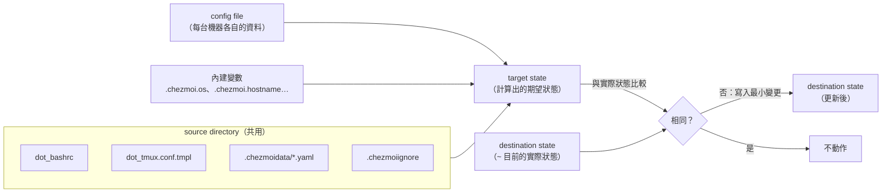
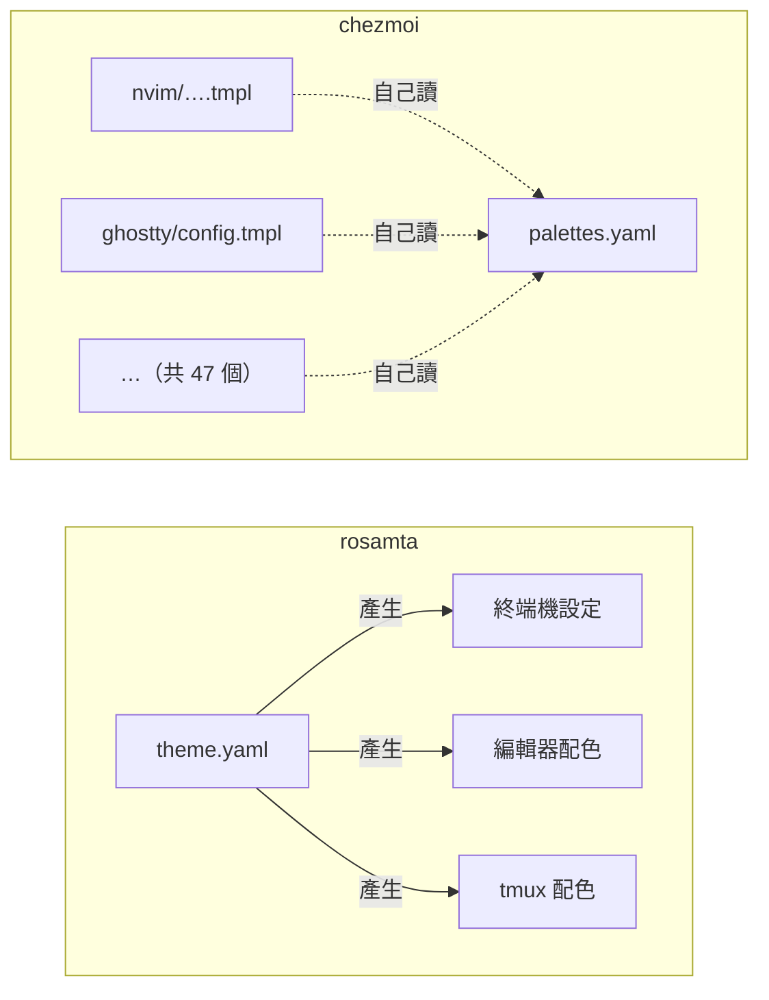

# 前期研究：chezmoi

本文研究 dotfile 管理工具 chezmoi，目的是為 rosamta 的 SRS 整理需求。重點放在 rosamta 的三個核心概念：Profile、Module、Template，並在第 7 節整理出候選需求。

## 目錄

1. [基本資訊](#1-基本資訊)
2. [定位與目標使用者](#2-定位與目標使用者)
3. [核心運作模型](#3-核心運作模型)
4. [實際使用](#4-實際使用)
5. [對照 rosamta 的三個核心概念](#5-對照-rosamta-的三個核心概念)
6. [優點與痛點](#6-優點與痛點)
7. [對 rosamta 的啟示](#7-對-rosamta-的啟示)
8. [參考資料](#8-參考資料)

---

## 1. 基本資訊

| 項目 | 內容 |
| --- | --- |
| repo | [twpayne/chezmoi](https://github.com/twpayne/chezmoi) |
| 實作語言 | Go |
| 授權 | MIT |
| 歷史 | GitHub repo 建立於 2018-11-12，持續維護至今 |
| 規模 | 約 22.1k stars、700 forks；約 54 個子命令 |
| 研究時的版本 | 文件讀 `main` 分支 commit `effc262`（2026-11-03）；最新 release 為 v2.74.0（2026-11-01）；實際操作用 v2.73.3 |
| 研究日期 | 2026-11-04，文中的 stars、reactions 與 issue 狀態都以這天為準 |

名稱來自法文「chez moi」（在我家）。作者表示靈感來自 Puppet，但 Puppet 對個人設定檔太重，所以 chezmoi 永遠只聚焦在「個人 home 目錄的管理」（[Design FAQ][doc-faq-design]）。

## 2. 定位與目標使用者

### 一句話定位

**在多台機器之間管理個人設定檔，機器之間有差異也能處理**（[What does chezmoi do?][doc-what]）。

### 目標使用者

官方列出的目標使用者（[Why use chezmoi?][doc-why]、[What does chezmoi do?][doc-what]）：

- 有自訂工具設定，而且要在多個帳號（家裡、公司）或多個 OS（Linux、macOS、Windows）之間同步的人
- 經常在臨時環境工作的人：Docker container、VM、GitHub Codespaces

官方也明說**不需要** chezmoi 的人：不自訂設定、只用單一 OS 單一帳號、dotfile 裡沒有機密。

### 要取代的做法

官方把以下做法列為痛點來源：自寫 shell script、dotbot、rcm、homesick、vcsh、yadm、GNU Stow、bare git repo。對應的四個痛點是：

1. 處理機器差異要額外工夫，例如每台機器一個分支，還要 merge、rebase
2. 機密以明文存放，repo 只能設成 private
3. 自寫工具要自己維護
4. 安裝要先裝語言 runtime，不是一行指令

### 範圍的邊界

chezmoi 刻意不做系統管理。管理 home 以外的檔案「extremely strongly discouraged」，需求超過這個範圍時，官方建議改用 Puppet、Chef、Ansible、Salt（[Design FAQ][doc-faq-design]）。多個 repo 分層套用（公司、部門、個人）的需求也以同樣理由拒絕（[#1169]）。

### 在比較表上的位置

官方的[比較表][doc-comparison]用 27 列比較 chezmoi、dotbot、rcm、vcsh、yadm、bare git。只有 chezmoi 打勾的項目有「Custom variables in templates」「Password manager integration」「Externals」。

表中**沒有**「多個程式共用同一份設定」或「內建常見程式的範本」這類維度。rosamta 的 Module 概念在這張表上是空白，這是 rosamta 和既有工具最大的差異。

## 3. 核心運作模型

### 3.1 名詞

| 名詞 | 意義 |
| --- | --- |
| source directory | 存放 source state 的目錄，預設 `~/.local/share/chezmoi`，通常是一個 git repo |
| source state | home 目錄的期望狀態，**只由一般檔案與目錄組成**，檔名帶有屬性前綴 |
| config file | 每台機器各自的資料，預設 `~/.config/chezmoi/chezmoi.toml`，不進 repo |
| destination directory | chezmoi 管理的目錄，通常是 `~` |
| target | destination directory 裡的一個檔案、目錄或 symlink |
| destination state | 所有 target 目前的實際狀態 |
| target state | 由 source state、config file、destination state 計算出的期望狀態；除了檔案與目錄，也可以包含 symlink、要執行的 script、要刪除的 target |

出處：[Reference: Concepts][doc-concepts]。

### 3.2 流程：source → target → destination



`chezmoi apply` 計算每個 dotfile 的期望內容，只做讓 destination 符合期望所需的最小變更（[Quick start][doc-quickstart]、[Architecture][doc-arch]）。

幾個設計重點：

- **產生一般檔案，不用 symlink**。這樣才能做加密、權限、可執行、template；產生出來的 dotfile 與手寫的沒有差別。另有受限的 symlink mode，只適用於「不加密、不可執行、非 private、非 template」的檔案（[Design FAQ][doc-faq-design]）
- **單一檔案的寫入是 atomic 的**，寫到一半中斷也不會留下壞檔（[What does chezmoi do?][doc-what]）。但整次 apply 不是 transaction，見 [6.2 節](#62-痛點)痛點 4
- **persistent state 只存內容的 SHA256**，不存內容本身，避免把機密寫進 state；chezmoi 靠它判斷 target 是否在上次寫入後被別人改過（[Architecture][doc-arch]）
- **dry-run 不是另寫一套邏輯**。chezmoi 讀寫檔案、執行指令都透過同一個 `System` 介面。平常用的是真正讀寫檔案的實作；加上 `--dry-run` 時，chezmoi 在外面再包一層，讀取照常、寫入全部丟掉。所以 dry-run 和實際執行跑的是同一段程式，預覽的結果就是實際會發生的結果（[Architecture][doc-arch]）

套用順序是確定的（[Application order][doc-order]）：

1. 讀 source state
2. 讀 destination state
3. 計算 target state
4. 依字母順序執行 `run_before_` script
5. 依 target 名稱的字母順序更新所有 entry，目錄先於其內容
6. 依字母順序執行 `run_after_` script

### 3.3 屬性前綴：metadata 寫在檔名上

chezmoi 不用集中的設定檔記錄每個檔案的屬性，而是寫在 source 的檔名上（[Source state attributes][doc-attrs]）。

| 類別 | 屬性 |
| --- | --- |
| 命名 | `dot_`（變成 `.` 開頭）、`literal_`（停止解析後面的前綴） |
| 權限 | `private_`、`readonly_`、`executable_` |
| 內容 | `.tmpl`（template）、`encrypted_`、`empty_`（保留空檔，否則空檔會被刪除） |
| 檔案行為 | `create_`（不存在才建立）、`modify_`（用 script 改寫既有檔案）、`remove_`、`symlink_` |
| 目錄行為 | `exact_`（刪除沒被管理的項目）、`external_`（子項目不解析屬性） |
| script | `run_`、`once_`／`onchange_`、`before_`／`after_` |

例如 `private_dot_ssh/encrypted_private_config.tmpl` 代表 `~/.ssh/config`：目錄權限 `0700`、檔案加密存放、權限 `0600`、內容是 template。

官方承認檔名「又長又怪」，但稱之為「deliberate, practical, compromise」：集中的設定檔每次都要讀、改、寫，而且不一定保留得住註解與格式；放在檔名上，改一個檔案只會動到一個檔案（[Design FAQ][doc-faq-design]）。

### 3.4 特殊檔案與目錄

依處理順序（[Special files][doc-special]）：

| 檔案 | 用途 |
| --- | --- |
| `.chezmoiroot` | 把 source state 指到 repo 的子目錄 |
| `.chezmoi.$FORMAT.tmpl` | `chezmoi init` 用它產生本機的 config file，可在這裡詢問使用者 |
| `.chezmoidata.$FORMAT`、`.chezmoidata/` | 所有機器共用的靜態資料 |
| `.chezmoitemplates/` | 共用的 template 片段 |
| `.chezmoiignore` | 要忽略的 target，本身是 template |
| `.chezmoiremove` | 要刪除的 target，本身是 template |
| `.chezmoiexternal.$FORMAT`、`.chezmoiexternals/` | 從 URL 引入的檔案、archive、git repo |
| `.chezmoiversion` | 需要的最低 chezmoi 版本 |
| `.chezmoiscripts/` | 放 script，但不在 target 產生對應目錄 |

### 3.5 script

- `run_` 每次 apply 都執行；`run_onchange_` 在內容改變時執行；`run_once_` 同樣內容只成功執行一次（[Use scripts][doc-scripts]）
- 官方立場：「Scripts break chezmoi's declarative approach and should be used sparingly」，所有 script 都必須 idempotent
- 維護者的設計原則是「declarative where possible, imperative where necessary」：需要先後順序或動態路徑的事交給 script（[#1226]）

## 4. 實際使用

### 4.1 Quick start 紀錄

照官方 [Quick start][doc-quickstart] 操作，用兩個臨時的 `HOME` 目錄模擬兩台機器，GitHub 以本機的 git repo 代替。

**第一台機器：建立 source**

| 步驟 | 指令 | 結果 |
| --- | --- | --- |
| 1 | `chezmoi init` | 建立 `~/.local/share/chezmoi` 並 `git init` |
| 2 | `chezmoi add ~/.bashrc` | source 多了 `dot_bashrc` |
| 3 | `chezmoi edit ~/.bashrc`，加一行 alias | 改的是 source 裡的 `dot_bashrc`，`~/.bashrc` 還沒變 |
| 4 | `chezmoi diff` | 輸出 git 格式的 unified diff，顯示 apply 會加上那行 alias |
| 5 | `chezmoi apply -v` | 顯示 diff 並寫入 `~/.bashrc` |
| 6 | `chezmoi status` | 沒有輸出，表示 target 與 source 一致 |
| 7 | `git add`、`commit`、`push` | source 就是一般的 git repo |

**第二台機器：套用**

| 步驟 | 指令 | 結果 |
| --- | --- | --- |
| 1 | `chezmoi init <repo>` | clone 到 `~/.local/share/chezmoi` |
| 2 | `chezmoi diff` | 顯示 `.bashrc` 會被新增 |
| 3 | `chezmoi apply` | `.bashrc` 內容與第一台相同 |

**在 target 直接修改，再收回 source**

| 步驟 | 指令 | 結果 |
| --- | --- | --- |
| 1 | 第一台不經過 chezmoi，直接改 `~/.bashrc` | — |
| 2 | `chezmoi status` | 顯示 `MM .bashrc`：第一欄是 destination 相對上次寫入的變動，第二欄是 apply 會做的變動 |
| 3 | `chezmoi re-add` | 把 target 的內容寫回 source |
| 4 | `chezmoi git -- commit -qam ...`、`chezmoi git -- push` | 不必進入 source directory 也能操作 git |
| 5 | 第二台 `chezmoi update -v` | 先 `git pull`，再 apply |

**新機器一行完成**：`chezmoi init --apply <repo>`，clone 加 apply 共 0.033 秒。

心得：日常只用到 `add`、`edit`、`diff`、`apply`、`re-add`、`update` 幾個指令，而且都沿用 git 的概念（diff 格式、status 的兩欄），上手很快。

### 4.2 多機情境：研究者的 dotfile

研究者自己用 chezmoi 管理 3 台機器的 dotfile：Windows 桌機、Arch 筆電、WSL（未公開）。規模如下：

| 項目 | 數量 |
| --- | --- |
| `.tmpl` 檔 | 91 個 |
| `.chezmoitemplates/` 片段 | 15 個 |
| `.chezmoiignore` | 146 行，4 個依機器切換的條件區塊 |
| `run_onchange_` script | 19 個 |
| `modify_` 檔 | 5 個 |
| `.chezmoiremove` | 10 條路徑 |
| 讀取配色資料 `palettes.yaml` 的檔案 | 47 個，分布在約 30 個程式 |

這個規模剛好用到了 rosamta 想解決的每一種情境：一份配色給 30 個程式用（Module）、不同機器啟用不同的檔案、同一份設定在 Windows 與 Linux 放在不同位置（Profile）、大量手寫的 template（Template）。第 5、6 節會引用其中的具體案例。

## 5. 對照 rosamta 的三個核心概念

rosamta 的三個概念（見專案 README）：

- **Profile**：依 OS、主機名稱或自訂標籤，決定啟用哪些模組與範本，以及輸出的位置
- **Module**：把多個程式共用的設定抽出來，一份設定產生多個 dotfile
- **Template**：把模組的值轉換成特定程式的設定格式，可自訂或覆寫內建範本

chezmoi 沒有直接對應的一級概念，以下逐一說明它用什麼機制拼出來、做到哪裡、還缺什麼。

### 5.1 Profile

#### 怎麼做

- **機器資料放在每台機器各自的 config file**；source 是所有機器共用的（[Manage machine-to-machine differences][doc-machine]）
- **config file 由 `.chezmoi.$FORMAT.tmpl` 產生**：`chezmoi init` 時執行，可用 `promptStringOnce`、`promptChoiceOnce` 等函式詢問使用者，值已存在就不再詢問（[Setup][doc-setup]）
- **內建 30 多個機器變數**，例如 `.chezmoi.os`、`.chezmoi.hostname`、`.chezmoi.osRelease`、`.chezmoi.kernel`（[Variables][doc-vars]）
- **以檔案為單位的啟用與停用**：`.chezmoiignore` 本身是 template，可以依機器忽略檔案或目錄
- **同一份內容在不同 OS 放不同位置**：內容放進 `.chezmoitemplates/`，每個位置各建一個只有一行的 stub，再用 `.chezmoiignore` 把不需要的那個關掉（[Manage machine-to-machine differences][doc-machine]）

#### 做到哪裡

研究者的 dotfile 用這套機制區分機器，運作正常：

- `.chezmoi.toml.tmpl`（35 行）偵測機器：WSL 與 Arch 對 chezmoi 來說都是 `linux`，hostname 也分不出來，所以用 `.chezmoi.kernel.osrelease` 是否含 `microsoft` 判斷 WSL；另外用 `/sys/class/power_supply/BAT*` 是否存在區分 Arch 筆電與桌機。偵測結果再交給 `promptStringOnce` 當預設值
- `.chezmoiignore` 用 4 個條件區塊決定每台機器啟用哪些檔案
- 6 組 Windows 與 Linux 成對的 stub，例如 `AppData/Roaming/eza/theme.yml.tmpl` 與 `dot_config/eza/theme.yml.tmpl`，共用 `.chezmoitemplates/eza-theme.yml.tmpl`

#### 缺什麼

1. **輸出位置不能依機器設定**。chezmoi 的 source 路徑就是 target 路徑，所以「同內容、不同位置」只能用 stub 加 ignore。
   - 這是全 repo reactions 最多的 issue（[#2273]，93 個 reactions），由作者本人開立，提案在 config 裡寫路徑改寫規則，但因為要重新設計 state 管理，標為 `v3` 擱置
   - 這個做法容易出錯：[#2199] 的使用者照做失敗。研究者的 6 組 stub 有一段時間只寫了 Windows 那一半，Linux 上 eza、lazygit、yazi 等程式一直是預設配色。chezmoi 沒有任何錯誤或警告，因為對它來說 Linux 的 target 根本不存在
   - stub 讓 `edit`、`add`、`re-add` 失效（[#2273] 留言）。實測 `chezmoi source-path` 指向的是只有一行 `{{- template "app.conf" . -}}` 的 stub，所以 `chezmoi edit` 打開的也是 stub，不是實際內容
2. **ignore 要反著寫**。chezmoi 預設全部安裝，所以「只在筆電安裝」要寫成「不是筆電就忽略」。條件一多就變成雙重否定，例如研究者 `.chezmoiignore` 裡的這一行：

   ```
   {{ if not (or (eq .chezmoi.os "windows") (and (hasPrefix "arch" $m) (ne $m "arch-wsl"))) }}
   ```

3. **沒有「標籤」或「profile」這種具名單位**。機器分類要使用者自己在 config template 裡寫偵測邏輯，再在每個用到的地方重寫條件。官方刻意只內建少量變數，認為通用的機器偵測太脆弱，「通用解很難，特定解容易」（[#1474]）
4. **缺少的變數讓所有指令失敗**。template 預設 `missingkey=error`，`.chezmoiignore` 又是每個指令都要先執行的 template。實測在 config template 新增一個 key 之後，還沒重跑 `chezmoi init` 的機器連 `chezmoi managed` 都會失敗，錯誤訊息是 `map has no entry for key "machine"`。研究者的 dotfile 因此規定所有地方都寫 `(index . "machine" | default "")`，不能直接寫 `.machine`。改了 config template 也不會自動重新產生 config，只會警告（[#865]）
5. **非互動初始化要靠問題的文字對答案**。config template 用 `promptStringOnce` 詢問使用者，例如：

   ```
   {{ $machine := promptStringOnce . "machine" "machine (desktop / laptop)" "desktop" }}
   ```

   其中 `"machine"` 是變數名稱，`"machine (desktop / laptop)"` 是顯示給使用者看的問題。在腳本、CI 這類沒有人能回答的環境，要用 `chezmoi init --promptString` 事先給答案，但 chezmoi 拿來比對的是**問題的文字**，不是變數名稱：

   - `--promptString machine=laptop`：對不上，chezmoi 仍會嘗試詢問，沒有終端機就直接報錯
   - `--promptString "machine (desktop / laptop)=laptop"`：這樣才有效

   問題的文字本來只是給人看的說明，但只要改個措辭，所有自動化腳本就會失效

### 5.2 Module

這是 rosamta 和 chezmoi 差異最大的地方，也是本研究的重點。

#### 怎麼做

chezmoi 沒有「模組」，只提供零件，由使用者自己組合：

| 需要 | chezmoi 的零件 |
| --- | --- |
| 放共用的資料 | `.chezmoidata.$FORMAT` 或 `.chezmoidata/`，所有機器共用，多個檔案依檔名字母順序合併到資料的根部（[`.chezmoidata/`][doc-data-dir]、[#751]） |
| 資料的覆寫層級 | 內建變數 → `.chezmoidata` → config file 的 `data`，後者覆蓋前者（[Templating][doc-templating]） |
| 由資料產生檔案 | 每個目標程式各寫一個 `.tmpl`，各自讀同一組變數 |
| 共用 template 片段 | `.chezmoitemplates/`，可傳參數產生多個相似的檔案 |
| 只管檔案的一部分 | `modify_` script 或 `modify_` template、`setValueAtPath` 函式（[Manage different types of file][doc-filetypes]、[#847]） |
| 只在不存在時建立 | `create_` |
| 引入第三方設定 | externals：從 URL 引入檔案、archive、git repo，內容原樣複製（[Include files from elsewhere][doc-externals]） |
| 「哪些檔案屬於某程式」 | `chezmoi mackup add`，讀取本機安裝的 mackup 資料；至今未寫進文件（[#885]） |

#### 做到哪裡

「一份資料產生多個 dotfile」**做得到，而且可以做到很大的規模**：

- 研究者的 `.chezmoidata/palettes.yaml` 被 47 個檔案讀取，分布在 nvim、ghostty、niri、rofi、fcitx5、git、PowerShell、Windows Terminal 等約 30 個程式；其中 45 個檔案用同一行開頭 `{{- $p := index .palettes .palette -}}`。換配色只要改一個值
- 研究者用 `.chezmoidata/` 的字母順序合併做「每台機器的覆寫」：`active.default.yaml` 進 repo，`active.yaml` 不進 repo，靠 `active.y` 排在 `active.d` 之後逐 key 覆寫，讓每台機器保留自己的配色選擇。這個做法可行，但覆寫順序完全取決於檔名，任何一個檔案改名，順序就會悄悄改變

chezmoi 和 rosamta 的依賴方向剛好相反：



#### 缺什麼

1. **資料與產出之間沒有宣告的關係**。依賴的方向是「每個 template 自己去讀資料」，所以要知道 `palettes.yaml` 會影響哪些檔案，只能 grep。研究者只好另外手寫一張表，記錄哪個程式讀哪種格式。多則 issue 都在要一個「資料加產出」的單位：
   - [#3206]：想把資料和使用它的 template 放在同一個檔案（frontmatter），被拒，建議在同目錄放 `.chezmoidata.yaml`
   - [#3327]：想讓資料片段附上啟用條件，再把多個片段組成一個檔案，被拒（見下方第 4 點）
   - [#5110]：一份 VS Code 設定同時給 VS Code 與 Kiro 用，仍在討論
2. **一份資料要衍生多種格式時，只能在 chezmoi 外面做**。[#1342] 的使用者想從 16 色 hex 衍生出 RGB、0–1 小數等格式給不同程式，維護者建議呼叫外部程式。研究者也是這樣：用一支 Python 產生器產生 `palettes.yaml`，每個配色有 7 種格式。其中 RGB 格式存在，是因為 Go template 沒辦法把 hex 字串拆開；0–1 小數格式存在，是因為 sioyek 只接受這種寫法。這類產生器研究者寫了 3 支
3. **沒有內建程式範本**。每個使用者都從零寫 template。[#885] 要求像 mackup 一樣內建熱門程式的設定，因授權（mackup 是 GPL-3）與「程式只有部分設定檔存在時怎麼辦」而卡住，最後的 `chezmoi mackup add` 只記錄「哪些檔案屬於某程式」，沒有參數化，功能曾因沒人使用被移除，重新加入後仍未寫進文件。研究者的 91 個 `.tmpl` 全部手寫
4. **刻意不支援多個來源寫同一個 target**。官方在 Design FAQ 與多則 issue 中拒絕「依程式分資料夾」和「多個 source」（[Design FAQ][doc-faq-design]、[#753]、[#1169]），理由可以整理成 rosamta 必須回答的四個問題：
   - **衝突**：兩個單位都要寫 `.bashrc`（例如 VIM 與 Emacs 都想設 `$EDITOR`），誰勝？
   - **歸屬**：`add ~/.zshrc` 時，該放進哪個單位？
   - **跨界**：某程式的 shell completion，屬於該程式還是屬於 shell？
   - **另發明語言**：[#3327] 中維護者「strongly opposed」為片段加上條件 directive，因為這是在 template 語言之外再發明一種規格不明的條件語言（inner-platform effect）

   rosamta 的模組只要允許多個模組影響同一個檔案（例如 `theme.yaml` 與 `font.yaml` 都要寫終端機設定），就一定會遇到前三個問題
5. **程式會自己改寫的設定檔（drift）**。模組產生完整檔案時，會和「程式自己會改的設定檔」互相覆蓋：
   - Windows Terminal 一碰設定介面就重寫 `settings.json`。研究者的 template 必須模仿它的序列化方式（大寫 hex、key 排序、結尾沒有換行等），否則 `chezmoi status` 會永遠顯示有差異
   - 研究者刻意不交給 chezmoi 管理的 12 項設定中，至少 4 項的理由是程式會自己改寫
   - 相關 issue 見第 6 節痛點 3

### 5.3 Template

#### 怎麼做

- 引擎是 Go `text/template`，加上第三方函式庫 sprig 的全部文字函式，再加上 chezmoi 自己約 48 個通用函式與 19 組密碼管理器函式（[Templating][doc-templating]）
- 檔名有 `.tmpl` 後綴，或放在 `.chezmoitemplates/` 底下的檔案是 template；`.chezmoiignore`、`.chezmoiremove`、`.chezmoiexternal.*` 一律當 template
- 除錯工具：`chezmoi execute-template` 執行片段、`chezmoi cat` 看渲染結果、`chezmoi data` 列出所有變數
- 輸出格式化函式：`toJson`、`toToml`、`toYaml`、`toIni`；讀取函式：`fromJson`、`fromYaml` 等
- 逐檔 directive 可換分隔符、編碼、換行符號，避免和檔案本身的 `{{` 衝突（[Directives][doc-directives]）
- template 渲染結果為空字串時，target 會被刪除

#### 做到哪裡

功能足以支撐研究者的 91 個 template 與 15 個共用片段，包括 JSON、TOML、YAML、INI、Lua、PowerShell、XAML 等多種格式。

官方文件沒有說明為什麼選 `text/template`。從 issue 推得的立場是：它是「a widely-used template language」，和 git、`$EDITOR`、gpg 一樣屬於「插進既有工具」（[#753]）；而維護者重視它「by design 很簡單」，不願擴充語意（[#2668]、[#1661]）。

#### 缺什麼

1. **語言本身的限制變成使用者的負擔**。`text/template` 只有 `and`、`or` 會在結果確定後停止求值，其他函式的參數一律先全部求值，所以 `ternary`、`default` 不能用來保護可能失敗的運算式；此外不能自訂函式、不能取得子 template 的輸出、只能「完成或失敗」（[#865]、[#1474]、[#1619]、[#4569]）。想用 early return 取代巢狀條件，最後是用 sentinel error 實作 `abortEmpty`（[#4569]）
2. **細節陷阱多**。研究者實際踩過、各花了不少時間的四個陷阱：
   - `{{ template "x" . }}` 會多輸出一個換行
   - comment 遇到第一個 `*/` 就結束
   - `.chezmoitemplates/` 的所有檔案屬於同一個 template set，一個檔案語法錯，所有 template 都報錯
   - `{{ /*` 中間加了空白就不是 comment
3. **檔案本身含 `{{` 時衝突**。研究者的 yazi `init.lua` 因此不共用，因為 Lua 的 `{{1,2}}` 會被當成 template
4. **函式庫一旦公開就是相容性承諾**。sprig 已無人維護，命名與參數順序都和 Go 慣例不合，但為了相容不能改。2025-12 改用 sprout 的相容層，一個月內出現多個回歸（讀 JSON 壞掉、`append` panic），只好回退；2026-08 再試，又因算術函式的型別不同而回退。作者說「replacing the template library is definitely something for chezmoi v3」（[#2668]）

## 6. 優點與痛點

### 6.1 優點

| # | 優點 | 證據 |
| --- | --- | --- |
| 1 | **上手快、指令仿 git**：日常只用幾個指令，`diff`、`status` 沿用 git 的格式 | 4.1 節；[What does chezmoi do?][doc-what] |
| 2 | **新機器一行完成**：單一 binary、無相依、不需 root，`chezmoi init --apply <repo>` | 4.1 節；[Why use chezmoi?][doc-why] |
| 3 | **快**：500 個 template 檔，apply 約 0.3 秒；時間主要花在執行所有 template，有沒有變更差不多 | 實測（v2.73.3） |
| 4 | **產出是一般檔案**：可加密、設權限、用 template；移除 chezmoi 後 dotfile 照常可用 | [Design FAQ][doc-faq-design]、[Migrate away][doc-migrate] |
| 5 | **透明**：所有指令支援 `-v` 與 `--dry-run`，dry-run 與實際執行跑同一段程式 | [Architecture][doc-arch] |
| 6 | **一份資料可以餵很多檔案**：`.chezmoidata` 讓所有 template 共用資料 | 研究者的 `palettes.yaml` 被 47 個檔案讀取 |
| 7 | **有部分管理的工具**：`modify_`、`create_`、`exact_` 能處理程式會自己改的檔案、只需初始內容的檔案、需要清掉舊項目的目錄 | 研究者的 dotfile 有 5 個 `modify_`、5 個 `exact_` 目錄 |
| 8 | **安全**：密碼管理器整合、age／GnuPG 加密，state 只存 hash | [What does chezmoi do?][doc-what]、[Architecture][doc-arch] |
| 9 | **維護者對範圍很克制**：拒絕會讓核心變複雜、或要永久維持相容的功能 | [#1169]、[#1661]、[#3327] |

### 6.2 痛點

| # | 痛點 | 證據 |
| --- | --- | --- |
| 1 | **輸出位置不能依機器設定**：只能 stub 加 ignore，容易漏而且不會報錯，stub 還讓 `edit`、`re-add` 失效 | [#2273]（93 reactions）、[#2199]；5.1 節 |
| 2 | **資料與產出的關係看不到**：要知道改資料會影響哪些檔案，只能 grep；衍生格式要靠外部程式 | [#1342]、[#3206]；5.2 節 |
| 3 | **drift 處理卡在架構上**：程式自己改了 target 時，只能整批覆蓋或跳過，不能選「以 target 為準」。chezmoi 的不變式是「一個指令只改 source 或只改 destination」，加上 template 不可逆，反向同步只能靠 `re-add`、`modify_`、symlink 繞路 | [#2162]（29 reactions，`v3` 擱置）、[#2018]、[#2298]、[#4361]、[#5110]、[#4556] |
| 4 | **apply 不是 transaction**：atomic 只到單一檔案。實測在中間放一個有錯的 template 或一個被改過的檔案，字母順序排在前面的檔案已經寫入，排在後面的檔案與 `run_after_` script 都沒處理 | 實測 |
| 5 | **沒有終端機時，drift 詢問會中止整次 apply**：chezmoi 要問「這個檔案被改過，要覆蓋嗎」，但沒有人能回答，就直接失敗。研究者在 quickshell 狀態列點選配色時，狀態列會在背景執行 `chezmoi apply`，沒有終端機。fcitx5 的設定檔用 `create_` 管理，chezmoi 不管內容，卻仍強制權限為 `0644`，而 fcitx5 每次登入都把它改寫成 `0600`，所以每次切換配色都觸發詢問、整次 apply 中止。`.config/fcitx5/` 的字母順序排在多數設定檔前面，結果配色完全沒變。最後把檔案改成 `create_private_` 讓權限一致，狀態列也改用 `apply --force`。同一個情境還有一個至今沒解決的問題：配色也要套用到 SDDM 登入畫面，但那個 script 要寫入 home 以外的檔案，需要 sudo，而狀態列沒有地方輸入密碼，所以從狀態列切換配色時登入畫面不會跟著換，只有從終端機切換才會 | 實測；研究者的 dotfile |
| 6 | **template 語言難用**：巢狀條件、反向 ignore、細節陷阱，缺一個 key 就全部失敗 | 5.1、5.3 節；[#1474]、[#4569]、[#2668] |
| 7 | **`run_onchange_` 跳過後不會重跑**：只看 script 內容的 hash，exit 0 就記為完成。研究者有 6 個 script 必須把「為什麼跳過」寫進 script 的內容，讓內容改變，下次 apply 才會重跑 | 實測；研究者的 dotfile |
| 8 | **刪除與改名要手動處理**：刪掉 source 檔不會刪掉 target，要另外寫進 `.chezmoiremove`。研究者的 `.chezmoiremove` 有 10 條路徑，而且要等每台機器都 apply 過才能刪掉那一行 | [#4361]（15 reactions）；研究者的 dotfile |
| 9 | **核心重構遙遙無期**：多個高票需求被標為 `v3` 或等待核心重寫，作者表示「不知道何時、甚至會不會」有時間做 | [#2162]、[#2273]、[#2298]；`v3` 標籤有 7 則 open issue |

## 7. 對 rosamta 的啟示

### 7.1 值得借鏡

1. **產出一般檔案，不用 symlink**。這樣才能做權限、加密與 template，而且移除 rosamta 後 dotfile 照常可用（[Design FAQ][doc-faq-design]）
2. **宣告式加最小變更**：計算期望狀態，與實際狀態比較後只寫入差異；state 只存 hash（[Architecture][doc-arch]）
3. **指令仿 git**：`diff`、`status`、`apply` 的心智模型使用者已經熟悉（4.1 節）
4. **dry-run 與實際執行跑同一段程式**，確保預覽的結果就是實際的結果（[Architecture][doc-arch]、[#2244]）
5. **明確的資料覆寫層級**：chezmoi 的「內建變數 → 共用資料 → 本機資料」可以直接對應 rosamta 的「內建模組預設值 → 使用者模組 → Profile → 本機」
6. **只內建少量可靠的機器變數**，其他偵測交給使用者寫，避免維護脆弱的通用偵測（[#1474]）
7. **輸出的擁有程度要分級**：完整管理、只管部分欄位（`modify_`）、只在不存在時建立（`create_`）、管理目錄並清除沒列出的項目（`exact_`）（5.2 節）
8. **一行完成新機器的安裝與套用**（4.1 節）

### 7.2 應該避開

1. **不要讓 source 路徑等於輸出路徑**。這是 chezmoi 最高票未解需求的根源（[#2273]）。rosamta 應讓 Profile 直接指定輸出位置，不需要 stub
2. **不要讓 Profile 條件只能反向寫**。用「啟用」的方向描述，而不是「預設全部、再忽略」（5.1 節）
3. **不要讓資料與產出的關係隱藏在 template 裡**。模組應宣告它產生哪些輸出，工具才能回答「改這個值會影響哪些檔案」（5.2 節）
4. **不要把整次 apply 的成敗綁在單一檔案上**。一個衝突或 template 錯誤不應讓其他無關的檔案停在一半（6.2 節痛點 4）
5. **不要在非互動環境等待輸入**。詢問應有可設定的預設策略（6.2 節痛點 5）
6. **不要把大型第三方函式庫直接公開給使用者**。函式一旦公開就要永久相容，chezmoi 換掉 sprig 已經講了近四年仍未成功（[#2668]）
7. **小心 inner-platform effect**。rosamta 的 Profile 一定需要某種條件表達，但不應在 template 語言之外再發明一套規格不明的條件語言（[#3327]）。需求階段就要決定條件能表達到什麼程度
8. **不要只用內容 hash 判斷 script 或產生步驟是否完成**。跳過或失敗的步驟應能在下次套用時重試（6.2 節痛點 7）

### 7.3 候選需求

以下需求供 SRS 階段討論，每條都標出來源。編號只在本文件內有效，進入 SRS 時會重新編號。

#### User story

| 編號 | user story | 來源 |
| --- | --- | --- |
| US-1 | 身為在多台機器上使用多種終端機與編輯器的使用者，我想要只改一份配色模組，就更新所有相關程式的設定，以便換配色時不必逐一修改 | 5.2 節；[#1342] |
| US-2 | 身為同時使用 Windows 與 Linux 的使用者，我想要在 Profile 裡指定同一份設定在各 OS 的輸出位置，以便不必為每個位置維護一個 stub | 5.1 節；[#2273]、[#2199] |
| US-3 | 身為使用者，我想要查詢某個模組會產生哪些檔案、某個檔案來自哪些模組，以便修改前知道影響範圍 | 5.2 節 |
| US-4 | 身為使用者，我想要直接使用內建的常見程式範本，只覆寫我需要改的部分，以便不必從零寫範本 | 5.2 節；[#885] |
| US-5 | 身為使用者，我想要在程式自己改寫設定檔時，選擇保留程式的修改或以模組為準，以便不會默默失去設定 | 6.2 節痛點 3；[#2162]、[#5110] |
| US-6 | 身為從腳本或狀態列觸發套用的使用者，我想要在沒有終端機的情況下，套用也能依我設定的策略完成，以便一個衝突不會讓整批設定停在一半 | 6.2 節痛點 5 |
| US-7 | 身為設定新機器的使用者，我想要用一個指令完成安裝與套用，以便在臨時環境也能快速帶入自己的設定 | 4.1 節；[#1410]、[#3676] |
| US-8 | 身為使用者，我想要刪除或改名一個輸出時，舊位置的檔案自動被清除，以便不必手動記錄要刪除的路徑 | 6.2 節痛點 8；[#4361] |

#### 功能需求

| 編號 | 功能需求 | 來源 |
| --- | --- | --- |
| FR-1 | 模組檔可宣告一組設定值，以及由這組值產生的輸出（使用哪個範本、輸出到哪裡） | 5.2 節缺什麼第 1 點；[#3206] |
| FR-2 | 提供查詢指令，列出「模組 → 輸出」與「輸出 → 模組」的對應 | 5.2 節 |
| FR-3 | 範本可直接對模組的值做常見的格式轉換（例如 hex 轉 RGB、轉 0–1 小數），不需外部程式 | 5.2 節缺什麼第 2 點；[#1342] |
| FR-4 | Profile 可依 OS、主機名稱、自訂標籤選擇要啟用的模組與範本 | 5.1 節 |
| FR-5 | Profile 可為每個輸出指定各平台的輸出位置，同一份內容不需重複宣告 | 5.1 節缺什麼第 1 點；[#2273] |
| FR-6 | Profile 的啟用條件以「啟用」的方向描述，不需要用忽略清單反向表達 | 5.1 節缺什麼第 2 點 |
| FR-7 | 多個模組影響同一個輸出檔時，依明確的規則合併；規則無法處理時報錯，不得默默以其中一方覆蓋 | 5.2 節缺什麼第 4 點；[#753]、[#1169] |
| FR-8 | 每個輸出可設定擁有程度：完整管理、只管理指定欄位、只在檔案不存在時建立；權限是否由 rosamta 管理也可分開設定 | 7.1 節第 7 點；6.2 節痛點 5；[#847] |
| FR-9 | 套用前偵測輸出檔是否在上次寫入後被修改，並提供「以模組為準」「保留目前檔案」「略過」三種處理方式 | 6.2 節痛點 3；[#2162] |
| FR-10 | 非互動模式下，drift 的處理方式依設定的預設策略執行，不等待輸入 | 6.2 節痛點 5 |
| FR-11 | 提供 diff 與 dry-run，顯示套用後會有的變更，不寫入任何檔案 | 6.1 節優點 5 |
| FR-12 | 模組或輸出被移除、改名後，下次套用時自動刪除先前產生、已不再被管理的檔案 | 6.2 節痛點 8；[#4361] |
| FR-13 | 內建模組附帶常見程式的範本；使用者可以覆寫個別範本，不必複製整個模組 | 5.2 節缺什麼第 3 點；[#885] |
| FR-14 | 產生步驟或 script 失敗、跳過時，記錄為未完成，下次套用時重試 | 6.2 節痛點 7 |
| FR-15 | 需要系統權限的步驟（例如寫入 home 以外的檔案）在非互動環境下不執行，也不中止其他輸出；記為待完成，並在下次互動執行時提示使用者 | 6.2 節痛點 5 |

#### 非功能需求

| 編號 | 類別 | 非功能需求 | 量測方式 | 來源 |
| --- | --- | --- | --- | --- |
| NFR-1 | 效能 | 500 個輸出檔、沒有變更時，套用時間小於 1 秒 | 在一般筆電上產生 500 個輸出的測試設定，取 10 次執行時間的中位數。參考值：chezmoi 約 0.3 秒 | 6.1 節優點 3；[What does chezmoi do?][doc-what] |
| NFR-2 | 可靠性 | 單一檔案的寫入是 atomic 的：寫入中途中斷，不會留下內容不完整的輸出檔 | 在寫入過程中強制終止程序 100 次，不完整的輸出檔數量為 0 | [What does chezmoi do?][doc-what] |
| NFR-3 | 可靠性 | 套用因範本錯誤或衝突中止時，所有輸出檔維持套用前的內容；若無法做到，則回報 100% 已寫入與未寫入的檔案清單 | 在第 N 個輸出注入錯誤，比對套用前後每個輸出檔的 hash 與回報清單 | 6.2 節痛點 4 |
| NFR-4 | 可用性 | 範本錯誤或缺少變數時，錯誤訊息包含檔案路徑、行號與缺少的變數名稱，並提示如何補上 | 錯誤測試案例中，100% 的錯誤訊息包含這些資訊 | 5.1 節缺什麼第 4 點 |
| NFR-5 | 可用性 | 在沒有終端機的環境執行任何指令都不等待輸入；exit code 區分成功、部分成功、失敗 | 以 `</dev/null` 執行所有指令，0 個指令等待輸入，exit code 符合定義 | 6.2 節痛點 5 |
| NFR-6 | 可用性 | 非互動初始化時，Profile 變數可以用變數名稱直接指定值 | 只改問題的文字、不改變數名稱時，既有的自動化初始化腳本 100% 仍可執行 | 5.1 節缺什麼第 5 點 |
| NFR-7 | 可攜性 | 支援 Linux、macOS、Windows | 三個平台的 CI 都通過全部測試 | [Architecture][doc-arch] |
| NFR-8 | 易安裝 | 以單一執行檔發佈，不需 root 權限、不需其他語言 runtime；新機器從零到套用完成只需 1 個指令 | 在乾淨的 container 中，以 1 個指令完成安裝與套用 | [Why use chezmoi?][doc-why]；4.1 節 |
| NFR-9 | 相容性 | 範本語言與內建函式在同一個 major 版本內不做破壞性變更 | 每個內建函式都有回歸測試；minor 版本升級後，既有測試 100% 通過 | [#2668] |
| NFR-10 | 安全性 | 狀態檔不存放輸出檔的內容，只存 hash | 檢查狀態檔，不含任何測試輸出檔的內容字串 | [Architecture][doc-arch] |
| NFR-11 | 可退出 | 輸出為一般檔案；移除 rosamta 後，所有已產生的 dotfile 照常可用 | 套用後移除 rosamta 與其狀態檔，所有輸出檔仍存在且內容不變 | [Design FAQ][doc-faq-design]、[Migrate away][doc-migrate] |

## 8. 參考資料

### 書籍

- Marco Tulio Valente,《Software Engineering: A Modern Approach》, Chapter 3: Requirements

### chezmoi 官方文件

文件內容依 twpayne/chezmoi `main` 分支 commit `effc262`（2026-11-03）。

- [Why use chezmoi?][doc-why]
- [What does chezmoi do?][doc-what]
- [Quick start][doc-quickstart]
- [Comparison table][doc-comparison]
- [FAQ: Design][doc-faq-design]
- [User guide: Setup][doc-setup]
- [User guide: Manage machine-to-machine differences][doc-machine]
- [User guide: Templating][doc-templating]
- [User guide: Manage different types of file][doc-filetypes]
- [User guide: Use scripts to perform actions][doc-scripts]
- [User guide: Include files from elsewhere][doc-externals]
- [User guide: Migrate away from chezmoi][doc-migrate]
- [Reference: Concepts][doc-concepts]
- [Reference: Source state attributes][doc-attrs]
- [Reference: Application order][doc-order]
- [Reference: Special files][doc-special]
- [Reference: `.chezmoidata/`][doc-data-dir]
- [Reference: Templates / Variables][doc-vars]
- [Reference: Templates / Directives][doc-directives]
- [Developer guide: Architecture][doc-arch]

### chezmoi issue／PR

| # | 標題 | 狀態 | 本文引用處 |
| --- | --- | --- | --- |
| [#751] | Add `.chezmoidata.<format>` for template data | closed，實作 | 5.2 |
| [#753] | Is chezmoi dotfile structure changeable/configurable? | closed，拒絕 | 5.2、5.3、7.3 |
| [#847] | Manage only part of config file | closed，實作 `modify_` | 5.2、7.3 |
| [#865] | Regenerate chezmoi.toml in apply automatically | closed，部分實作 | 5.1、5.3 |
| [#885] | Add pre-defined templates for config files of popular applications | closed，實作但未文件化 | 5.2、7.3 |
| [#1169] | Add support for multiple repos as source | closed，拒絕 | 2、5.2、6.1、7.3 |
| [#1226] | Recommendations for dealing with dynamically named directories | closed，workaround | 3.5 |
| [#1342] | Dynamic Template Variable Generation | closed，workaround | 5.2、6.2、7.3 |
| [#1410] | Remote install dotfiles over ssh without installing chezmoi | closed，替代方案 | 7.3 |
| [#1474] | Collection of boilerplates for common variables | closed，拒絕內建 | 5.1、5.3、6.2、7.1 |
| [#1619] | Template function for capturing the output of `template` | closed，拒絕 | 5.3 |
| [#1661] | `execTemplate`（PR） | closed，拒絕 | 5.3、6.1 |
| [#2018] | An easier way to handle symlinking settings files into chezmoi source dir | open | 6.2 |
| [#2162] | Inverse of "overwrite" (i.e. "accept") option for `chezmoi apply` | open，`v3` | 6.2、7.3 |
| [#2199] | Issue having the same file be in different locations on different OSes | closed，使用者錯誤 | 5.1、6.2、7.3 |
| [#2244] | Overwrite change handling for `modify_` scripts | closed，維持現狀 | 7.1 |
| [#2273] | Rewrite target paths | open，`v3` | 5.1、6.2、7.2、7.3 |
| [#2298] | Add an entire directory so re-add would include new files | open，部分實作 | 6.2 |
| [#2668] | Replace masterminds/sprig template functions | open，擱置 | 5.3、6.2、7.2、7.3 |
| [#3206] | Frontmatter support in template source files | closed，frontmatter 拒絕 | 5.2、6.2、7.3 |
| [#3327] | Add conditions directive/frontmatter and pieces | closed，拒絕 | 5.2、6.1、7.2 |
| [#3676] | Add `chezmoi ssh` command | closed，實作 | 7.3 |
| [#4361] | Automated synchronization of deletions and renaming | open | 6.2、7.3 |
| [#4556] | Handle configuration directories which are externally modified | closed，拒絕 | 6.2 |
| [#4569] | Template function that allows easy return of empty file | closed，實作 `abortEmpty` | 5.3、6.2 |
| [#5110] | Support Variant of `modify_` to Prompt for Overwrite | open，討論中 | 5.2、6.2、7.3 |

[doc-why]: https://www.chezmoi.io/why-use-chezmoi/
[doc-what]: https://www.chezmoi.io/what-does-chezmoi-do/
[doc-quickstart]: https://www.chezmoi.io/quick-start/
[doc-comparison]: https://www.chezmoi.io/comparison-table/
[doc-faq-design]: https://www.chezmoi.io/user-guide/frequently-asked-questions/design/
[doc-setup]: https://www.chezmoi.io/user-guide/setup/
[doc-machine]: https://www.chezmoi.io/user-guide/manage-machine-to-machine-differences/
[doc-templating]: https://www.chezmoi.io/user-guide/templating/
[doc-filetypes]: https://www.chezmoi.io/user-guide/manage-different-types-of-file/
[doc-scripts]: https://www.chezmoi.io/user-guide/use-scripts-to-perform-actions/
[doc-externals]: https://www.chezmoi.io/user-guide/include-files-from-elsewhere/
[doc-migrate]: https://www.chezmoi.io/user-guide/advanced/migrate-away-from-chezmoi/
[doc-concepts]: https://www.chezmoi.io/reference/concepts/
[doc-attrs]: https://www.chezmoi.io/reference/source-state-attributes/
[doc-order]: https://www.chezmoi.io/reference/application-order/
[doc-special]: https://www.chezmoi.io/reference/special-files/
[doc-data-dir]: https://www.chezmoi.io/reference/special-directories/chezmoidata/
[doc-vars]: https://www.chezmoi.io/reference/templates/variables/
[doc-directives]: https://www.chezmoi.io/reference/templates/directives/
[doc-arch]: https://www.chezmoi.io/developer-guide/architecture/

[#751]: https://github.com/twpayne/chezmoi/issues/751
[#753]: https://github.com/twpayne/chezmoi/issues/753
[#847]: https://github.com/twpayne/chezmoi/issues/847
[#865]: https://github.com/twpayne/chezmoi/issues/865
[#885]: https://github.com/twpayne/chezmoi/issues/885
[#1169]: https://github.com/twpayne/chezmoi/issues/1169
[#1226]: https://github.com/twpayne/chezmoi/issues/1226
[#1342]: https://github.com/twpayne/chezmoi/issues/1342
[#1410]: https://github.com/twpayne/chezmoi/issues/1410
[#1474]: https://github.com/twpayne/chezmoi/issues/1474
[#1619]: https://github.com/twpayne/chezmoi/issues/1619
[#1661]: https://github.com/twpayne/chezmoi/pull/1661
[#2018]: https://github.com/twpayne/chezmoi/issues/2018
[#2162]: https://github.com/twpayne/chezmoi/issues/2162
[#2199]: https://github.com/twpayne/chezmoi/issues/2199
[#2244]: https://github.com/twpayne/chezmoi/issues/2244
[#2273]: https://github.com/twpayne/chezmoi/issues/2273
[#2298]: https://github.com/twpayne/chezmoi/issues/2298
[#2668]: https://github.com/twpayne/chezmoi/issues/2668
[#3206]: https://github.com/twpayne/chezmoi/issues/3206
[#3327]: https://github.com/twpayne/chezmoi/issues/3327
[#3676]: https://github.com/twpayne/chezmoi/issues/3676
[#4361]: https://github.com/twpayne/chezmoi/issues/4361
[#4556]: https://github.com/twpayne/chezmoi/issues/4556
[#4569]: https://github.com/twpayne/chezmoi/issues/4569
[#5110]: https://github.com/twpayne/chezmoi/issues/5110
