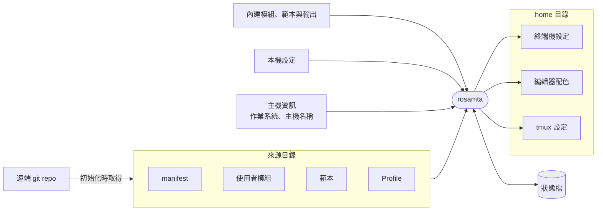

# 軟體需求規格書（SRS）

本文件依 IEEE Std 830-1998 撰寫，規定 rosamta 第一版的軟體需求。

## 修訂紀錄

| 版本 | 日期 | 作者 | 說明 |
| --- | --- | --- | --- |
| 0.1 | 2026-11-05 | ShawnChiu | 草稿：建立章節架構，記錄研究階段的需求決策（附錄 B） |
| 0.2 | 2026-11-05 | ShawnChiu | 草稿：完成第 1、2 節，送組員確認範圍與名詞 |

## 目錄

1. [引言](#1-引言)
2. [整體描述](#2-整體描述)
3. [具體需求](#3-具體需求)

- [附錄 A：需求追溯矩陣](#附錄-a需求追溯矩陣)
- [附錄 B：決策紀錄](#附錄-b決策紀錄)

---

## 1. 引言

### 1.1 目的

本文件規定 rosamta 第一版的軟體需求，包括它必須提供的功能、對外的介面，以及效能、可靠性等品質要求。

本文件的讀者是 rosamta 開發組的組員：

- 撰寫初步設計與詳細設計時，以本文件為設計必須滿足的條件
- 撰寫測試計畫時，以第 3 節的需求編號與驗收條件設計測試案例
- review 時，確認範圍與需求符合組內的共識

本專案採用瀑布式開發。本文件經組員審核通過後成為基準版本（baseline），之後的修改都要透過 PR，並記錄在修訂紀錄中。

### 1.2 範圍

rosamta 是跨平台的 dotfile 管理工具，以命令列操作。它把多個程式共用的設定抽成模組，用範本轉換成各程式的設定格式；manifest 宣告要產生哪些輸出、寫到哪裡，Profile 再決定每台主機啟用哪些輸出。例如換配色時，使用者只修改 `theme.yaml` 一個模組，終端機、編輯器、tmux 的配色設定都會跟著更新。

rosamta 第一版提供以下功能，摘要見 2.2 節，正式需求見 3.2 節：

- 由一個模組產生多個程式的設定檔
- 使用內建的模組與範本，並個別覆寫範本
- 在一份 manifest 中宣告所有輸出與屬性，並為各平台指定目標路徑；以指令納入、修改或停止管理輸出
- 依作業系統、主機名稱、標籤選擇每台主機啟用的輸出
- 接管 manifest 中標明的既有檔案，覆寫前先備份
- 套用前預覽變更，並在寫入任何檔案前完成預檢
- 檢查輸出需要的程式與字型是否已安裝，列出缺少的項目
- 套用中發生執行錯誤時整批回復
- 偵測使用者或其他程式對輸出的修改，預設不覆寫
- 移除或停用輸出時，清除沒有被修改的舊輸出
- 查詢模組與輸出之間的對應
- 在新機器上以一個指令完成初始化與套用

使用 rosamta 的效益：

- 共用的設定只維護一份，修改一次就套用到所有相關程式
- 主機之間的差異集中寫在 Profile，不必為每台主機維護一套設定檔
- 使用者或其他程式對設定檔的修改，不會在套用時默默消失
- 輸出都是一般檔案；不再使用 rosamta 後，已產生的設定檔照常可用

以下項目不在 rosamta 的範圍內：

| 項目 | 說明 | 依據 |
| --- | --- | --- |
| 符號連結 | 只產生一般檔案，不建立符號連結 | B-1 |
| git 同步 | 不代替使用者 pull、push 或解決合併衝突；初始化時第一次取得來源目錄是唯一例外 | B-9、B-11 |
| 機密管理 | 不加密機密，不整合密碼管理器 | B-9 |
| 系統管理 | 不寫入 home 目錄以外的檔案，不需要系統管理員權限 | B-9 |
| 套件安裝 | 不安裝軟體套件與字型；只檢查輸出需要的程式與字型，並列出缺少的項目 | B-9、B-13 |

### 1.3 名詞定義與縮寫

#### 1.3.1 名詞

本文件的名詞一律使用下表「名詞」欄的寫法，英文只供對照。研究文件與 README 的部分用語和本文件不同，對照如下：README 的「主機設定」即 Profile；Dotter 研究的「部署」即套用；研究文件中的「目標」「target」即目標路徑。

| 名詞 | 英文 | 定義 |
| --- | --- | --- |
| dotfile | dotfile | 程式的個人設定檔，例如 `.bashrc`、終端機的設定檔 |
| 來源目錄 | Source directory | 存放 manifest、使用者模組、範本與 Profile 的目錄，通常由使用者以 git 管理 |
| 模組 | Module | 一組多個程式共用的設定值，例如配色、字型。模組不宣告輸出，輸出由 manifest 宣告（B-14） |
| 內建模組 | Built-in module | rosamta 隨附的模組：`theme`、`font`、`shellrc`、`terminal` |
| 使用者模組 | User module | 使用者在來源目錄中撰寫的模組 |
| 欄位 | Field | 模組中的一個具名設定值，例如前景色 |
| 範本 | Template | 把模組的欄位值轉換成特定程式設定格式的檔案 |
| 內建範本 | Built-in template | rosamta 隨附、對應常見程式的範本 |
| manifest | Manifest | 來源目錄中宣告 rosamta 管理哪些輸出的檔案，記錄每個輸出的範本或來源檔、各平台的目標路徑與其他屬性（B-14） |
| 內建輸出 | Built-in output | rosamta 隨附的輸出宣告，以內建範本與內建模組產生輸出；使用者可以在 manifest 中覆寫它的屬性 |
| Profile | Profile | 依作業系統、主機名稱或標籤，決定一台主機啟用 manifest 中的哪些輸出，並可為符合條件的主機設定欄位值 |
| 標籤 | Tag | 使用者為主機自訂的名稱，例如 `work`、`laptop`，供 Profile 選擇輸出時使用 |
| 本機設定 | Local settings | 只屬於單一主機、不放進來源目錄的設定 |
| 覆寫層級 | Override layer | 設定值的來源層級，依序為內建模組預設值、使用者模組、Profile、本機設定，後者優先（B-8） |
| 輸出 | Output | rosamta 以範本與模組欄位值產生，或由來源檔原樣複製，寫到目標路徑的一般檔案。強調檔案本身時寫「輸出檔」 |
| 原樣複製 | Verbatim copy | 不經範本處理，把來源檔的內容原封不動寫成輸出 |
| 目標路徑 | Target path | 輸出寫入的位置 |
| 目標碰撞 | Target collision | 兩個以上的輸出解析為同一個目標路徑 |
| 狀態檔 | State file | rosamta 記錄已寫入哪些輸出的檔案，用來判斷 drift 與清除 |
| 受管理的輸出 | Managed output | 狀態檔中有紀錄的輸出 |
| 未受管理的檔案 | Unmanaged file | 目標路徑上已經存在、但不是 rosamta 產生的檔案（B-15） |
| 接管 | Takeover | 目標路徑上已有未受管理的檔案時，先備份這個檔案，再寫入輸出（B-15） |
| 依賴 | Dependency | 輸出要發揮作用所需、由使用者自行安裝的程式或字型，例如終端機設定指定的字型（B-13） |
| 套用 | Apply | 依套用計畫寫入或刪除輸出，並更新狀態檔 |
| 套用計畫 | Apply plan | 一次套用中，每個目標路徑要執行的動作，例如建立、更新、刪除、不變 |
| 項目 | Item | 套用計畫中，針對一個目標路徑的一個動作 |
| 完成 | Done | 項目已成功寫入、成功刪除，或目標路徑原本就符合期望 |
| 保留 | Kept | 項目因 drift 衝突、目標路徑上已有未受管理的檔案而沒有宣告接管，或清除時內容已被修改，而沒有更動目標路徑 |
| 預檢 | Preflight check | 寫入任何輸出前，對整個套用計畫所做的檢查，例如模組欄位驗證、目標碰撞；任一項不通過就不寫入任何輸出 |
| 預覽 | Preview | 顯示套用計畫與每個輸出的內容差異，不寫入目標路徑與狀態檔 |
| 整批回復 | Rollback | 套用中發生執行錯誤時，把所有輸出恢復成套用前的內容（B-2） |
| drift | Drift | 受管理的輸出在 rosamta 上次寫入後，被使用者或其他程式修改 |
| drift 衝突 | Drift conflict | 輸出有 drift，而且目前內容與本次新產生的內容不同（B-4） |
| 清除 | Cleanup | 刪除不再由 manifest 宣告或不再啟用的受管理輸出（B-6） |
| 預設模式 | Default mode | 有 drift 衝突的項目保留，其他項目照常套用（B-3） |
| 嚴格模式 | Strict mode | 有任何 drift 衝突時，不寫入任何輸出（B-3） |
| 互動模式 | Interactive mode | 使用者明確啟用互動，而且標準輸入連接終端機時的執行方式；只有這時 rosamta 會等待輸入（B-4） |
| 初始化 | Initialization | 在新機器上取得來源目錄、建立本機設定，並完成第一次套用（B-11） |

#### 1.3.2 縮寫

| 縮寫 | 全名 |
| --- | --- |
| CLI | Command-Line Interface，命令列介面 |
| SRS | Software Requirements Specification，軟體需求規格書 |
| TBD | To Be Determined，待決定 |

#### 1.3.3 需求用語

第 3 節的需求以下列用語敘述：

| 用語 | 意義 |
| --- | --- |
| 應 | rosamta 必須具備的行為，例如「rosamta 應在寫入任何輸出前完成預檢」 |
| 不得 | rosamta 必須避免的行為 |
| 可 | 只用於優先序為 optional 的需求，表示第一版不一定提供 |

描述使用者能做的事時，寫成「rosamta 應允許使用者……」，不寫「使用者可……」，以免和 optional 需求混淆。需求敘述不使用「快速」「容易」「適當」這類無法驗證的形容詞，一律寫成可以量測或觀察的條件。

### 1.4 參考資料

| 編號 | 文件 | 本文件引用的內容 |
| --- | --- | --- |
| [R1] | IEEE Std 830-1998, *IEEE Recommended Practice for Software Requirements Specifications* | 章節架構、需求的撰寫原則與優先序分級 |
| [R2] | [前期研究：chezmoi](../01-research/chezmoi.md) | 候選需求 US-1–8、FR-1–15、NFR-1–11 |
| [R3] | [前期研究：Dotter](../01-research/dotter/README.md) | 候選需求 DOT-01–10 |
| [R4] | [前期研究：dotbot](../01-research/dotbot.md) | 範圍邊界、平台差異、目標路徑已有檔案時的處理 |
| [R5] | [rosamta 專案說明](../../README.md) | 三個核心概念與內建模組規劃 |
| [R6] | [貢獻指南](../../CONTRIBUTING.md) | 文件撰寫規範與修改流程 |
| [R7] | Marco Tulio Valente,《Software Engineering: A Modern Approach》, Chapter 3: Requirements | 需求的撰寫方式 |

本文件提到研究文件時，以工具名稱加節次或候選編號表示。例如「chezmoi §7.3 FR-5」指 [R2] 第 7.3 節的 FR-5，「Dotter DOT-04」指 [R3] 的 DOT-04。chezmoi、Dotter、dotbot 的官方文件與 issue，列在各研究文件的參考資料中。

### 1.5 文件概覽

| 章節 | 內容 |
| --- | --- |
| 第 2 節 整體描述 | rosamta 與周邊環境的關係、主要功能、使用者、限制與假設，以及需求分期。本節提供背景，不含正式需求 |
| 第 3 節 具體需求 | 外部介面、功能需求（依功能特性分成九組）、效能、邏輯資料、設計限制與軟體系統屬性。設計與測試以本節為準 |
| 附錄 A 需求追溯矩陣 | 本文件的需求編號，與研究候選編號、測試案例的對應 |
| 附錄 B 決策紀錄 | 研究文件之間的衝突如何定案，以及尚未決定的事項 |

第 3 節的每條需求包含以下欄位：

| 欄位 | 說明 |
| --- | --- |
| 編號 | 依下方的編號規則；編號發布後不再更動，需求刪除時保留編號並標示「刪除」 |
| 敘述 | 依 1.3.3 節的用語撰寫，一條需求只規定一件事 |
| 優先序 | essential、conditional、optional，定義見 2.6 節 |
| 來源 | 研究文件的候選編號或節次，以及附錄 B 的決策編號 |
| 驗收條件 | 判斷需求是否滿足的方法，供測試計畫引用 |

編號規則：

| 章節 | 格式 | 例子 |
| --- | --- | --- |
| 2.5 假設與相依 | `AS-N` | `AS-1` |
| 3.1 外部介面需求 | `IF-NNN` | `IF-001` |
| 3.2 功能需求 | `FR-<功能代碼>-NNN` | `FR-PRF-003` |
| 3.3 效能需求 | `PERF-NNN` | `PERF-001` |
| 3.4 邏輯資料需求 | `DATA-NNN` | `DATA-001` |
| 3.5 設計限制 | `DC-NNN` | `DC-001` |
| 3.6 軟體系統屬性 | `REL-NNN`（可靠性）、`USE-NNN`（易用性）、`SEC-NNN`（安全性）、`MNT-NNN`（可維護性）、`PORT-NNN`（可攜性） | `REL-001` |

功能代碼對應 3.2 節的九組功能特性：`MOD` 模組、`TPL` 範本、`MAN` manifest、`PRF` Profile、`PLN` 套用計畫與預檢、`APL` 套用與失敗回報、`DRF` drift 與清除、`QRY` 查詢、`INI` 初始化。

同一件事只在一條需求中規定，其他地方以編號引用。

## 2. 整體描述

### 2.1 產品觀點

rosamta 是獨立的命令列程式，不屬於其他系統。它讀取來源目錄、rosamta 隨附的內建模組、內建範本與內建輸出、本機設定，以及作業系統與主機名稱等主機資訊，在使用者的 home 目錄寫入輸出，並以狀態檔記錄寫入的結果。各程式讀取輸出時，不需要知道 rosamta 的存在。

#### 與既有工具的關係

rosamta 和 chezmoi、Dotter、dotbot 一樣管理 dotfile，差異在於：

- **模組是一級概念**：模組放多個程式共用的值，manifest 宣告哪些輸出引用它們，rosamta 因此能回答「改這個值會影響哪些檔案」。chezmoi 官方的工具比較表沒有「多個程式共用同一份設定」這個維度（chezmoi §2、§7.2 第 3 點）
- **內建常見程式的模組與範本**：Dotter 能讓多個範本共用變數，但不定義欄位的型別與範圍，也不附帶範本（Dotter §8）
- **屬性集中宣告**：輸出的目標路徑、權限等屬性寫在 manifest，不像 chezmoi 編在來源檔名的前綴（chezmoi §3.3、B-14）
- **明確的覆寫層級**：最終值不受模組名稱、檔名或列出順序影響（B-8）
- **寫入前預檢、出錯整批回復**：Dotter 的一次部署不是整批交易，失敗時可能只更新一部分輸出（Dotter §6、B-2）

#### 介面摘要

| 介面 | 說明 | 詳見 |
| --- | --- | --- |
| 系統介面 | 無。rosamta 不依賴其他常駐服務 | — |
| 使用者介面 | 命令列；也能在沒有終端機的環境由腳本執行 | 3.1.1 |
| 硬體介面 | 無 | — |
| 軟體介面 | 作業系統的檔案系統與主機資訊；來源目錄中的 manifest、模組、範本與 Profile；初始化時以 git 取得來源目錄 | 3.1.2 |
| 通訊介面 | 只在初始化時連線到使用者指定的遠端 git repo（B-11）；其他操作不連線 | 3.1.2 |
| 運作方式 | 由使用者手動執行，或由腳本、狀態列、排程觸發；第一版不在輸出被修改時主動通知使用者（B-18） | — |
| 各主機的調整 | 主機之間的差異由 Profile 與本機設定處理 | 3.2.4 |

### 2.2 產品功能

下表摘要 rosamta 的主要功能，改寫自 chezmoi 研究的 user story（US-1–8）與兩份研究的候選需求。各功能的正式需求見 3.2 節。

| 功能 | 說明 | 3.2 節的功能特性 | 來源 |
| --- | --- | --- | --- |
| 一個模組產生多個設定檔 | 使用者在模組中設定一次配色、字型等值，所有引用這些值的程式設定檔一起更新 | 模組、範本、manifest | chezmoi US-1 |
| 使用並覆寫內建範本 | rosamta 附帶常見程式的範本；使用者只覆寫需要修改的範本，不必複製整個模組 | 範本 | chezmoi US-4 |
| 集中宣告輸出 | 在 manifest 中宣告所有輸出、各平台的目標路徑與屬性，不必把屬性編進檔名；以指令納入既有檔案、修改屬性、停止管理或列出輸出，不必熟悉 manifest 的格式 | manifest | chezmoi US-2、§3.3；B-14 |
| 接管既有檔案 | 目標路徑上已有的檔案，在 manifest 標明接管就先備份再覆寫；沒有標明的保留並說明原因 | manifest | dotbot；B-15 |
| 依主機選擇輸出 | Profile 依作業系統、主機名稱、標籤選擇每台主機啟用的輸出，並設定主機專屬的欄位值 | Profile | chezmoi US-2 |
| 預覽與預檢 | 套用前顯示每個輸出的變更；寫入任何檔案前，檢查模組欄位與目標碰撞 | 套用計畫與預檢 | chezmoi FR-11；Dotter DOT-03、DOT-04 |
| 檢查依賴 | 列出輸出需要、但沒有安裝的程式與字型，以及受影響的輸出；rosamta 不代替使用者安裝 | manifest、套用計畫與預檢 | B-13 |
| 套用與失敗回報 | 寫入輸出，發生執行錯誤時整批回復；以 exit code 與逐項清單回報結果，沒有終端機時也能完成 | 套用與失敗回報 | chezmoi US-6 |
| 保護使用者的修改 | 輸出在上次套用後被修改時，預設保留修改；使用者也能選擇以模組為準，或接受這次修改 | drift 與清除 | chezmoi US-5 |
| 清除舊輸出 | 模組或輸出被移除、改名、停用後，自動刪除沒有被修改的舊輸出 | drift 與清除 | chezmoi US-8 |
| 查詢影響範圍 | 列出某個模組產生哪些輸出，以及某個輸出來自哪些模組 | 查詢 | chezmoi US-3 |
| 新機器初始化 | 以一個指令取得來源目錄，並完成第一次套用 | 初始化 | chezmoi US-7 |

以換配色為例，這些功能的使用順序如下：

1. 使用者修改 `theme.yaml` 的前景色
2. 執行預覽，看到終端機、編輯器、tmux 三個輸出會更新
3. 執行套用。編輯器先前自己改寫過設定檔，這個輸出被保留並列在回報中；另外兩個輸出更新完成，exit code 為 2
4. 使用者確認編輯器的修改可以捨棄，選擇以模組為準再套用一次，exit code 為 0

### 2.3 使用者特性

rosamta 的主要使用者，是在多台機器、多個帳號（例如家裡與公司）或多個作業系統之間使用同一套自訂設定的人，也包括經常在 container、VM 等臨時環境工作的人（chezmoi §2）。只在單一作業系統、單一帳號工作，而且不自訂程式設定的人，不是 rosamta 的目標使用者。

| 使用者 | 特性 | 對 rosamta 的期待 |
| --- | --- | --- |
| 一般使用者 | 會使用命令列，能用文字編輯器修改設定檔；不一定懂範本語言 | 只修改內建模組的欄位值，就能產生常見程式的設定檔 |
| 進階使用者 | 熟悉目標程式的設定格式與範本語言 | 撰寫自己的模組與範本，管理內建模組沒有涵蓋的程式；覆寫個別內建範本 |
| 以腳本執行的使用者 | 由腳本、狀態列或排程觸發 rosamta，執行時沒有終端機 | 不等待輸入；從 exit code 與輸出訊息判斷結果 |

使用 rosamta 不需要懂 git。rosamta 只在初始化時取得來源目錄；要在多台機器之間同步來源目錄的使用者，需要自行使用 git 等工具。

### 2.4 限制

| 限制 | 說明 | 依據 |
| --- | --- | --- |
| 開發流程 | 瀑布式開發；本文件成為基準版本後，修改需透過 PR 並記錄在修訂紀錄 | [R6] |
| 時程 | 第一版需在課程期程內完成；時程不足時，依 2.6 節的優先序決定第一版包含哪些需求 | — |
| 平台 | Linux、Windows、macOS 都要支援。各平台的路徑規則與程式設定檔位置不同，需求不得假設單一平台的行為 | B-10；dotbot |
| 執行權限 | 以一般使用者權限執行，只寫入 home 目錄 | B-9 |
| 輸出型態 | 只產生一般檔案 | B-1 |
| 狀態檔 | 輸出可能含有機密，狀態檔不得包含輸出的內容 | B-7 |
| 非互動執行 | 除了互動模式，任何操作都不得等待輸入 | B-4 |

### 2.5 假設與相依

下列假設不成立時，「影響範圍」欄列出的需求需要重新檢討。

| 編號 | 假設或相依 | 影響範圍 |
| --- | --- | --- |
| AS-1 | 使用者以自己的帳號執行 rosamta，對 home 目錄與來源目錄有讀寫權限 | 套用、狀態檔 |
| AS-2 | 各程式設定檔的位置與格式由程式本身決定。內建範本對應特定版本的程式設定格式，程式改變格式時，需要更新內建範本（Dotter §8） | 範本 |
| AS-3 | 來源目錄在多台機器之間的同步，由使用者以 git 等工具處理（B-9） | 初始化 |
| AS-4 | 初始化時，主機能連線到遠端 git repo，而且使用者已具備存取權限，例如 SSH 金鑰（B-11） | 初始化 |
| AS-5 | 同一時間只有一個 rosamta 程序對同一組目標路徑套用 | 套用、整批回復 |
| AS-6 | 目標路徑所在的檔案系統能以單一操作取代整個檔案 | 可靠性 |
| AS-7 | 模組含有機密時，由使用者自行保護來源目錄；rosamta 不加密（B-9） | 安全性 |

### 2.6 需求分期

第 3 節的每條需求依 IEEE 830 的必要程度分級，標示優先序（B-10）：

| 優先序 | 意義 |
| --- | --- |
| essential（必要） | 第一版必須提供；缺少時，第一版不予接受 |
| conditional（有條件） | 能明顯改善產品，但缺少時第一版仍可接受 |
| optional（選用） | 可能有價值；時程允許才實作，否則延到之後的版本 |

第一版的範圍：

- 包含全部 essential 需求，以及時程允許的 conditional 需求
- 在 Linux、Windows、macOS 三個平台上都要滿足上述需求（B-10）
- 沒有納入第一版的需求，在附錄 A 標示延後
- 1.2 節列為不在範圍內的項目，不屬於任何版本的規劃；之後若要納入，需要修改本文件

附錄 B 的待決事項定案前，第 3 節相關的需求標示 TBD；定案後更新本文件，並記錄在修訂紀錄。

## 3. 具體需求

### 3.1 外部介面需求

#### 3.1.1 使用者介面

#### 3.1.2 軟體介面

### 3.2 功能需求

本節依 IEEE 830 附錄 A 依功能特性組織的範本（A.5），分成九組功能特性。每組包含三部分：

- **簡介**：這組功能特性要解決的問題，以及閱讀需求時需要的規則
- **刺激與回應**：使用者的操作或系統的狀態，以及 rosamta 對應的行為。這部分是需求的摘要，不是正式需求
- **功能需求**：正式需求，欄位與編號規則見 1.5 節

#### 3.2.1 模組（FR-MOD）

##### 簡介

模組是一組多個程式共用的欄位，例如配色模組的前景色與背景色。使用者修改模組的欄位值後，所有引用這些欄位的輸出在下次套用時一起更新，換配色時不必逐一修改各程式的設定檔。

模組只包含欄位、欄位值與欄位的宣告，不宣告輸出。要產生哪些輸出、每個輸出引用哪些模組的欄位，由 manifest 宣告（3.2.3 節、B-14）。

為了在寫入前發現錯誤的值，欄位可以宣告型別、允許的範圍或格式，以及是否必填（Dotter §8「共用資料需要資料契約」）。內建模組的每個欄位都有這些宣告，四個內建模組要涵蓋的設定見 3.4 節；欄位值在各層級之間如何覆寫，見 3.2.4 節。

##### 刺激與回應

| 刺激 | 回應 |
| --- | --- |
| 使用者修改模組的一個欄位值，然後套用 | 所有引用這個欄位的輸出都更新為新值 |
| 欄位值不符合宣告的型別或範圍 | 預檢失敗，不寫入任何輸出（3.2.5 節） |

##### 功能需求

| 編號 | 敘述 | 優先序 | 來源 | 驗收條件 |
| --- | --- | --- | --- | --- |
| FR-MOD-001 | rosamta 應允許使用者在模組中宣告欄位，以及每個欄位的值 | essential | chezmoi FR-1 | 撰寫一個含兩個欄位的使用者模組，並在 manifest 中宣告一個引用這兩個欄位的輸出；套用後，輸出檔包含這兩個欄位的值 |
| FR-MOD-002 | 一個欄位應能被多個輸出引用；欄位值修改後，下次套用時所有引用它的輸出都使用新值 | essential | chezmoi US-1；Dotter DOT-01 | `theme` 的前景色被三個輸出引用；修改前景色並套用後，三個輸出檔都使用新值，引用背景色的部分維持原值 |
| FR-MOD-003 | 每個內建模組的每個欄位都應定義型別與是否必填；數值與色碼欄位另外定義允許的範圍或格式 | essential | Dotter DOT-03、§8「共用資料需要資料契約」 | 逐一檢查每個內建模組的每個欄位，都有型別與是否必填的定義；數值與色碼欄位另有範圍或格式的定義 |
| FR-MOD-004 | rosamta 應允許使用者模組為欄位宣告型別、允許的範圍或格式，以及是否必填 | conditional | Dotter DOT-03 | 使用者模組宣告一個必填的整數欄位，範圍為 1–72；值為 0、非整數或缺少時，預檢失敗（3.2.5 節） |

#### 3.2.2 範本（FR-TPL）

##### 簡介

範本把模組的欄位值轉換成特定程式的設定格式。rosamta 隨附內建範本，一般使用者只修改內建模組的欄位值，就能產生常見程式的設定檔；進階使用者可以撰寫自己的範本，或只覆寫個別內建範本（2.3 節）。範本語言由設計階段決定（TBD-3）。

內建範本對應特定版本的程式設定格式，程式改變格式時需要更新（AS-2）。模組的欄位也可能在新版本中改變，使用者覆寫的範本因此可能和新的模組不相容。為了在寫入前發現這種情況，模組標示格式版本，範本宣告它相容的模組格式版本。

不需要依欄位值改變內容的輸出，可以在 manifest 中宣告為原樣複製：rosamta 把來源檔原封不動寫到目標路徑，不經範本處理。內容本身含有和範本語法相同字元的檔案，例如 Lua 的 `{{1,2}}`，因此不會被誤當成範本（chezmoi §5.3）。

##### 刺激與回應

| 刺激 | 回應 |
| --- | --- |
| 使用者只覆寫 `theme` 的終端機範本，然後套用 | 終端機設定由使用者的範本產生；`theme` 的其他輸出仍由內建範本產生 |
| 使用者範本相容的模組格式版本，和目前的模組不相容 | 預檢失敗，指出範本、模組與雙方的版本 |
| 宣告為原樣複製的來源檔含有 `{{` | 輸出與來源檔的內容完全相同 |
| 範本需要 0–1 小數格式的色彩分量 | 以一次內建函式呼叫，從模組的 hex 色碼取得 |

##### 功能需求

| 編號 | 敘述 | 優先序 | 來源 | 驗收條件 |
| --- | --- | --- | --- | --- |
| FR-TPL-001 | rosamta 應為每個內建模組附帶至少一個內建範本 | essential | chezmoi FR-13、US-4、§5.2 缺什麼第 3 點 | 3.4 節列出的每個內建模組都至少有一個內建範本；在 Profile 中啟用所有內建輸出、不修改任何欄位值時套用，每個內建範本都產生輸出 |
| FR-TPL-002 | 每個內建範本都應標示它對應的程式，以及該程式設定格式的版本 | essential | AS-2；Dotter §8「範本維護需要穩定邊界」 | 逐一檢查內建範本，每個都標示程式名稱與設定格式的版本 |
| FR-TPL-003 | rosamta 應允許使用者以自己的範本覆寫個別內建範本，不需複製同一模組的其他範本或欄位 | essential | chezmoi FR-13、US-4；Dotter DOT-09 | 在 manifest 中只把 `theme` 終端機內建輸出的範本改為使用者的範本；套用後，終端機設定由使用者的範本產生，`theme` 的其他輸出與覆寫前相同 |
| FR-TPL-004 | 每個內建模組都應標示格式版本；rosamta 應允許範本宣告它相容的模組格式版本 | conditional | Dotter DOT-09 | 每個內建模組都有格式版本；宣告相容版本、且與目前模組相容的範本，預覽時不報錯 |
| FR-TPL-005 | 範本宣告的相容版本和目前的模組格式版本不相容時，預檢應失敗，並指出範本、模組與雙方的版本 | conditional | Dotter DOT-09 | 範本宣告相容 `theme` 格式版本 1，把模組的格式版本改為 2 後預覽；預檢失敗，訊息包含範本路徑、模組名稱與兩個版本，沒有寫入任何輸出 |
| FR-TPL-006 | rosamta 應允許輸出宣告為原樣複製；原樣複製的輸出應與來源檔的內容逐位元組相同 | essential | chezmoi §5.3 缺什麼第 3 點；Dotter DOT-06 後半 | 來源檔含 `{{1,2}}` 與非 UTF-8 的位元組；套用後，輸出與來源檔逐位元組相同 |
| FR-TPL-007 | rosamta 應提供內建函式，讓範本以一次函式呼叫把 hex 色碼轉成 0–255 的 RGB 十進位分量 | conditional | chezmoi FR-3、§5.2 缺什麼第 2 點 | 範本以一次函式呼叫轉換 `#ff8000`，得到 255、128、0；轉換過程不呼叫外部程式 |
| FR-TPL-008 | rosamta 應提供內建函式，讓範本以一次函式呼叫把 hex 色碼轉成 0–1 的小數分量 | conditional | chezmoi FR-3、§5.2 缺什麼第 2 點 | 範本以一次函式呼叫轉換 `#ff8000`，得到 1、128/255、0 三個分量，各分量與正確值的差小於 0.001；轉換過程不呼叫外部程式 |

#### 3.2.3 Manifest（FR-MAN）

#### 3.2.4 Profile（FR-PRF）

#### 3.2.5 套用計畫與預檢（FR-PLN）

#### 3.2.6 套用與失敗回報（FR-APL）

#### 3.2.7 drift 與清除（FR-DRF）

#### 3.2.8 查詢（FR-QRY）

#### 3.2.9 初始化（FR-INI）

### 3.3 效能需求

### 3.4 邏輯資料需求

### 3.5 設計限制

### 3.6 軟體系統屬性

#### 3.6.1 可靠性

#### 3.6.2 易用性

#### 3.6.3 安全性

#### 3.6.4 可維護性

| 編號 | 敘述 | 優先序 | 來源 | 驗收條件 |
| --- | --- | --- | --- | --- |
| MNT-001 | 在同一個 major 版本內，rosamta 不得對範本語言與內建函式做破壞性變更 | essential | chezmoi NFR-9、§7.2 第 6 點 | 每個內建函式都有回歸測試；同一個 major 版本內升級 minor 版本後，既有的回歸測試 100% 通過 |

#### 3.6.5 可攜性

## 附錄 A：需求追溯矩陣

## 附錄 B：決策紀錄

研究階段的兩份候選需求（[chezmoi](../01-research/chezmoi.md) §7.3、[Dotter](../01-research/dotter/README.md) §9）有重疊與互相矛盾之處，[dotbot](../01-research/dotbot.md) 則補充了範圍與平台的考量。本附錄記錄撰寫第 3 節前做出的決定；第 3 節的需求以這裡為準，被合併或不採用的候選需求也在這裡交代原因。

### B-1 輸出型態

- **決定**：rosamta 只產生一般檔案，不建立符號連結
- **理由**：rosamta 的輸出大多由模組經範本渲染而成，本來就必須是一般檔案；一般檔案才能管理權限，且移除 rosamta 後 dotfile 照常可用。程式自己改寫設定檔的情況，由 drift 處理（B-4）負責，不靠符號連結
- **來源**：chezmoi §3.2、§7.1 第 1 點、NFR-11；Dotter §5。DOT-06 的符號連結部分（尊重明確指定的符號連結型態）不採用；後半「原樣輸出不得經範本渲染」由 FR-TPL-006 採用

### B-2 套用失敗時的回復

- **決定**：套用過程發生執行錯誤（例如範本渲染失敗、檔案寫入失敗）時，rosamta 應整批回復，所有輸出維持套用前的內容
- **理由**：避免一部分輸出已更新、一部分未更新的狀態
- **來源**：chezmoi §6.2 痛點 4、NFR-3；Dotter §6「一次部署不是整批交易」、DOT-08

### B-3 drift 衝突是否視為失敗

- **決定**：
  - 預設模式：輸出因 drift 衝突而保留時不視為失敗，不觸發整批回復；其他沒有衝突的輸出照常寫入，保留的項目列在回報中
  - 嚴格模式：只要有任何 drift 衝突，就不寫入任何輸出
- **理由**：drift 在寫入前就能檢查出來，所以兩種模式都不需要「寫入後再回復」。預設模式讓單一程式改寫自己的設定檔時，不會卡住其他程式的更新，也能在沒有終端機的環境完成；需要「全有或全無」的使用者可改用嚴格模式
- **來源**：chezmoi §6.2 痛點 5；Dotter §9「衝突處理與回傳碼」

### B-4 drift 的處理方式與預設

- **決定**：輸出檔在上次寫入後被修改時，提供三種處理：
  - 覆寫：以模組產生的內容為準
  - 接受：保留目前檔案，並更新狀態，之後不再列為衝突
  - 略過：本次保留目前檔案，下次套用時仍列為衝突

  預設為「略過」，互動與非互動執行相同，不等待輸入。只有使用者明確啟用互動，且標準輸入連接終端機時，才逐檔詢問。目前檔案已等於新產生的內容時，直接更新狀態，不列為衝突
- **理由**：預設不覆寫使用者或程式的修改，也不讓非互動環境卡在詢問
- **來源**：chezmoi FR-9、FR-10、§6.2 痛點 3；Dotter DOT-05

### B-5 exit code

- **決定**：
  - 0：全部完成，包含原本就符合期望的項目，以及空的套用計畫
  - 2：預設模式下，有完成的項目，也有保留的項目，例如因 drift 衝突而保留
  - 1：預檢失敗、嚴格模式下有衝突、發生執行錯誤並已整批回復，或沒有任何項目完成而仍有保留的項目

  整批回復本身失敗時，exit code 為 1，回報方式見 B-16
- **理由**：自動化程式只看 exit code 就能分辨「完全成功」「部分保留」「沒有變更」
- **來源**：chezmoi NFR-5；Dotter DOT-08 與 §9「衝突處理與回傳碼」，依 B-2、B-3 調整

### B-6 移除或停用輸出時的清除

- **決定**：模組或輸出被移除、改名、停用後，舊輸出的內容與上次產生的內容相同時，下次套用自動刪除；內容不同時預設保留，列為未完成並保留追蹤資料，只有使用者明確同意才刪除
- **理由**：不必手動記錄要刪除的路徑，也不會刪掉使用者的修改
- **來源**：chezmoi FR-12、§6.2 痛點 8；Dotter DOT-10

### B-7 狀態檔內容

- **決定**：狀態檔不得包含輸出檔的內容。判斷 drift 所需的資訊如何記錄，留給設計階段決定
- **理由**：輸出可能含有機密；Dotter 的 cache 保存渲染後內容，等於多存一份機密
- **來源**：chezmoi NFR-10、§3.2；Dotter §6「Cache 保存的是內容與對應」

### B-8 設定值的覆寫層級

- **決定**：設定值依「內建模組預設值、使用者模組、Profile、本機設定」的順序覆寫，後者優先。每個最終值都能查出來自哪一層、哪個檔案。勝負不得由模組名稱、檔名或列出順序決定；同一層級有兩個來源設定同一個值時報錯
- **理由**：Dotter 依 package 名稱排序、chezmoi 依檔名字母順序合併，改名就可能悄悄改變結果
- **來源**：chezmoi §5.2、§7.1 第 5 點、FR-7；Dotter §4.2、DOT-02

### B-9 範圍

- **決定**：以下項目不在 rosamta 的範圍內：
  - git 同步：rosamta 不代替使用者 pull、push 或解決合併衝突；初始化時第一次取得來源目錄是唯一例外，見 B-11
  - 機密加密與密碼管理器整合
  - 系統管理：不寫入 home 目錄以外的檔案，因此 chezmoi FR-15（需要系統權限的步驟）不採用
  - 套件安裝：不安裝軟體套件
- **理由**：rosamta 聚焦在個人設定檔的產生與部署，與 chezmoi 的範圍邊界一致
- **來源**：chezmoi §2「範圍的邊界」、FR-15；dotbot（外掛、git）

### B-10 支援平台與優先序分級

- **決定**：
  - 第一版支援 Linux、Windows、macOS
  - 需求優先序採 IEEE 830 的分級：essential（必要）、conditional（有條件）、optional（選用）
- **來源**：chezmoi NFR-7；dotbot（平台差異）

### B-11 初始化時取得來源目錄

- **決定**：初始化時，使用者可以指定遠端 git repo 的位址，由 rosamta 取得（clone）來源目錄後直接套用。這是 rosamta 唯一主動連線到遠端的情況；之後的 pull、push 與合併衝突仍由使用者處理（B-9）
- **理由**：新機器與 container、VM 等臨時環境能以一個指令完成初始化與套用，不必先手動取得來源目錄
- **來源**：chezmoi US-7、NFR-8、§4.1

### B-12 輸出屬性的記錄方式

- **決定**：
  - 每個輸出的屬性，例如擁有程度、權限，寫在 manifest 中（B-14）。來源目錄裡的檔名不帶任何意義，因此不需要跳脫
  - rosamta 的指令修改使用者撰寫的檔案（例如 manifest、模組、Profile）時，應保留檔案中的註解與格式
- **理由**：chezmoi 把屬性寫在檔名前綴，檔名冗長，遇到和前綴同名的檔案還要用 `literal_` 跳脫。chezmoi 不採用集中設定檔的理由，是程式改寫設定檔時保不住註解與格式；保留註解就消除了這個缺點。集中宣告需要多維護的部分，以納入既有檔案等指令降低成本
- **來源**：chezmoi §3.3、§7.1 第 7 點、§7.2 第 1 點、FR-1、FR-8

### B-13 依賴的程式與字型

- **決定**：
  - 使用者可以為輸出宣告需要的程式或字型（依賴）。預覽與套用時，rosamta 檢查已啟用輸出的依賴，列出缺少與無法確認的項目，並說明是哪個輸出需要它、這個輸出使用哪些模組與範本，以及輸出是否照常寫入
  - rosamta 不安裝任何依賴，B-9 的「套件安裝」維持排除。缺少依賴不阻止寫入輸出
  - 執行使用者自訂的安裝腳本、整合各平台的套件管理器，都不採用
- **理由**：只寫入設定、不提醒缺少的字型或程式，使用者會以為套用成功，打開程式才發現設定沒有生效，還要自己查原因。安裝則需要系統管理員權限、裝好的套件無法整批回復（B-2），各平台的套件管理器與套件名稱也不同，所以只檢查、不安裝。自訂安裝腳本的客製程度高，維護成本也高，使用者要做的工作也沒有減少。時程不足時，第一版可以先不提供檢查，因此相關需求列為 conditional
- **來源**：PR #5 討論；dotbot（外掛）；chezmoi FR-15、§6.2 痛點 5

### B-14 輸出集中宣告在 manifest

- **決定**：
  - 來源目錄中有一份 manifest，宣告 rosamta 管理的每個輸出：範本或原樣複製的來源檔、各平台的目標路徑、擁有程度、權限、依賴，以及是否接管（B-15）
  - 模組只包含欄位、欄位值與欄位的宣告，不宣告輸出
  - Profile 依條件啟用 manifest 中的輸出，並可為符合條件的主機設定欄位值；目標路徑只在 manifest 中依平台宣告
  - 內建模組的輸出由 rosamta 隨附宣告。使用者在 manifest 中只寫要改的屬性，就能覆寫內建輸出
  - 不屬於任何模組的 dotfile，例如原樣複製的 `.gitconfig`，直接列在 manifest 中，不需要另外建立模組
  - manifest 取代 chezmoi 的檔名前綴，所以 chezmoi 管理前綴的操作，rosamta 都提供管理 manifest 的指令：納入既有檔案、修改屬性、停止管理、列出輸出。manifest 也是純文字檔，使用者可以直接編輯
- **理由**：chezmoi 把屬性編在來源檔名的前綴，檔名冗長，還要跳脫（B-12）。集中在一份 manifest，使用者在一個地方就能看到 rosamta 管理哪些 dotfile、各要做什麼，要接管的既有檔案也有地方標明。模組只放值，修改配色時不會碰到輸出的宣告
- **來源**：B-12；chezmoi §3.3、§7.2 第 1 點、FR-1；PR #5 討論

### B-15 首次接管既有檔案

- **決定**：
  - manifest 中的輸出可以宣告接管：目標路徑上已有未受管理的檔案時，rosamta 先備份這個檔案，再寫入輸出
  - 沒有宣告接管的輸出遇到未受管理的檔案時，保留該檔案，在回報中列出原因；其他項目照常套用。保留的項目依 B-5 計入 exit code
  - 互動模式下，rosamta 逐檔列出目標路徑上已有的未受管理檔案，由使用者選擇是否接管；選擇接管的檔案同樣先備份再寫入
- **理由**：無法確定使用者偏好時，改動的檔案越少越安全；但第一次套用時，目標路徑大多已經有程式原本的設定檔，一律保留會讓使用者自己去刪除檔案。讓使用者事先在 manifest 標明要接管哪些，由狀態列等非互動環境觸發套用時也不需要詢問
- **來源**：dotbot（目標位置已有設定檔時提示、備份或停止）；PR #5 討論

### B-16 整批回復失敗

- **決定**：整批回復本身失敗時，rosamta 在回報中列出每個未能回復的輸出與失敗原因，exit code 為 1。不發送系統通知
- **理由**：系統通知在這個專案沒有先例，也要依平台分別實作；列出未能回復的輸出，使用者就能逐一處理。exit code 沿用 B-5 的「失敗」，自動化程式不需要再區分回復是否成功
- **來源**：chezmoi NFR-3；PR #5 討論

### B-17 接受 drift 時不寫回來源目錄

- **決定**：第一版不把目標路徑的內容寫回來源目錄，也不在回報中指出應修改的模組欄位或範本；B-4 的「接受」只更新狀態。這項功能延到之後的版本再評估
- **理由**：寫回對使用者比較方便，但範本產生的輸出無法直接寫回，原樣複製的輸出也要處理它和模組的關係，會增加實作的複雜度；第一版先在期限內完成基本功能
- **來源**：chezmoi §6.2 痛點 3；PR #5 討論

### B-18 發現 drift 的時機

- **決定**：第一版不主動通知使用者輸出被修改；drift 只在預覽、套用等比對內容的操作中發現。是否需要主動通知，之後的版本再討論
- **理由**：第一版不發送系統通知（B-16），主動通知還需要持續監看輸出檔；預覽與套用已經能在使用者操作時發現 drift
- **來源**：Dotter §7（watch）；PR #5 討論

### 待決事項

| 編號 | 議題 | 說明 |
| --- | --- | --- |
| TBD-1 | 整批回復失敗 | 已定案，見 B-16 |
| TBD-2 | 首次接管既有檔案 | 已定案，見 B-15 |
| TBD-3 | 範本語言（移到設計階段） | 屬於設計決定，不在 SRS 中決定。選用的範本語言須滿足第 3 節的需求，例如 MNT-001 |
| TBD-4 | 實作語言與授權（移到設計階段） | 實作語言屬於設計決定，授權屬於專案決定，都不在 SRS 中決定。課程沒有指定實作語言，選用的語言須滿足第 3 節的需求，以及 B-10 的三個平台 |
| TBD-5 | 接受 drift 時寫回來源目錄 | 已定案，見 B-17 |
| TBD-6 | 發現 drift 的時機 | 已定案，見 B-18 |
