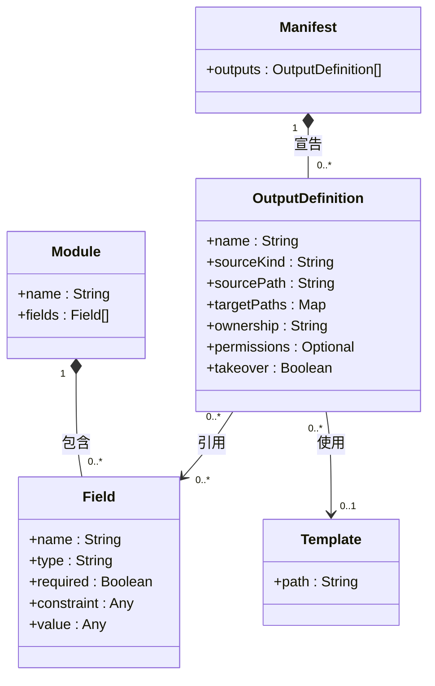
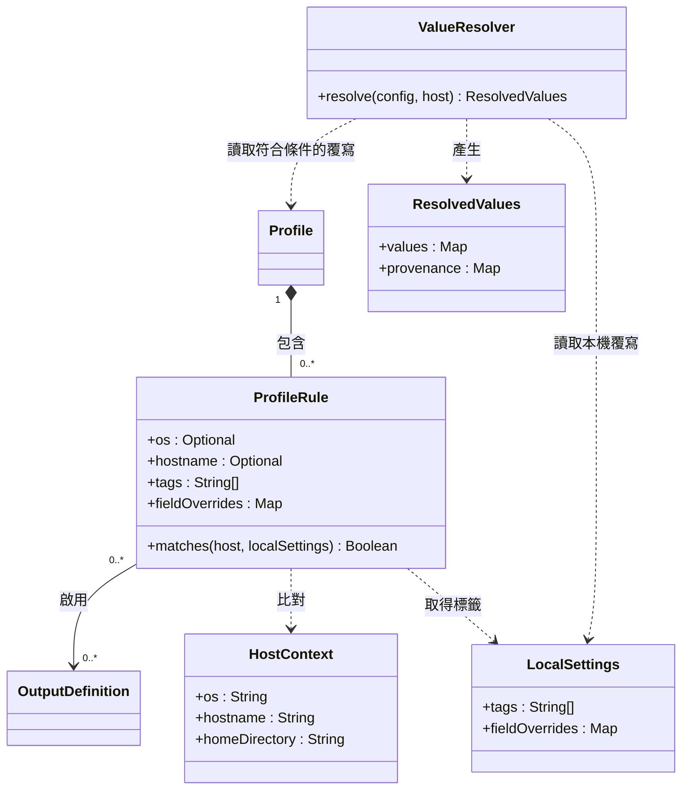
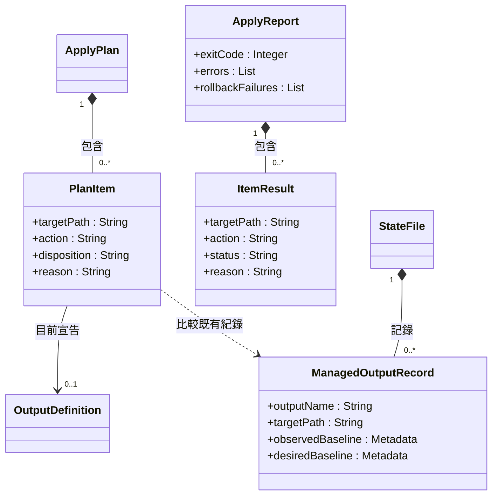
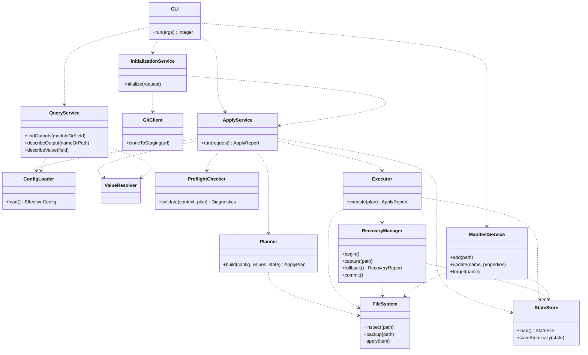
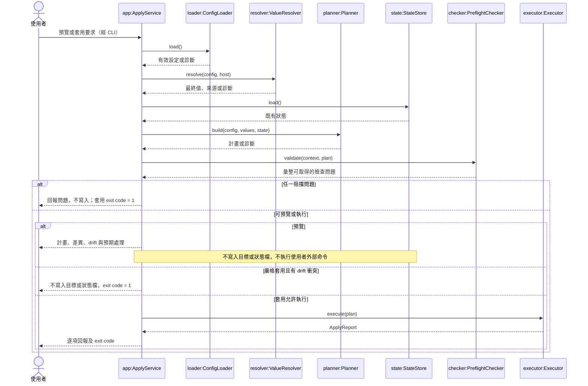
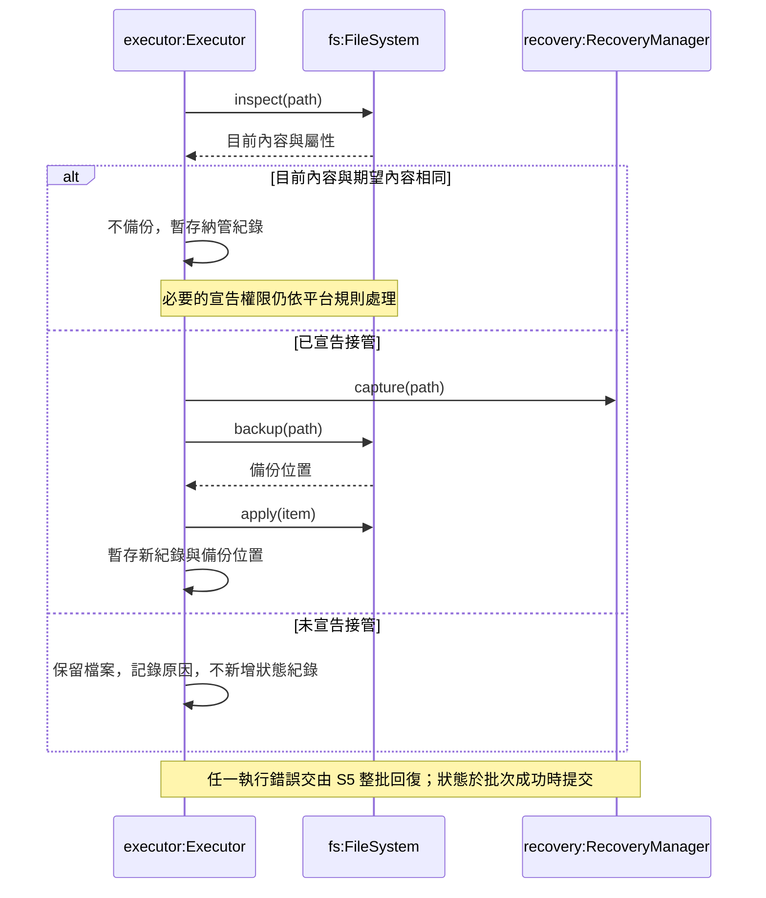
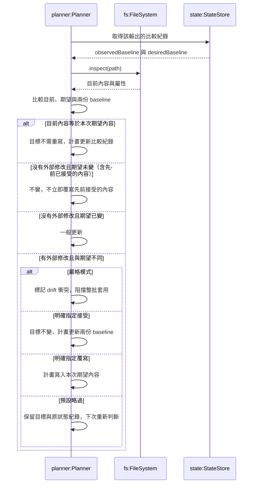
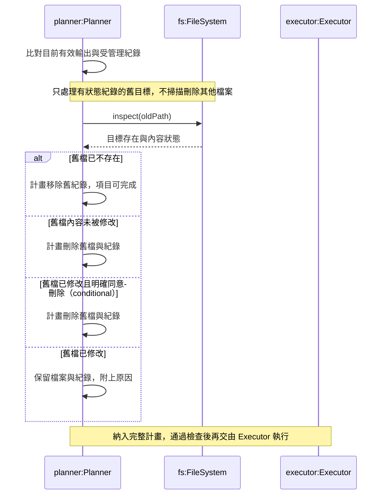
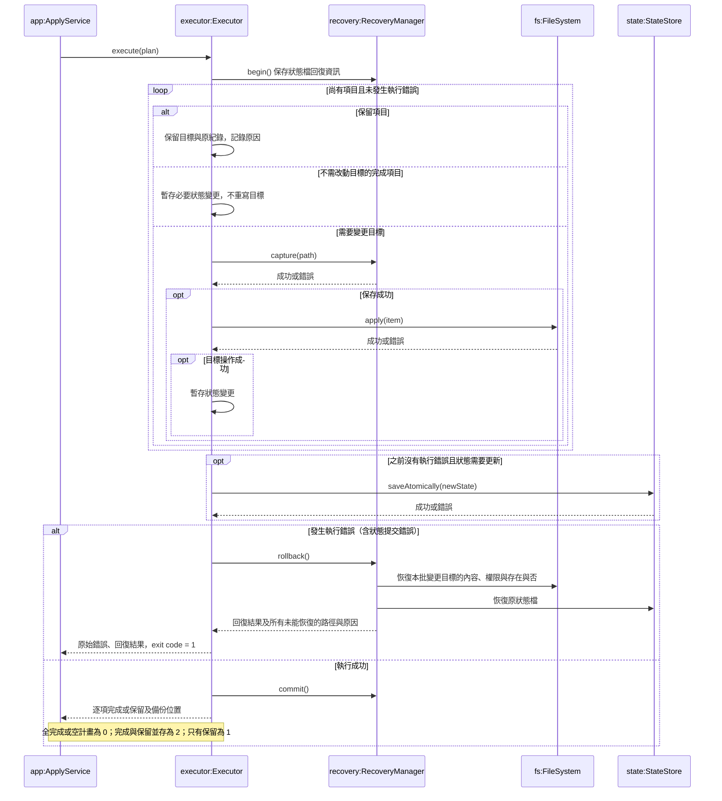
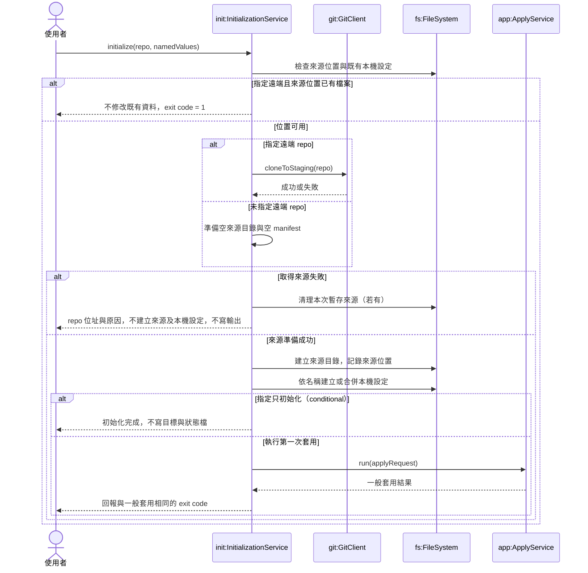

# rosamta 初步設計：UML

狀態：供組員審查的設計草稿。依據提供的 SRS 1.0；尚未與實作程式碼核對。本文件的服務名稱、方法及資料分工為設計建議，不是 SRS 已規定的實作。

建議存放於 `docs/03-preliminary-design/uml.md`。GitHub 可直接將下列 Mermaid 區塊顯示為圖；實際排版仍需在目標 GitHub 頁面確認。

## 1. 建模依據與範圍

Royce（1970）的論文不是 UML 規範，也沒有規定應畫哪些 UML 圖。本文採用其提早進行初步設計、記錄設計、安排驗證並允許回饋修正的觀點，不將瀑布流程解讀為禁止回頭。高風險設計（整批回復、接受 drift 後的比較、平台路徑）應在實作前驗證。

Valente 第 4 章將模型定位為需求與程式碼之間的溝通工具，區分類別圖的靜態結構與循序圖的執行情境。本文依此選擇 Class 與 Sequence 圖，不為了完整而加入沒有用途的圖種，也不把所有情境塞入同一張圖。

參考資料：

- Winston W. Royce. *Managing the Development of Large Software Systems*. IEEE WESCON, 1970. [論文掃描本](https://cpske.github.io/ISP/resources/Royce1970-Managing-the-Development-of-Large-Software-Systems.pdf)。
- Marco Tulio Valente. *Software Engineering: A Modern Approach*, 2024，§4.2、§4.3、§4.5。[作者提供的第 4 章網路版](https://softengbook.org/chapter4)。本次查閱的是網路版，未逐頁核對 2024 年電子書版本。

## 2. 類別圖 C1：設定資料模型

此圖表示解析與合併後的有效設定。內建輸出與使用者覆寫如何保存在檔案中，不由此圖決定。所有輸出共用一份來源目錄 manifest；模組只放欄位，不持有輸出宣告。

`sourceKind` 區分範本與原樣複製；每個輸出只選其中一種來源。原樣複製必須保留位元組，不經範本處理。權限未宣告時，不變更既有權限；Windows 不套用 POSIX 權限位元。型別與版本相容資訊可在詳細設計補充；conditional 的版本檢查及依賴檢查不應被當成已確定交付。

## 3. 類別圖 C2：Profile 與欄位解析

重複出現的類別僅為跨圖參照。條件內是 AND，同一輸出的多個啟用條件是 OR；沒有被啟用的輸出不得寫入。

解析順序固定為內建預設值 → 使用者模組 → Profile → 本機設定；後者優先，未指定欄位保留低層值。同層重複設定是錯誤，不能以檔名或列出順序決定。`provenance` 記錄值的層級與來源位置，支援查詢。

## 4. 類別圖 C3：套用資料模型

`action` 為建立／更新／刪除／不變；`disposition` 表示將執行、略過或接受等處理決策；正常結束的 `status` 是完成或保留。執行錯誤與回復失敗另外記在回報，避免把已回復項目誤報為已完成。

兩份 baseline 是本文件的設計提案：observedBaseline 用於偵測目標後續的外部修改，desiredBaseline 用於判斷來源產生的期望內容是否改變。它們只存比較用中繼資料，不存輸出原文，也不在此指定演算法。這個分工支援「接受 drift 後，來源未改時不立刻覆寫；來源改變後依一般更新處理」。執行期產生內容不得序列化進狀態檔。

## 5. 類別圖 C4：服務責任

服務皆為同一 CLI 程式內部的邏輯分工，不表示常駐服務或網路服務。此圖只列主要依賴。

ConfigLoader 必須保留診斷來源位置；無法解析的設定可直接回傳診斷，不能假設一定能先建立完整計畫。寫回 manifest 等使用者文件時，ManifestService 必須保留註解與格式。停止管理除了移除宣告，也要移除狀態紀錄，才能避免下次清除目標檔。

## 6. 循序圖 S1：預覽與套用入口

此圖的呼叫表示概念順序；錯誤資料不能傳入不適用的後續步驟。實作應在可繼續分析時收集所有可辨識問題，而非遇到第一項就停止診斷。計畫產生可先驗證渲染必要的欄位，再計算內容；所有阻擋檢查必須在任何輸出寫入前完成。

## 7. 循序圖 S2：未受管理檔案的接管

前提：完整計畫已通過預檢與嚴格模式檢查；此項目目標存在，但狀態檔沒有紀錄。此圖聚焦完整管理輸出，其他擁有程度另依其規則處理。

互動接管屬 conditional；若納入，須在決策階段取得使用者選擇，且只有明確啟用互動並且 stdin 為終端機時才詢問。接管備份與回復快照用途不同，不應混為同一個生命週期。

## 8. 循序圖 S3：受管理輸出的 drift 決策

本圖是計畫階段的分析，不直接寫入。以完整管理輸出為範圍；未宣告的權限不列為 drift。

接受不修改來源目錄，且執行成功時記為完成。若先前接受後來源改變，但目標未再被外部修改，依一般更新處理。嚴格模式與明確接受／覆寫同時指定時，本稿採嚴格模式優先；SRS 未明示優先順序，列為待確認。

## 9. 循序圖 S4：清除舊輸出

手動從 manifest 移除、停用、改目標路徑，都可能產生清除項目；「停止管理」指令則移除狀態紀錄並保留檔案，後續不清除它。

## 10. 循序圖 S5：執行與整批回復

前提：預檢通過、嚴格模式沒有阻擋，並已完成所有項目的處理決策。RecoveryManager 的快照保存方式是設計提案，不得把輸出內容寫入狀態檔。

begin、capture、backup、目標操作與狀態提交的錯誤都必須走失敗處理；回復需盡力處理所有受影響項目，不能在第一個回復錯誤時就遺漏其他項目。不可因 drift 或未宣告接管而觸發回復。此模型沒有承諾多檔案同時原子可見，也沒有自行增加斷電後自動復原的需求。

## 11. 循序圖 S6：新機器初始化

此圖聚焦新機器路徑；既有本機設定的合併另依 FR-INI-008，未明確指定的值及文件格式必須保留。

clone 的暫存與成功後移入是為滿足取得失敗時不得留下來源目錄的設計建議。此圖不宣稱首次套用失敗時會撤銷整個初始化；SRS 只明定輸出與狀態的回復。首次取得來源以外的操作不得連線，不進行 git 同步或安裝套件。

## 12. 需求追溯與審查重點

| 圖 | 主要需求 | 審查重點 |
| --- | --- | --- |
| C1 | FR-MOD-001–004、FR-TPL-006、FR-MAN-001–016 | 模組不宣告輸出；原樣複製不渲染；平台目標集中宣告 |
| C2 | FR-PRF-001–013 | AND／OR、四層覆寫、同層衝突、值來源追溯 |
| C3 | FR-APL-001–009、FR-DRF-001–008、SEC-001 | 計畫與結果分開；狀態不存原文；接受不立即被覆寫 |
| C4 | FR-MAN-023–030、FR-QRY-001–006 及主要套用需求 | 各服務責任；修改文件保留格式；查詢不遺漏引用 |
| S1 | FR-PLN-001–010、FR-DRF-009、USE-004 | 整批預檢；預覽不寫入；嚴格模式不寫入 |
| S2 | FR-MAN-018–022 | 相同內容直接納管；接管先備份；未接管保留 |
| S3 | FR-DRF-001–011、B-17 | 三種處理、接受只更新狀態、嚴格模式 |
| S4 | FR-DRF-012–017、FR-MAN-025 | 修改過的舊檔保留；停止管理與清除不同 |
| S5 | FR-APL-001–009、REL-001–002 | 寫入、刪除、權限與狀態皆可回復；正確 exit code |
| S6 | FR-INI-001–011、IF-013 | clone 失敗不留來源；首次套用重用一般套用流程 |

本文件是核心 UML 集合，並非宣稱覆蓋全部 152 條需求。conditional 的依賴檢查若納入，應另設 DependencyChecker：預覽與套用均回報存在／缺少／無法確認，附受影響的輸出、模組、範本，但不阻擋寫入、不改變 exit code，且不安裝任何依賴。optional 的指定欄位管理亦需另補相應設計。

## 13. 詳細設計前須定案

1. 嚴格模式和明確接受／覆寫同時指定時的優先順序。本稿採嚴格模式優先，須與組員確認。
2. 接管備份的目錄、唯一命名、保留期限，以及批次失敗後是否保留；回報必須提供可用的備份位置。
3. 比較中繼資料的實際格式與演算法；兩份 baseline 提案應以「接受後重跑不變」「來源改後一般更新」「目標再改後偵測 drift」三組案例驗證。
4. 如何處理預檢後檔案被外部程式修改，以及多個 rosamta 同時執行。不能只因先前預檢通過便假設目標未變。
5. 路徑正規化、大小寫與指向 home 外的符號連結如何檢查，確保寫入範圍符合 SRS。
6. 內建輸出停止管理後的持久化表示，避免下次合併內建宣告時重新出現。

