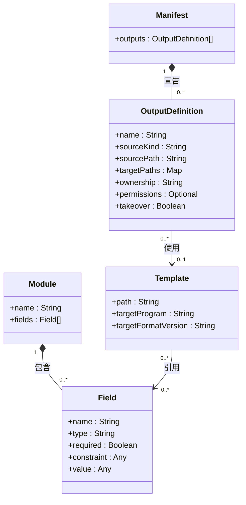
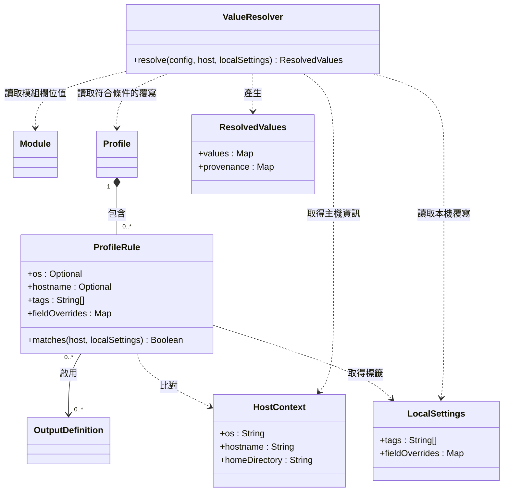
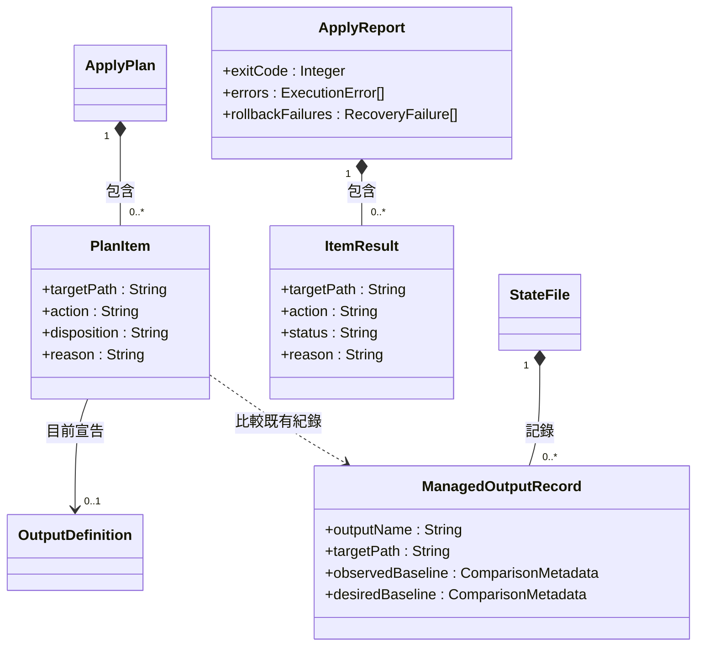
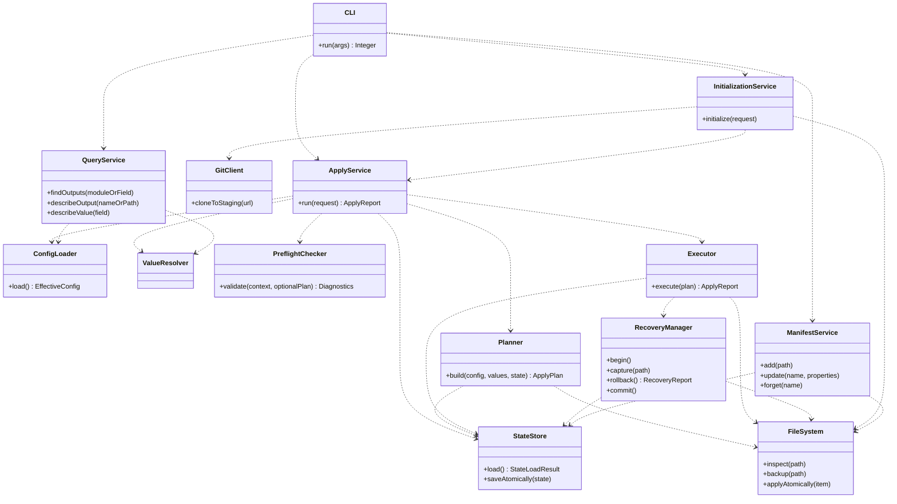
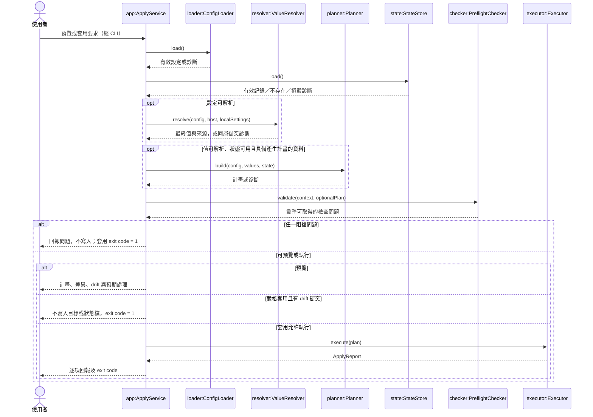
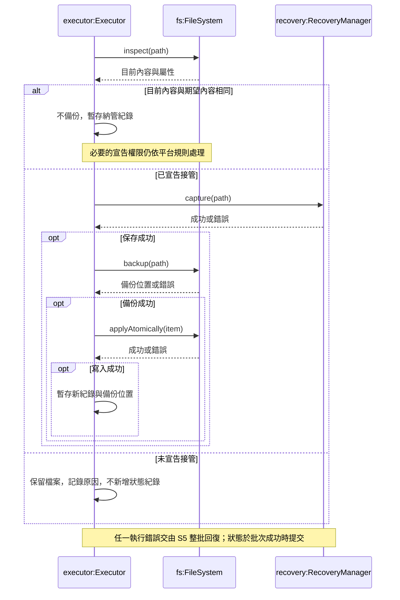
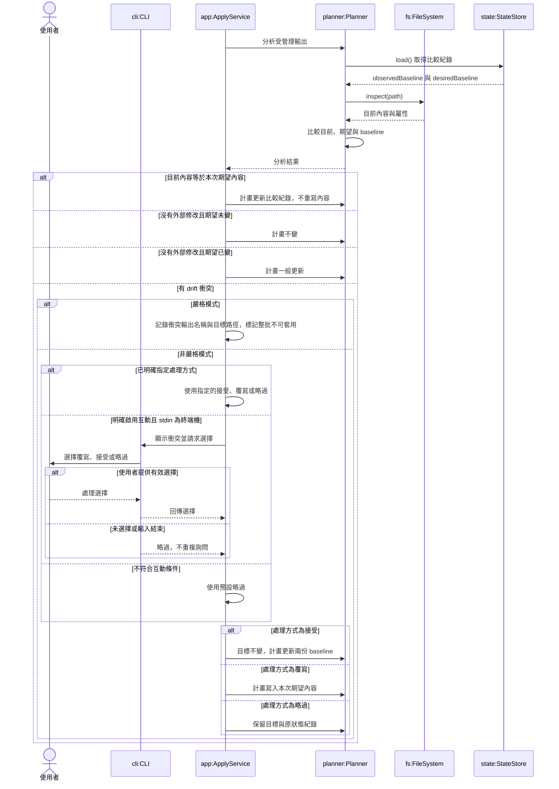
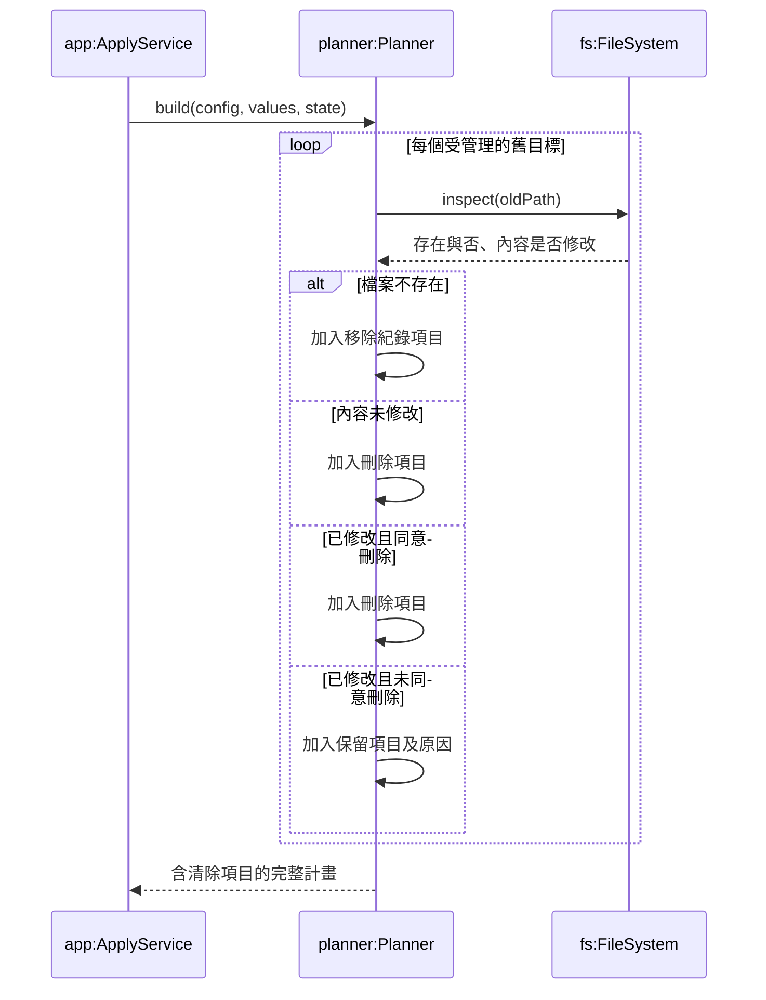
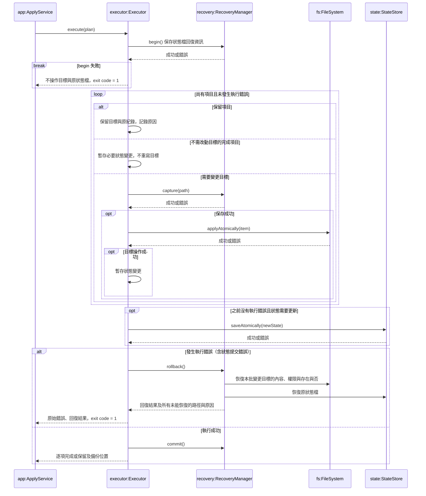

## 1. 類別圖 C1：設定資料模型

此圖表示解析與合併後的有效設定。內建輸出與使用者覆寫如何保存在檔案中，不由此圖決定。所有輸出共用一份來源目錄 manifest；模組只放欄位，不持有輸出宣告。

圖中的 + 表示公開可見的成員；本圖尚未指定其可寫性與實作封裝方式，於詳細設計時決定。

`sourceKind` 區分範本與原樣複製；每個輸出只選其中一種來源。原樣複製必須保留位元組，不經範本處理。權限未宣告時，不變更既有權限；Windows 不套用 POSIX 權限位元。型別與版本相容資訊可在詳細設計補充；conditional 的版本檢查及依賴檢查不應被當成已確定交付。

Template 的程式與設定格式版本欄位對應 essential 的 FR-TPL-002，內建範本必填；這與 conditional 的「模組格式版本及其相容檢查」不同。

Field 由 Module 宣告，Template 引用欄位值產生內容。Manifest 不另外記錄欄位引用；輸出使用哪些模組與欄位，透過其範本的引用關係追溯，並須符合 FR-QRY-004 不遺漏引用輸出的要求。輸出的啟用狀態由 Profile 決定。

### C1 成員說明

下表的泛型寫法是設計說明，不是選定實作語言。圖內 Map、Optional 等簡寫的具體意義以下表為準。

| 類別／成員 | 型別 | 用途與限制 |
| --- | --- | --- |
| Manifest.outputs | OutputDefinition[] | 合併內建宣告與使用者覆寫後的有效輸出清單；輸出名稱不可重複。 |
| OutputDefinition.name | String | 輸出的唯一名稱，供啟用、查詢及管理操作使用。 |
| OutputDefinition.sourceKind | String | 區分 template（範本）與 verbatim（原樣複製）；這兩個值是設計命名建議。 |
| OutputDefinition.sourcePath | String | 範本或複製來源的位置；來源目錄內的路徑相對於來源目錄解讀，內建資源如何定位留給詳細設計。 |
| OutputDefinition.targetPaths | `Map<Platform, String>` | key 為 Linux、Windows、macOS；value 為該平台尚未展開的目標路徑字串。每個平台最多一個值；不要求每個輸出都有三平台路徑，但啟用時必須有目前平台的路徑。 |
| OutputDefinition.ownership | String | 完整管理為預設；只在不存在時建立為 conditional；只管理指定欄位為 optional，不表示三者都已決定實作。 |
| OutputDefinition.permissions | `Optional<PermissionBits>` | 可不宣告的 POSIX 權限位元，如 0600；非任意字串。未宣告時不變更既有權限，Windows 不變更 POSIX 權限位元。實際編碼留待詳細設計。 |
| OutputDefinition.takeover | Boolean | 是否允許在既有未受管理檔案內容不同時，先備份再接管；不是略過備份或忽略 drift 的開關。 |
| Module.name | String | 模組識別名稱，例如 theme、font。 |
| Module.fields | Field[] | 模組宣告的欄位集合；模組不宣告輸出。 |
| Field.name | String | 模組內的欄位名稱；跨模組參照需搭配模組識別，例如 theme.foreground。 |
| Field.type | String | 對應 SRS 3.4.1 的欄位型別；不是選定語言的任意型別名稱。 |
| Field.required | Boolean | 是否必填；適用該宣告的驗證不通過時阻擋套用。 |
| Field.constraint | `Optional<FieldConstraint>` | 型別允許的範圍或格式限制，例如最小／最大值、色碼格式、列舉選項。圖中 Any 是尚未固定結構的簡寫。 |
| Field.value | FieldValue | 模組提供的欄位值；尚不代表四層解析後的最終值。FieldValue 須符合欄位型別。 |
| Template.path | String | 範本資源位置；使用者範本可取代特定輸出的內建範本。 |
| Template.targetProgram | String | 範本對應的目標程式名稱；內建範本必填。 |
| Template.targetFormatVersion | String | 目標程式設定格式版本；不同於模組格式相容版本，內建範本必填。 |

## 2. 類別圖 C2：Profile 與欄位解析

重複出現的類別僅為跨圖參照。條件內是 AND，同一輸出的多個啟用條件是 OR；沒有被啟用的輸出不得寫入。

解析順序固定為內建預設值 → 使用者模組 → Profile → 本機設定；後者優先，未指定欄位保留低層值。
同層重複設定是錯誤，不能以檔名或列出順序決定。`provenance` 記錄值的層級與來源位置，支援查詢。

### C2 成員與方法說明

`Platform` 表示 Linux、Windows、macOS；`FieldRef` 表示模組與欄位的識別，例如 `theme.foreground`；`FieldValue` 為符合該欄位型別的值。

| 類別／成員 | 型別 | 用途 |
| --- | --- | --- |
| Profile | 包含 `ProfileRule` 的容器 | 保存啟用輸出及覆寫欄位的條件規則；圖中以組合關係表示。 |
| ProfileRule.os | `Optional<Platform>` | 限制作業系統；未指定則不限制。 |
| ProfileRule.hostname | `Optional<String>` | 限制主機名稱；未指定則不限制。 |
| ProfileRule.tags | `String[]` | 主機必須具備的標籤；同一條件內全部符合才成立。 |
| ProfileRule.fieldOverrides | `Map<FieldRef, FieldValue>` | 條件成立時提供的 Profile 層欄位覆寫。 |
| HostContext.os | `Platform` | 目前主機的作業系統。 |
| HostContext.hostname | `String` | 目前主機名稱。 |
| HostContext.homeDirectory | `String` | 使用者 home 的絕對路徑，供路徑展開與驗證。 |
| LocalSettings.tags | `String[]` | 本機指定的標籤，供 Profile 比對。 |
| LocalSettings.fieldOverrides | `Map<FieldRef, FieldValue>` | 本機設定層的欄位覆寫，優先序最高。 |
| ResolvedValues.values | `Map<FieldRef, FieldValue>` | 四層解析後的最終欄位值。 |
| ResolvedValues.provenance | `Map<FieldRef, ValueSource>` | 最終值的來源層級、檔案及可用的位置資訊。 |

`ValueSource` 是來源描述資料，其具體結構於詳細設計時決定。

| 方法 | 參數 | 回傳與用途 |
| --- | --- | --- |
| ProfileRule.matches(host, localSettings) | `host: HostContext`；`localSettings: LocalSettings` | 回傳 `Boolean`，比對作業系統、主機名稱及本機標籤，判斷條件是否成立。 |
| ValueResolver.resolve(config, host, localSettings) | `config: EffectiveConfig`，包含模組與 Profile 的有效設定；`host: HostContext`；`localSettings: LocalSettings` | 成功時回傳 `ResolvedValues`，依四層優先序解析值並保留來源；同層重複設定時回報診斷。 |

圖中的方法簽名只列成功回傳型別；診斷結果的具體表示方式於詳細設計時決定。

## 3. 類別圖 C3：套用資料模型

`action` 為建立／更新／刪除／不變；`disposition` 表示將執行、略過或接受等處理決策；正常結束的 `status` 是完成或保留。執行錯誤與回復失敗另外記在回報，避免把已回復項目誤報為已完成。

兩份 baseline 是本文件的設計提案：observedBaseline 用於偵測目標後續的外部修改，desiredBaseline 用於判斷來源產生的期望內容是否改變。它們只存比較用中繼資料，不存輸出原文，也不在此指定演算法。這個分工支援「接受 drift 後，來源未改時不立刻覆寫；來源改變後依一般更新處理」。執行期產生內容不得序列化進狀態檔。

ComparisonMetadata 是值型別，記錄內容指紋及需追蹤的宣告屬性；不是檔案原文。權限未宣告及 Windows 權限位元不得納入 drift 判斷。接受時 observedBaseline 記錄目前實際內容、desiredBaseline 記錄本次來源產生的內容；兩者可以不同。目標內容已符合期望時，不重寫內容；若仍有已宣告且適用於目前平台的權限變更，仍須完成該變更，才能將項目記為完成。必要時更新狀態紀錄。

### C3 成員說明

| 類別／成員 | 型別 | 用途 |
| --- | --- | --- |
| ApplyPlan | 包含 `PlanItem` 的容器 | 保存本次套用的完整計畫；圖中以組合關係表示。 |
| PlanItem.targetPath | `String` | 本項目解析後的目標路徑。 |
| PlanItem.action | `String` | 建立、更新、刪除或不變。 |
| PlanItem.disposition | `String` | 本次處理決策，例如執行、略過或接受；與目標動作分開。 |
| PlanItem.reason | `String` | 處理決策的原因；保留項目必須說明原因。 |
| ApplyReport.exitCode | `Integer` | 套用的回傳碼：0、2 或 1，依 SRS 的結果規則計算。 |
| ApplyReport.errors | `ExecutionError[]` | 原始執行錯誤的項目、目標路徑與原因。 |
| ApplyReport.rollbackFailures | `RecoveryFailure[]` | 整批回復時，所有未能恢復的目標路徑與原因。 |
| ItemResult.targetPath | `String` | 回報項目的目標路徑。 |
| ItemResult.action | `String` | 該項目的建立、更新、刪除或不變動作。 |
| ItemResult.status | `String` | 正常結束時為完成或保留；執行錯誤與整批回復另外說明。 |
| ItemResult.reason | `String` | 保留原因；完成項目可使用空字串。 |
| StateFile | 包含 `ManagedOutputRecord` 的容器 | 保存受管理輸出的紀錄，不保存輸出原文。 |
| ManagedOutputRecord.outputName | `String` | 受管理輸出的識別名稱。 |
| ManagedOutputRecord.targetPath | `String` | 已記錄的實際目標路徑，供 drift 判斷與舊輸出清除。 |
| ManagedOutputRecord.observedBaseline | `ComparisonMetadata` | 上次記錄的實際目標比較資訊，用於偵測後續外部修改。 |
| ManagedOutputRecord.desiredBaseline | `ComparisonMetadata` | 上次處理時的期望內容比較資訊，用於判斷來源是否改變。 |

`ExecutionError`、`RecoveryFailure` 是錯誤描述資料；`ComparisonMetadata` 是不含輸出原文的比較資料，其具體結構於詳細設計時決定。

`ApplyReport` 透過組合關係包含逐項的 `ItemResult`。C3 未宣告成員方法，因此沒有方法參數需要補充；計畫產生、執行及狀態儲存由 C4 的服務負責。

## 4. 類別圖 C4：服務責任

服務皆為同一 CLI 程式內部的邏輯分工，不表示常駐服務或網路服務。此圖只列主要依賴。

ConfigLoader 必須保留診斷來源位置；無法解析的設定可直接回傳診斷，不能假設一定能先建立完整計畫。寫回 manifest 等使用者文件時，ManifestService 必須保留註解與格式。停止管理除了移除宣告，也要移除狀態紀錄，才能避免下次清除目標檔。

StateLoadResult 區分成功、檔案不存在及無法讀取／損毀。不存在回傳空紀錄；損毀是阻擋錯誤，不可當空紀錄繼續，更不可覆寫原狀態檔。圖只畫主要依賴，不列所有資料值型別。呼叫可回傳具來源位置的診斷；方法簽名是正常成功結果的摘要。

### C4 方法與參數說明

本圖只列方法，未列服務內部屬性。方法簽名以正常結果為摘要；執行失敗時須回傳或傳遞錯誤，具體錯誤表示方式於詳細設計時決定。

| 類別／方法 | 參數 | 回傳與用途 |
| --- | --- | --- |
| CLI.run(args) | `args: String[]`，命令列參數 | 回傳 `Integer` exit code；解析子指令與選項，呼叫對應服務並顯示結果。 |
| ApplyService.run(request) | `request: ApplyRequest`，包含預覽／套用、模式及衝突處理選項 | 回傳 `ApplyReport`；協調設定載入、值解析、計畫、預檢與執行。預覽不得寫入目標或狀態檔。 |
| ConfigLoader.load() | 無顯式參數；來源位置由初始化紀錄及執行環境取得 | 成功時回傳 `EffectiveConfig`；載入來源設定與內建資源，合併輸出覆寫並保留診斷來源位置。 |
| Planner.build(config, values, state) | `config: EffectiveConfig`；`values: ResolvedValues`；`state: StateFile` | 回傳 `ApplyPlan`；計算期望內容、建立／更新／刪除／不變動作、衝突與清除項目，不寫入目標或狀態檔。 |
| PreflightChecker.validate(context, optionalPlan) | `context: AnalysisContext`，包含可取得的設定、主機資訊及診斷；`optionalPlan: Optional<ApplyPlan>` | 回傳 `Diagnostics`；檢查寫入前的阻擋問題。無法建立完整計畫時，仍可檢查不依賴計畫的部分。 |
| Executor.execute(plan) | `plan: ApplyPlan`，已通過預檢與模式檢查的計畫 | 回傳 `ApplyReport`；執行項目並提交狀態，發生執行錯誤時協調整批回復。 |
| RecoveryManager.begin() | 無顯式參數；使用本批次上下文 | 建立回復上下文並保存原狀態檔資訊；失敗時不得開始變更目標。 |
| RecoveryManager.capture(path) | `path: String`，將被變更的目標路徑 | 保存套用前的內容、權限及存在與否；失敗時不得繼續變更該目標。回復資料不寫入狀態檔。 |
| RecoveryManager.rollback() | 無顯式參數；使用已保存的批次快照 | 回傳 `RecoveryReport`；恢復本批受影響的目標與狀態檔，列出所有未能恢復的路徑與原因。 |
| RecoveryManager.commit() | 無顯式參數；使用目前批次上下文 | 結束成功批次並釋放回復暫存資源，不再變更輸出內容。暫存清理問題須與套用或回復失敗區分。 |
| StateStore.load() | 無顯式參數；使用已設定的狀態檔位置 | 回傳 `StateLoadResult`；區分有效紀錄、不存在、無法讀取或損毀，不得將損毀當成空紀錄。 |
| StateStore.saveAtomically(state) | `state: StateFile`，待提交的新狀態 | 原子提交狀態；程序中止時，狀態檔維持完整舊內容或完整新內容。失敗時傳遞錯誤。 |
| FileSystem.inspect(path) | `path: String`，待檢查路徑 | 成功時回傳 `FileInspection`，包含存在與否、內容及屬性資訊；讀取錯誤不可當成檔案不存在。 |
| FileSystem.backup(path) | `path: String`，待接管的既有檔案 | 成功時回傳備份位置 `String`；在覆寫前保存原檔，失敗時不得繼續接管。 |
| FileSystem.applyAtomically(item) | `item: PlanItem`，已具備執行所需內容與屬性的項目 | 執行目標建立、更新、刪除或適用的宣告權限變更；內容寫入須保有完整舊／新內容，不重寫不變項目的內容。 |
| InitializationService.initialize(request) | `request: InitializationRequest`，包含遠端來源、具名本機值及適用的初始化選項 | 回傳 `InitializationResult`；準備來源、建立或合併本機設定、記錄來源位置，並依選項執行首次套用。 |
| GitClient.cloneToStaging(url) | `url: String`，使用者指定的遠端 repo 位址 | 成功時回傳暫存來源目錄位置 `String`；失敗時清理本次暫存並回報原因。不負責後續 pull、push 或合併。 |
| ManifestService.add(path) | `path: String`，home 內既有檔案路徑 | 回傳 `OperationResult`；複製檔案到來源目錄並新增原樣複製輸出，不刪除原目標檔。 |
| ManifestService.update(name, properties) | `name: String`，輸出名稱；`properties: OutputPropertyPatch`，指定要修改的屬性 | 回傳 `OperationResult`；只更新指定屬性，保留其他內容、註解及格式。 |
| ManifestService.forget(name) | `name: String`，輸出名稱 | 回傳 `OperationResult`；移除輸出宣告及其狀態紀錄，不刪除或修改目標檔。 |
| QueryService.findOutputs(moduleOrField) | `moduleOrField: ModuleRef 或 FieldRef` | 回傳 `OutputSummary[]`，列出引用該模組或欄位的輸出；模組查詢為 essential，欄位查詢為 conditional。 |
| QueryService.describeOutput(nameOrPath) | `nameOrPath: String`，輸出名稱或目標路徑 | 回傳 `OutputDescription`，列出範本或複製來源，以及透過範本追溯的模組與欄位。 |
| QueryService.describeValue(field) | `field: FieldRef`，模組與欄位的識別 | 回傳 `ResolvedValueDescription`，包含最終值、來源層級及來源檔案。 |

ValueResolver 的方法與參數已於 C2 說明；此圖只參照該類別，不重複列出。

### C4 資料型別說明

以下為服務間傳遞的概念資料，不代表新增設定檔格式；具體欄位結構於詳細設計時決定。

| 型別 | 說明 |
| --- | --- |
| EffectiveConfig | 合併後的有效設定，包含輸出宣告、模組、範本與 Profile。 |
| ApplyRequest | 本次預覽或套用的選項；不表示所有 conditional 功能都已決定交付。 |
| AnalysisContext | 可取得的設定、解析值、主機資訊、狀態載入結果及累積診斷。 |
| Diagnostics | 檢查問題集合，提供來源位置、原因與可用的修正提示。 |
| StateLoadResult | 狀態載入結果，區分成功、不存在與阻擋錯誤。 |
| FileInspection | 檔案存在與否、內容比較所需資料及適用屬性。 |
| RecoveryReport | 整批回復結果，以及未能恢復的路徑與原因。 |
| InitializationRequest | 初始化輸入，包括來源及具名本機設定。 |
| InitializationResult | 初始化結果、錯誤，以及有執行首次套用時的套用回報。 |
| OutputPropertyPatch | 只包含本次指定修改的輸出屬性；未指定的屬性保持原值。 |
| OperationResult | 管理操作的成功結果或錯誤資訊。 |
| OutputSummary | 輸出名稱、目前平台目標路徑與啟用狀態等查詢摘要。 |
| OutputDescription | 輸出來源及引用的模組、欄位資訊。 |
| ResolvedValueDescription | 最終欄位值與其來源描述。 |

PlanItem 的期望內容或執行期資源參照在 C3 中尚未展開，詳細設計須補齊其與 Executor 的傳遞契約；輸出原文不得因此被寫入 StateFile。

## 5. 循序圖 S1：預覽與套用入口

此圖的呼叫表示概念順序；錯誤資料不能傳入不適用的後續步驟。實作應在可繼續分析時收集所有可辨識問題，而非遇到第一項就停止診斷。計畫產生可先驗證渲染必要的欄位，再計算內容；所有阻擋檢查必須在任何輸出寫入前完成。

預覽不寫入目標與狀態檔，也不執行使用者定義的外部命令。預檢清單包括 manifest 語法與未知屬性、重複輸出名、平台目標缺失、home 範圍、欄位型別／範圍／必填、同層衝突，以及正規化後的目標碰撞（包含不區分大小寫的檔案系統）。若交付版本相容功能，亦檢查版本。不存在的狀態檔視為空紀錄，不產生舊檔清除計畫；損毀則預檢失敗。依賴檢查的缺少／無法確認只是非阻擋回報。

## 6. 循序圖 S2：未受管理檔案的接管

前提：完整計畫已通過預檢與嚴格模式檢查；此項目目標存在，但狀態檔沒有紀錄。此圖聚焦完整管理輸出，其他擁有程度另依其規則處理。

互動接管屬 conditional；若納入，須在決策階段取得使用者選擇，且只有明確啟用互動並且 stdin 為終端機時才詢問。接管備份與回復快照用途不同，不應混為同一個生命週期。

相同內容直接納管的檔案沒有特殊清除豁免：後續停用或移除時仍依 S4 清除（SRS 1.1 的 FR-MAN-021）。任何權限變更也須先 capture，並納入 S5 的回復範圍。capture／backup 失敗時不得繼續寫入；先回報執行錯誤並進入 S5，不能只靠圖外說明而無條件執行下一步。

## 7. 循序圖 S3：受管理輸出的 drift 決策

本圖是計畫階段的分析，不直接寫入。以完整管理輸出為範圍；未宣告的權限不列為 drift。互動詢問為 conditional 功能，僅在明確啟用互動且 stdin 連接終端機時進行。

本圖描述單一輸出；有多個衝突時逐檔處理。嚴格模式一旦發現任何 drift 衝突，本次套用不得寫入任何輸出或狀態檔。

接受不修改來源目錄，執行成功時記為完成。接受時 observedBaseline 記錄目前實際內容的比較資訊，desiredBaseline 記錄本次期望內容的比較資訊，不保存輸出原文。

先前接受後，若來源改變但目標未再被外部修改，依一般更新處理；此分支對應 conditional 的 FR-DRF-008。互動詢問與無選擇時略過，分別對應 conditional 的 FR-DRF-010、011。

圖中的「分析輸出」及「更新計畫」是責任描述，實際方法簽名於詳細設計時補充。所有計畫變更都不代表立即寫入，實際套用仍須通過整批檢查。

本稿暫以「嚴格模式優先、已指定的處理方式優先於互動詢問」作為設計提案，須由組員確認，並非 SRS 已明定的組合選項規則。

## 8. 循序圖 S4：清除舊輸出

此圖只產生清除計畫。舊目標是已移除、已停用或已改路徑的受管理輸出；只比較狀態檔有紀錄的路徑。

檢查通過後依 S5 執行，Executor 不參與本圖的計畫階段。刪除時同步移除紀錄；保留時檔案與原紀錄都不變；檔案已不存在則只移除紀錄並記完成。明確刪除已修改舊檔為 conditional。手動從 manifest 移除、停用、改目標路徑，都可能產生清除項目；「停止管理」指令則移除狀態紀錄並保留檔案，後續不清除它。

## 9. 循序圖 S5：執行與整批回復

前提：預檢通過、嚴格模式沒有阻擋，並已完成所有項目的處理決策。RecoveryManager 的快照保存方式是設計提案，不得把輸出內容寫入狀態檔。

begin、capture、backup、目標操作與狀態提交的錯誤都必須走失敗處理；回復需盡力處理所有受影響項目，不能在第一個回復錯誤時就遺漏其他項目。不可因 drift 或未宣告接管而觸發回復。此模型沒有承諾多檔案同時原子可見，也沒有自行增加斷電後自動復原的需求。

applyAtomically 對內容寫入先準備完整暫存檔再以平台支援的原子替換提交，保證程序中止時單一輸出只有完整舊內容或完整新內容（REL-001）；替換既有檔時須維持未宣告的權限。狀態檔同樣原子寫入（REL-002）。commit 只表示釋放回復資訊，不能另作未受保護的目標變更；快照清理失敗不得誤報輸出已回復。begin 失敗時不操作輸出，僅清理已建立的本次暫存資源；rollback 不可使用未成功保存的快照覆寫原狀態。

exit code：全完成或空計畫為 0；完成與保留並存為 2；只有保留為 1。依 SRS 1.1，嚴格模式下若沒有 drift 衝突，但有「未宣告接管」的保留項目，仍依此計算，可為 2；不可把嚴格模式一律視為全有或全無。回復完全成功才聲明所有目標已恢復；否則逐項列出失敗路徑與原因，均為 1。

## 10. 循序圖 S6：新機器初始化

此圖聚焦新機器路徑；既有本機設定的合併另依 FR-INI-008，未明確指定的值及文件格式必須保留。

clone 的暫存與成功後移入是為滿足取得失敗時不得留下來源目錄的設計建議。
此圖不宣稱首次套用失敗時會撤銷整個初始化；SRS 只明定輸出與狀態的回復。

## 11. 需求追溯與審查重點

| 圖 | 主要需求 | 審查重點 |
| --- | --- | --- |
| C1 | FR-MOD-001–004、FR-TPL-006、FR-MAN-001–016 | 模組不宣告輸出；原樣複製不渲染；平台目標集中宣告 |
| C2 | FR-PRF-001–013 | AND／OR、四層覆寫、同層衝突、值來源追溯 |
| C3 | FR-APL-001–009、FR-DRF-001–008、SEC-001 | 計畫與結果分開；狀態不存原文；接受不立即被覆寫 |
| C4 | FR-MAN-023–030、FR-QRY-001–006 及主要套用需求 | 各服務責任；修改文件保留格式；查詢不遺漏引用 |
| S1 | FR-PLN-001–010、FR-DRF-009、USE-004 | 整批預檢；預覽不寫入；嚴格模式不寫入 |
| S2 | FR-MAN-018–022 | 相同內容直接納管；接管先備份；未接管保留 |
| S3 | FR-DRF-001–011、B-17 | 三種處理、接受只更新狀態、嚴格模式 |
| S4 | FR-DRF-012–017、FR-MAN-025 | 修改過的舊檔保留；停止管理與清除不同 |
| S5 | FR-APL-001–009、REL-001–002 | 寫入、刪除、權限與狀態皆可回復；正確 exit code |
| S6 | FR-INI-001–011、IF-013 | clone 失敗不留來源；首次套用重用一般套用流程 |

上表為關聯需求索引，不代表每張圖完整覆蓋整個編號區間。FR-TPL-002 已在 C1 補入必要元資料；REL-003／004 在 S1 區分狀態不存在與損毀；SRS 1.1 的 FR-APL-007 與 FR-MAN-021 由 S5 與 S2／S4 的補充規則明確約束。IF-001 的功能分期不由本 UML 提升：只有交付範圍內的功能才需實作對應子指令。

本文件是核心 UML 集合，並非覆蓋全部 152 條需求。
conditional 的依賴檢查若納入，應另設 DependencyChecker：預覽與套用均回報存在／缺少／無法確認，附受影響的輸出、模組、範本，但不阻擋寫入、不改變 exit code，且不安裝任何依賴。optional 的指定欄位管理亦需另補相應設計。

## 12. 詳細設計前須定案
第 1 項已確認；第 2～6 項保留為詳細設計議題，由負責設計者決定。

1. 已確認採嚴格模式優先：即使同時指定接受或覆寫，只要存在 drift 衝突，本次套用就不寫入任何輸出與狀態檔。回報須列出各衝突輸出的名稱與目標路徑，讓使用者能定位問題。
2. 接管備份的目錄、唯一命名、保留期限，以及批次失敗後是否保留；回報必須提供可用的備份位置。
3. 比較中繼資料的實際格式與演算法；兩份 baseline 提案應以「接受後重跑不變」「來源改後一般更新」「目標再改後偵測 drift」三組案例驗證。
4. 如何處理預檢後檔案被外部程式修改，以及多個 rosamta 同時執行。不能只因先前預檢通過便假設目標未變。
5. 路徑正規化、大小寫與指向 home 外的符號連結如何檢查，確保寫入範圍符合 SRS。
6. 內建輸出停止管理後的持久化表示，避免下次合併內建宣告時重新出現。

## 13. 驗證狀態

已對照附件 SRS 1.1 的核心規則與跨圖名稱，並以 Mermaid 11 實際解析及渲染全部 10 個圖塊，全部成功。

本次審查以 Royce 的初步設計及設計文件原則、Valente 的類別關係及物件訊息表示方式為準。兩份著作並未共同定義一種可機械檢查的「瀑布 UML 格式」，亦不能據此宣稱本文件通過正式認證。2024 年電子書未另行取得，Valente 依作者網路章節核對。
