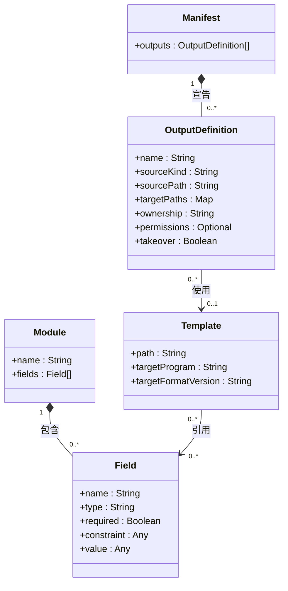
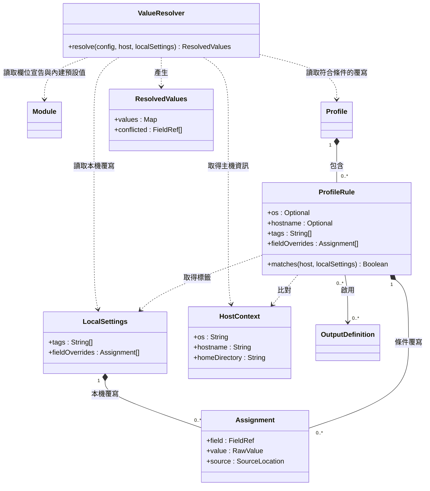
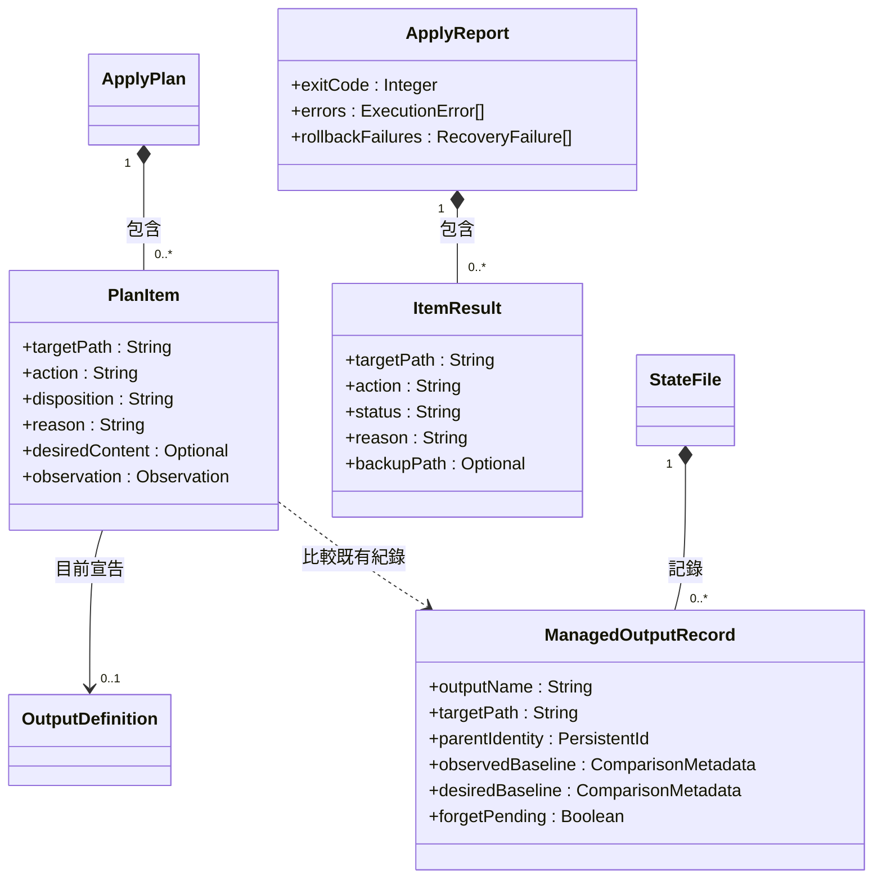
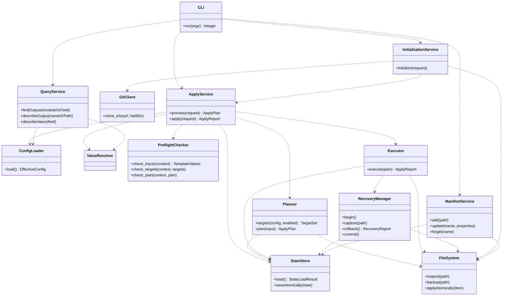
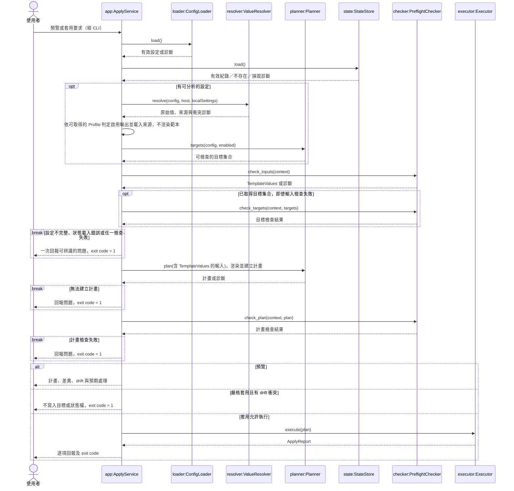
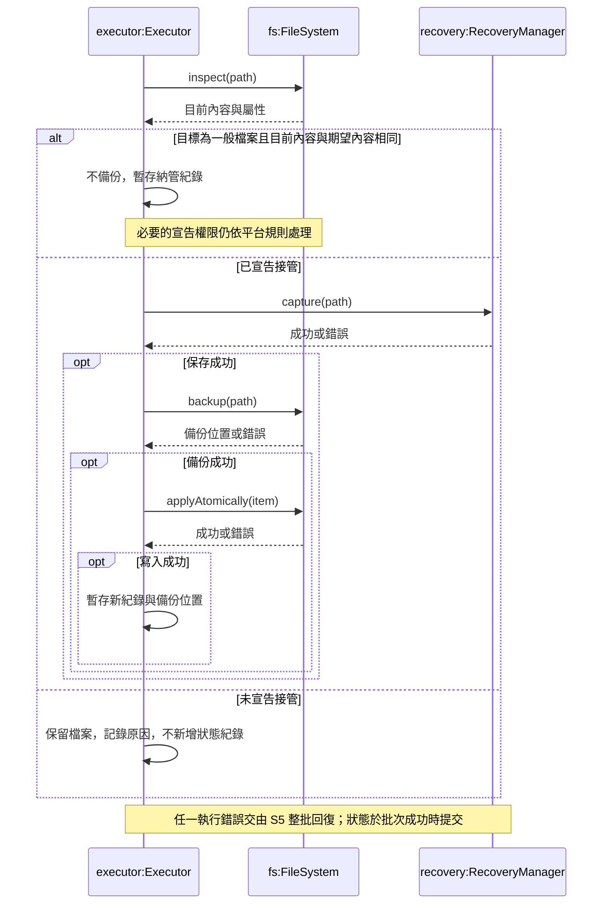
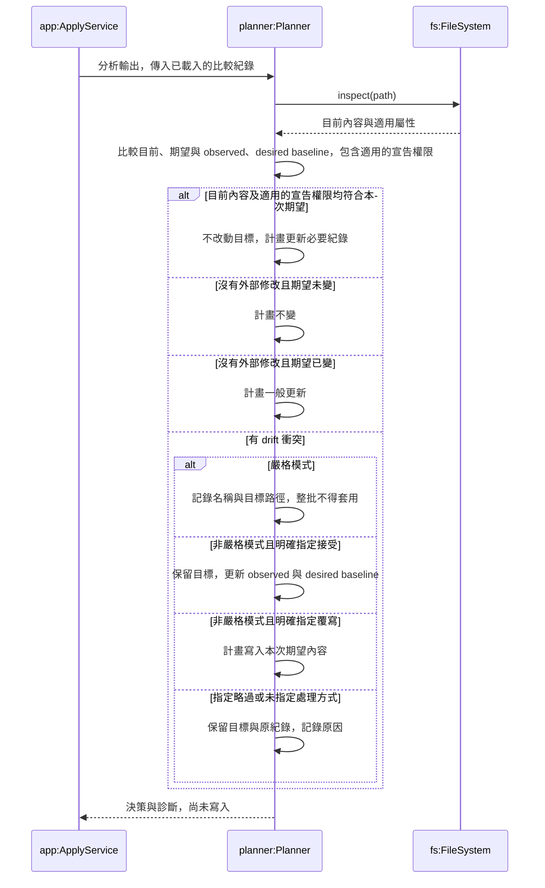
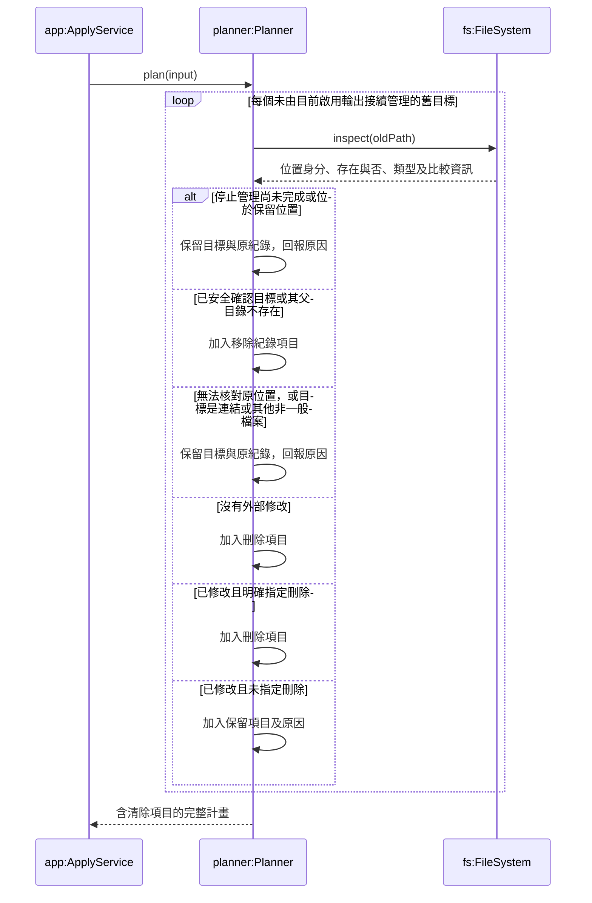
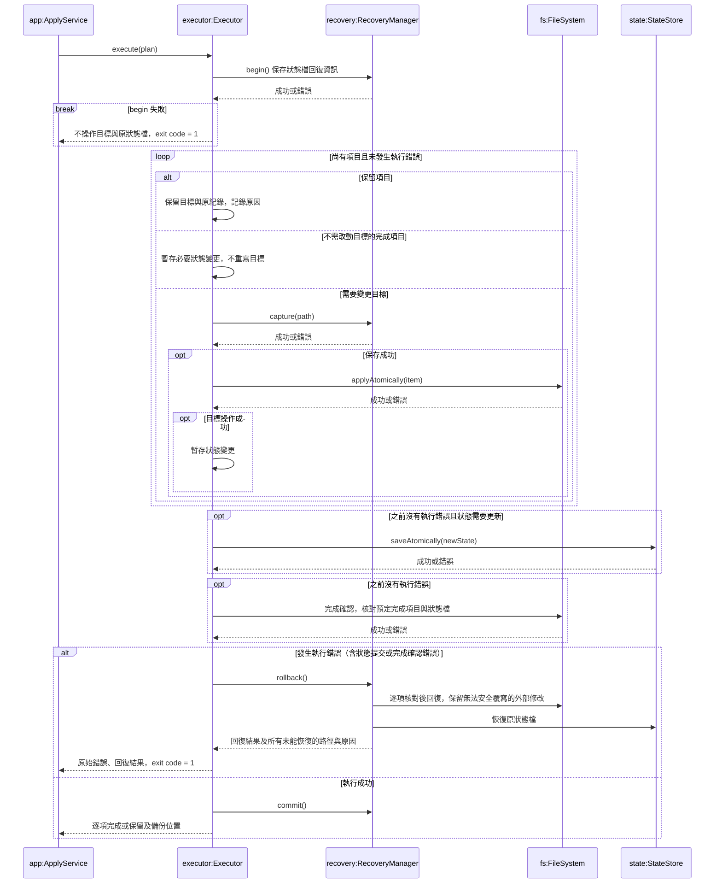
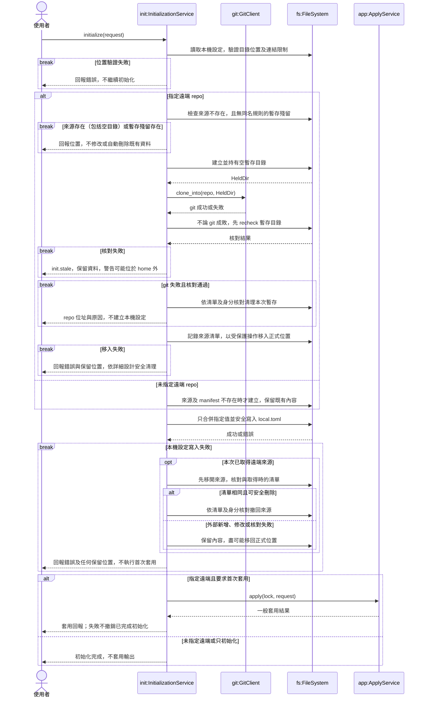

# 初步設計 UML

對照基準：SRS 1.5（2026/11/11）、設計分析與詳細設計，Git 基準 `8db4b567c6336e836c078e398ca6820fd1c3a167`。

本文件保留 C1–C4 與 S1–S6 的概念層級；方法名稱是責任摘要，並非 Rust API。實際型別、鎖定參數、診斷與操作契約以 `../05-detailed-design/detailed-design.md` 及該目錄的 `uml.md` 為準。

第一版依 SRS A.3 延後 12 條需求；互動詢問、依賴檢查、編輯來源內容及指定欄位管理不列入本次流程。其餘 conditional 功能依詳細設計的第一版範圍處理，不再一律視為待定。

## 1. 類別圖 C1：設定資料模型

此圖表示解析與合併後的有效設定。內建輸出與使用者覆寫如何保存在檔案中，不由此圖決定。所有輸出共用一份來源目錄 manifest；模組只放欄位，不持有輸出宣告。

圖中的 + 表示公開可見的成員；本圖尚未指定其可寫性與實作封裝方式，於詳細設計時決定。

`sourceKind` 區分範本與原樣複製；每個輸出只選其中一種來源。原樣複製必須保留位元組，不經範本處理。權限未宣告時，不變更既有權限；Windows 不套用 POSIX 權限位元。型別、格式與版本相容規則依詳細設計；FR-TPL-004、005 的模組格式相容檢查納入第一版，依賴檢查則依 SRS A.3 延後。

Template 的程式與設定格式版本欄位對應 essential 的 FR-TPL-002，內建範本必填；這與 conditional 的「模組格式版本及其相容檢查」不同。

Field 由 Module 宣告，Template 引用欄位值產生內容。Manifest 不另外記錄欄位引用；輸出使用哪些模組與欄位，透過其範本的引用關係追溯，並須符合 FR-QRY-004 不遺漏引用輸出的要求。輸出的啟用狀態由 Profile 決定。

### C1 成員說明

下表的泛型寫法是設計說明，不是選定實作語言。圖內 Map、Optional 等簡寫的具體意義以下表為準。

| 類別／成員 | 型別 | 用途與限制 |
| --- | --- | --- |
| Manifest.outputs | OutputDefinition[] | 合併內建宣告與使用者覆寫後的有效輸出清單；輸出名稱不可重複。 |
| OutputDefinition.name | String | 輸出的唯一名稱，供啟用、查詢及管理操作使用。 |
| OutputDefinition.sourceKind | String | 區分 template（範本）與 verbatim（原樣複製）；這兩個值是設計命名建議。 |
| OutputDefinition.sourcePath | String | 範本或複製來源的位置；來源目錄內的路徑相對於來源目錄解讀，內建資源如何定位留給詳細設計。 |
| OutputDefinition.targetPaths | `Map<Platform, String>` | key 為 Linux、Windows、macOS；value 為該平台尚未展開的目標路徑字串。每個平台最多一個值；不要求每個輸出都有三平台路徑，但啟用時必須有目前平台的路徑。 |
| OutputDefinition.ownership | String | 第一版提供完整管理（預設）及只在不存在時建立（FR-MAN-013）；只管理指定欄位（FR-MAN-014）延後。 |
| OutputDefinition.permissions | `Optional<PermissionBits>` | 可不宣告的 POSIX 權限位元，如 0600；非任意字串。未宣告時不變更既有權限，Windows 不變更 POSIX 權限位元。實際編碼留待詳細設計。 |
| OutputDefinition.takeover | Boolean | 是否允許在既有未受管理檔案內容不同時，先備份再接管；不是略過備份或忽略 drift 的開關。 |
| Module.name | String | 模組識別名稱，例如 theme、font。 |
| Module.fields | Field[] | 模組宣告的欄位集合；模組不宣告輸出。 |
| Field.name | String | 模組內的欄位名稱；跨模組參照需搭配模組識別，例如 theme.foreground。 |
| Field.type | String | 對應 SRS 3.4.1 的欄位型別；不是選定語言的任意型別名稱。 |
| Field.required | Boolean | 是否必填；適用該宣告的驗證不通過時阻擋套用。 |
| Field.constraint | `Optional<FieldConstraint>` | 型別允許的範圍或格式限制，例如最小／最大值、色碼格式、列舉選項。圖中 Any 是尚未固定結構的簡寫。 |
| Field.value | FieldValue | 模組提供的欄位值；尚不代表四層解析後的最終值。FieldValue 須符合欄位型別。 |
| Template.path | String | 範本資源位置；使用者範本可取代特定輸出的內建範本。 |
| Template.targetProgram | String | 範本對應的目標程式名稱；內建範本必填。 |
| Template.targetFormatVersion | String | 目標程式設定格式版本；不同於模組格式相容版本，內建範本必填。 |

## 2. 類別圖 C2：Profile 與欄位解析

重複出現的類別僅為跨圖參照。條件內是 AND，同一輸出的多個啟用條件是 OR；未啟用的輸出不產生新的輸出寫入，既有受管理舊檔的清除另依 S4 處理。

解析順序固定為內建預設值 → 使用者模組 → Profile → 本機設定；後者優先，未指定欄位保留低層值。覆寫以整個欄位值為單位，清單與對照表不逐項合併。

只有條件成立的 Profile 規則參與覆寫。同層有多個來源設定同一欄位時，即使值相同，也須回報衝突並列出所有來源，不以檔名或列出順序決定。

ResolvedValues 將解析後的原始值與來源一起保存，並記錄發生衝突的欄位。型別、範圍與必填條件由後續 PreflightChecker 檢查。

未指定的主機條件不構成限制；作業系統、主機名稱與標籤條件皆未指定時，規則對所有主機成立。

### C2 成員與方法說明

`Platform` 表示 Linux、Windows、macOS；`FieldRef` 表示模組與欄位的識別，例如 `theme.foreground`；`RawValue` 表示尚待預檢驗證的原始值；`Resolved` 同時保存解析後的原始值與來源。

| 類別／成員 | 型別 | 用途 |
| --- | --- | --- |
| Profile | 包含 ProfileRule 的容器 | 保存啟用輸出及覆寫欄位的條件規則。 |
| ProfileRule.os | Optional<Platform> | 限制作業系統；未指定則不限制。 |
| ProfileRule.hostname | Optional<String> | 限制主機名稱；未指定則不限制，比對時不分 ASCII 大小寫。 |
| ProfileRule.tags | String[] | 主機必須具備的標籤，全部符合才成立。 |
| ProfileRule.fieldOverrides | Assignment[] | 條件成立時提供的 Profile 層設定；保留每筆設定及來源，以偵測同層重複。 |
| HostContext.os | Platform | 目前主機的作業系統。 |
| HostContext.hostname | String | 目前主機名稱。 |
| HostContext.homeDirectory | String | 使用者 home 的絕對路徑，供路徑展開與驗證。 |
| LocalSettings.tags | String[] | 本機指定的標籤，供 Profile 比對。 |
| LocalSettings.fieldOverrides | Assignment[] | 本機設定層的欄位覆寫，優先序最高；保留原始值與來源。 |
| Assignment.field | FieldRef | 被設定的欄位，例如 theme.foreground。 |
| Assignment.value | RawValue | 尚未通過欄位型別檢查的原始值。 |
| Assignment.source | SourceLocation | 設定所在的檔案與位置，供診斷使用。 |
| ResolvedValues.values | Map<FieldRef, Resolved> | 每個已解析欄位的原始值及來源；未設定任何值的欄位可不在其中。 |
| ResolvedValues.conflicted | FieldRef[] | 發生同層重複設定的欄位，供預檢辨識衝突。 |

`Resolved` 的來源資訊包含覆寫層級、來源位置，以及適用時的 Profile 規則識別；具體結構以詳細設計為準。

| 方法 | 參數 | 回傳與用途 |
| --- | --- | --- |
| ProfileRule.matches(host, localSettings) | `host: HostContext`；`localSettings: LocalSettings` | 回傳 Boolean，比對作業系統、主機名稱及本機標籤，判斷條件是否成立。 |
| ValueResolver.resolve(config, host, localSettings) | `config: EffectiveConfig`，包含欄位宣告、內建預設值、使用者模組設定及 Profile；`host: HostContext`；`localSettings: LocalSettings` | 回傳 ResolvedValues，依四層優先序解析原始值並保留來源；同層重複設定時記錄衝突並回報診斷，不在此進行型別驗證。 |

圖中的方法為概念摘要，省略診斷參數；實際簽名與資料結構以詳細設計為準。
## 3. 類別圖 C3：套用資料模型

本圖區分規劃、執行結果與持久化狀態：ApplyPlan 描述本次準備執行的工作，ApplyReport 記錄實際結果，StateFile 保存下次比較所需的管理紀錄。類別與成員名稱為概念摘要，實際結構以詳細設計為準。

`action` 為建立、更新、刪除或不變；`disposition` 表示執行、接管、接受、覆寫或保留等處理決策。兩者分開表示，例如接受 drift 時，可以不改動目標內容，但仍更新管理紀錄。

`desiredContent` 保存本次渲染或讀取的期望內容及比較資訊，供 Executor 執行；清除項目可沒有期望內容。`observation` 保存規劃時的目標與父路徑觀測資料，執行時必須重新核對，不能因為預檢通過就假設目標沒有被外部程式修改。執行期的輸出原文不得序列化進狀態檔。

兩份 baseline 的責任已由詳細設計具體化：observedBaseline 用於偵測目標後續的外部修改，desiredBaseline 用於判斷來源產生的期望內容是否改變。它們只存比較用中繼資料，不存輸出原文。這個分工支援「接受 drift 後，來源未改時不立刻覆寫；來源改變且目標未再被外部修改時，依一般更新處理」。

ComparisonMetadata 是值型別，記錄內容指紋及適用的宣告權限，不是檔案原文。未宣告的權限及 Windows 的 POSIX 權限位元不得納入 drift 判斷。接受時 observedBaseline 記錄目前實際內容的比較資訊，desiredBaseline 記錄本次來源產生的期望內容比較資訊，兩者可以不同。

目標內容已符合期望時，不重寫內容；若仍有已宣告且適用於目前平台的權限變更，仍須完成該變更，才能將項目記為完成。必要時更新狀態紀錄。

狀態紀錄除了目標路徑，也保存父目錄身分。相同路徑字串或相同內容，不足以證明仍是原受管理的位置；位置核對及無法確認時的處理依詳細設計。`forgetPending` 表示停止管理尚未完成，套用時保留相關目標並提示使用者重新執行停止管理，避免中途停止後誤將它清除或接管。

正常結束的逐項狀態為完成或保留；發生執行錯誤時，另區分失敗、已回復、未能回復及尚未執行。已回復的項目不得仍列為完成，原始執行錯誤與回復失敗須分別回報。

### C3 成員說明

| 類別／成員 | 型別 | 用途 |
| --- | --- | --- |
| ApplyPlan | 包含 PlanItem 的容器 | 保存本次套用的完整計畫；圖中以組合關係表示。 |
| PlanItem.targetPath | String | 本項目解析後的目標路徑。 |
| PlanItem.action | String | 建立、更新、刪除或不變。 |
| PlanItem.disposition | String | 本次處理決策，例如執行、接管、接受、覆寫或保留；與目標動作分開。 |
| PlanItem.reason | String | 處理決策的原因；保留項目必須說明原因。 |
| PlanItem.desiredContent | `Optional<DesiredContent>` | 本次期望內容及比較資訊；清除項目可沒有期望內容，輸出原文不寫入狀態檔。 |
| PlanItem.observation | Observation | 規劃時取得的目標與父路徑觀測資料，供執行時核對。 |
| ApplyReport.exitCode | Integer | 概念上的套用回傳碼：0、2 或 1，依 SRS 的結果規則計算；詳細設計由 outcome 對應 exit code。 |
| ApplyReport.errors | ExecutionError[] | 原始執行錯誤的項目、目標路徑與原因；此處以集合概括，實際錯誤結構以詳細設計為準。 |
| ApplyReport.rollbackFailures | RecoveryFailure[] | 整批回復時，所有未能恢復的目標路徑與原因。 |
| ItemResult.targetPath | String | 回報項目的目標路徑。 |
| ItemResult.action | String | 該項目的建立、更新、刪除或不變動作。 |
| ItemResult.status | String | 完成、保留、失敗、已回復、未能回復或尚未執行；不得把已回復項目列為完成。 |
| ItemResult.reason | String | 保留原因；完成項目可使用空字串。執行錯誤與回復失敗的原因另由批次回報提供。 |
| ItemResult.backupPath | `Optional<String>` | 接管時產生的備份位置；沒有備份時為空。 |
| StateFile | 包含 ManagedOutputRecord 的容器 | 保存受管理輸出的紀錄，不保存輸出原文。 |
| ManagedOutputRecord.outputName | String | 受管理輸出的識別名稱。 |
| ManagedOutputRecord.targetPath | String | 已記錄的實際目標路徑，供 drift 判斷與舊輸出清除。 |
| ManagedOutputRecord.parentIdentity | PersistentId | 父目錄的持久身分資訊，協助核對原受管理的位置。 |
| ManagedOutputRecord.observedBaseline | ComparisonMetadata | 上次記錄的實際目標比較資訊，用於偵測後續外部修改。 |
| ManagedOutputRecord.desiredBaseline | ComparisonMetadata | 上次處理時的期望內容比較資訊，用於判斷來源是否改變。 |
| ManagedOutputRecord.forgetPending | Boolean | 停止管理尚未完成的標記；套用時保留相關目標，提示使用者重新執行停止管理。 |

`DesiredContent` 為執行期的期望內容與比較資訊；`Observation` 為檔案系統觀測資料；`PersistentId` 為位置身分資訊。`ExecutionError`、`RecoveryFailure` 是錯誤描述資料，`ComparisonMetadata` 是不含輸出原文的比較資料。具體結構以詳細設計為準。

ApplyReport 透過組合關係包含逐項的 ItemResult。C3 未宣告成員方法；計畫產生、執行及狀態儲存由 C4 的服務負責。

## 4. 類別圖 C4：服務責任

服務皆為同一 CLI 程式內部的邏輯分工，不表示常駐服務或網路服務。此圖只列主要依賴。

ConfigLoader 必須保留診斷來源位置；無法解析的設定可直接回傳診斷，不能假設一定能先建立完整計畫。寫回 manifest 等使用者文件時，ManifestService 必須保留註解與格式。停止管理除了移除宣告，也要移除狀態紀錄，才能避免下次清除目標檔。

StateLoadResult 區分成功、檔案不存在及無法讀取／損毀。不存在回傳空紀錄；損毀是阻擋錯誤，不可當空紀錄繼續，更不可覆寫原狀態檔。圖只畫主要依賴，不列所有資料值型別。呼叫可回傳具來源位置的診斷；方法簽名是正常成功結果的摘要。

### C4 方法與參數說明

本圖只列方法，未列服務內部屬性。方法簽名以正常結果為概念摘要，省略鎖定、診斷等參數；執行失敗時須回報錯誤。實際簽名與錯誤表示方式以詳細設計為準。

| 類別／方法 | 參數 | 回傳與用途 |
| --- | --- | --- |
| CLI.run(args) | `args: String[]`，命令列參數 | 回傳 `Integer` exit code；解析子指令與選項，呼叫對應服務並顯示結果。 |
| ApplyService.preview(request) | `request: ApplyRequest`，包含預覽與衝突處理選項 | 回傳 `ApplyPlan`；協調設定載入、值解析、預檢與規劃，不寫入目標或狀態檔。 |
| ApplyService.apply(request) | `request: ApplyRequest`，包含套用模式及衝突處理選項 | 回傳 `ApplyReport`；在持有寫入鎖後重新分析與產生計畫，不重用先前預覽的計畫；整批預檢與模式檢查通過後才交由 Executor 執行。 |
| ConfigLoader.load() | 無顯式參數；來源位置由初始化紀錄及執行環境取得 | 成功時回傳 `EffectiveConfig`；載入來源設定與內建資源，合併輸出覆寫並保留診斷來源位置。 |
| Planner.targets(config, enabled) | `config: EffectiveConfig` 與 Profile 判定的啟用輸出 | 取得可檢查的目標集合 `TargetSet`，不必先渲染範本。 |
| Planner.plan(input) | 輸入包含 `TemplateValues`、載入的來源、已檢查的目標、狀態及處理選項 | 回傳 `ApplyPlan`，包含期望內容、動作、衝突與清除項目。此階段唯讀。 |
| PreflightChecker.check_inputs(context) | `context: AnalysisContext`，包含目前可取得的設定、解析值、來源、主機資訊與狀態載入結果 | 檢查欄位、必填、範本引用與格式相容性等輸入。成功時回傳 `TemplateValues`。 |
| PreflightChecker.check_targets(context, targets) | `AnalysisContext` 與 `TargetSet` | 檢查目標碰撞、保留位置及路徑錯誤。即使輸入檢查失敗，仍檢查已取得的目標。 |
| PreflightChecker.check_plan(context, plan) | `AnalysisContext` 與 `ApplyPlan` | 確認計畫要求的操作可執行，例如要接管的檔案類型受支援。 |
| Executor.execute(plan) | `plan: ApplyPlan`，已通過預檢與模式檢查的計畫 | 回傳 `ApplyReport`；執行項目並提交狀態，發生執行錯誤時協調整批回復。 |
| RecoveryManager.begin() | 無顯式參數；使用本批次上下文 | 建立回復上下文並保存原狀態檔資訊；失敗時不得開始變更目標。 |
| RecoveryManager.capture(path) | `path: String`，將被變更的目標路徑 | 保存套用前的內容、權限及存在與否；失敗時不得繼續變更該目標。回復資料不寫入狀態檔。 |
| RecoveryManager.rollback() | 無顯式參數；使用已保存的批次快照 | 回傳 `RecoveryReport`；恢復本批受影響的目標與狀態檔，列出所有未能恢復的路徑與原因。 |
| RecoveryManager.commit() | 無顯式參數；使用目前批次上下文 | 結束成功批次並釋放回復暫存資源，不再變更輸出內容。暫存清理問題須與套用或回復失敗區分。 |
| StateStore.load() | 無顯式參數；使用已設定的狀態檔位置 | 回傳 `StateLoadResult`；區分有效紀錄、不存在、無法讀取或損毀，不得將損毀當成空紀錄。 |
| StateStore.saveAtomically(state) | `state: StateFile`，待提交的新狀態 | 原子提交狀態；程序中止時，狀態檔維持完整舊內容或完整新內容。失敗時傳遞錯誤。 |
| FileSystem.inspect(path) | `path: String`，待檢查路徑 | 成功時回傳 `FileInspection`，包含存在與否、內容及屬性資訊；讀取錯誤不可當成檔案不存在。 |
| FileSystem.backup(path) | `path: String`，待接管的既有檔案 | 成功時回傳備份位置 `String`；在覆寫前保存原檔，失敗時不得繼續接管。 |
| FileSystem.applyAtomically(item) | `item: PlanItem`，已具備執行所需內容與屬性的項目 | 執行目標建立、更新、刪除或適用的宣告權限變更；內容寫入須保有完整舊／新內容，不重寫不變項目的內容。 |
| InitializationService.initialize(request) | `request: InitializationRequest`，包含遠端來源、具名本機值及適用的初始化選項 | 回傳 `InitializationResult`；準備來源、建立或合併本機設定、記錄來源位置，並依選項執行首次套用。 |
| GitClient.clone_into(url, heldDir) | `url: String`；`heldDir: HeldDir`，由初始化服務經 FileSystem 建立並持有的空暫存目錄 | 僅執行 git，不自行配置或清理暫存目錄；初始化服務負責 clone 後核對、移入及失敗處理（詳細設計 §4.16）。 |
| ManifestService.add(path) | `path: String`，home 內既有檔案路徑 | 回傳 `OperationResult`；複製檔案到來源目錄並新增原樣複製輸出，不刪除原目標檔。 |
| ManifestService.update(name, properties) | `name: String`，輸出名稱；`properties: OutputPropertyPatch`，指定要修改的屬性 | 回傳 `OperationResult`；只更新指定屬性，保留其他內容、註解及格式。 |
| ManifestService.forget(name) | `name: String`，輸出名稱 | 回傳 `OperationResult`；移除輸出宣告及其狀態紀錄，不刪除或修改目標檔。 |
| QueryService.findOutputs(moduleOrField) | `moduleOrField: ModuleRef 或 FieldRef` | 回傳 `OutputSummary[]`，列出引用該模組或欄位的輸出；模組與欄位查詢均納入第一版。 |
| QueryService.describeOutput(nameOrPath) | `nameOrPath: String`，輸出名稱或目標路徑 | 回傳 `OutputDescription`，列出範本或複製來源，以及透過範本追溯的模組與欄位。 |
| QueryService.describeValue(field) | `field: FieldRef`，模組與欄位的識別 | 回傳 `ResolvedValueDescription`，包含最終值、來源層級及來源檔案。 |

ValueResolver 的方法與參數已於 C2 說明；此圖只參照該類別，不重複列出。

### C4 資料型別說明

以下為服務間傳遞的概念資料，不代表新增設定檔格式；具體欄位結構於詳細設計時決定。

| 型別 | 說明 |
| --- | --- |
| EffectiveConfig | 合併後的有效設定，包含輸出宣告、模組、範本與 Profile。 |
| ApplyRequest | 本次預覽或套用的選項；只包含第一版交付範圍，不提供延後的互動詢問。 |
| AnalysisContext | 可取得的設定、解析值、主機資訊、狀態載入結果及累積診斷。 |
| TargetSet | 可取得的啟用輸出目標及保留位置，供渲染前的路徑檢查。 |
| TemplateValues | `check_inputs` 通過後產生，供 Planner 渲染範本。 |
| Diagnostics | 檢查問題集合，提供來源位置、原因與可用的修正提示。 |
| StateLoadResult | 狀態載入結果，區分成功、不存在與阻擋錯誤。 |
| FileInspection | 檔案存在與否、內容比較所需資料及適用屬性。 |
| RecoveryReport | 整批回復結果，以及未能恢復的路徑與原因。 |
| InitializationRequest | 初始化輸入，包括來源及具名本機設定。 |
| InitializationResult | 初始化結果、錯誤，以及有執行首次套用時的套用回報。 |
| OutputPropertyPatch | 只包含本次指定修改的輸出屬性；未指定的屬性保持原值。 |
| OperationResult | 管理操作的成功結果或錯誤資訊。 |
| OutputSummary | 輸出名稱、目前平台目標路徑與啟用狀態等查詢摘要。 |
| OutputDescription | 輸出來源及引用的模組、欄位資訊。 |
| ResolvedValueDescription | 最終欄位值與其來源描述。 |

PlanItem 的期望內容或執行期資源參照在 C3 中尚未展開，詳細設計須補齊其與 Executor 的傳遞契約；輸出原文不得因此被寫入 StateFile。

## 5. 循序圖 S1：預覽與套用入口

預檢依序檢查輸入、目標及完整計畫。前兩階段各自使用能取得的資料，同一次可回報欄位錯誤、manifest 屬性錯誤與目標碰撞（USE-004）。兩階段都通過才渲染及建立計畫。輸出與狀態檔的寫入要等到所有檢查通過。

預覽不寫入目標與狀態檔，也不執行使用者定義的外部命令。預檢清單包括 manifest 語法與未知屬性、重複輸出名、平台目標缺失、home 範圍、欄位型別／範圍／必填、同層衝突，以及正規化後的目標碰撞（包含不區分大小寫的檔案系統）。第一版亦檢查模組格式版本相容性。不存在的狀態檔視為空紀錄，不產生舊檔清除計畫；損毀則預檢失敗。依賴檢查不在第一版範圍。套用在持有寫入鎖後重新分析與產生計畫，不重用先前預覽的計畫；鎖只協調 rosamta 寫入者，仍須防範外部程式修改。

## 6. 循序圖 S2：未受管理檔案的接管

前提：完整計畫已通過預檢與嚴格模式檢查；此項目目標存在，但狀態檔沒有紀錄。此圖聚焦完整管理輸出，其他擁有程度另依其規則處理。符號連結不得因指向內容相同就直接納管；接管時備份並替換連結本身，不觸及其指向的檔案。不支援的來源或需操作類型由預檢阻擋；未授權接管的非一般檔案只檢查類型並保留，不開檔讀取。

互動接管（FR-MAN-022）延後；第一版依設定清單中的明確接管宣告處理，不詢問使用者。接管備份與回復快照用途不同，不應混為同一個生命週期。

相同內容直接納管的檔案沒有特殊清除豁免：後續停用或移除時仍依 S4 清除（SRS 1.1 的 FR-MAN-021）。任何權限變更也須先 capture，並納入 S5 的回復範圍。capture／backup 失敗時不得繼續寫入；先回報執行錯誤並進入 S5，不能只靠圖外說明而無條件執行下一步。

## 7. 循序圖 S3：受管理輸出的 drift 決策

本圖是計畫階段的分析，不直接寫入。以完整管理輸出為範圍；未宣告的權限及 Windows 的 POSIX 權限位元不列為 drift。第一版不提供互動詢問。

嚴格模式優先：即使同時指定接受或覆寫，只要有 drift 衝突，就不寫入任何輸出與狀態檔。這是已確認的規則，不再列為設計提案。

接受不修改來源目錄；執行成功時記為完成。observedBaseline 記錄目前實際內容，desiredBaseline 記錄本次期望內容的比較資訊，不保存輸出原文。接受後若來源改變而目標未再被外部修改，依一般更新處理（第一版納入 FR-DRF-008）。FR-DRF-010、011 的互動流程延後。

所有分支只產生計畫；實際操作仍須通過整批預檢、重新核對及 S5 的執行流程。

## 8. 循序圖 S4：清除舊輸出

此圖只產生清除計畫。舊目標是已移除、已停用或已改路徑的受管理輸出；只比較狀態檔有紀錄的路徑。先依正規化的位置鍵與目前啟用輸出配對；同一位置由新名稱接續管理時，遷移紀錄而不產生舊檔刪除計畫，drift 仍依 S3 處理，保留時維持原名稱紀錄（詳細設計 §12.4）。

缺檔必須由安全走訪確認。若走訪遇到連結、非目錄阻擋、讀取錯誤，或發現現存父目錄的身分與紀錄不符，不視為缺檔；保留原紀錄並回報原因。若安全確認目標或其父目錄不存在，且沒有其他保留條件，只移除紀錄並記完成（FR-DRF-015）。

檢查通過後依 S5 執行，Executor 不參與本圖的計畫階段。刪除時同步移除紀錄；保留時檔案與原紀錄都不變。第一版納入明確刪除已修改舊檔（FR-DRF-014）；未指定時保留，不提供互動詢問（FR-DRF-017 延後）。手動從 manifest 移除、停用、改目標路徑，都可能產生清除項目；「停止管理」指令則移除狀態紀錄並保留檔案，後續不清除它。

## 9. 循序圖 S5：執行與整批回復

前提：預檢通過、嚴格模式沒有阻擋，並已完成所有項目的處理決策。套用持有寫入鎖，快照採詳細設計的副本方式，不以輸出硬連結充當快照；不得把輸出內容寫入狀態檔。圖中的 applyAtomically 是概念摘要，實作須依詳細設計 §4.10、§6.3 的 prepare → execute → confirm 契約逐步核對。

begin、capture、backup、目標操作與狀態提交的錯誤都必須走失敗處理；回復需盡力處理所有受影響項目，不能在第一個回復錯誤時就遺漏其他項目。不可因 drift 或未宣告接管而觸發回復。此模型沒有承諾多檔案同時原子可見，也沒有自行增加斷電後自動復原的需求。

applyAtomically 對內容寫入先準備完整暫存檔再以平台支援的原子替換提交，保證程序中止時單一輸出只有完整舊內容或完整新內容（REL-001）；替換既有檔時須維持未宣告的權限。狀態檔同樣原子寫入（REL-002）。commit 只表示釋放回復資訊，不能另作未受保護的目標變更；快照清理失敗不得誤報輸出已回復。begin 失敗時不操作輸出，僅清理已建立的本次暫存資源；rollback 不可使用未成功保存的快照覆寫原狀態。外部修改可能使回復無法安全完成，此時保留相關內容並逐項回報，不可聲明全部恢復。狀態提交後若完成確認發現變更，也須走回復並恢復原狀態檔；不宣稱所有競爭都能在提交前發現。

exit code：全完成或空計畫為 0；完成與保留並存為 2；只有保留為 1。依 SRS 1.1，嚴格模式下若沒有 drift 衝突，但有「未宣告接管」的保留項目，仍依此計算，可為 2；不可把嚴格模式一律視為全有或全無。回復完全成功才聲明所有目標已恢復；否則逐項列出失敗路徑與原因，均為 1。

## 10. 循序圖 S6：新機器初始化

對應詳細設計 §4.16；已取得寫入鎖並完成暫存清理規則的檢查。既有本機設定只合併本次明確指定的值，保留其他值、註解與格式；標籤採加入而非整批取代。

每一步操作失敗即停止正常流程，依詳細設計回報與處理；圖中的清理不代表可以無條件遞迴刪除。遠端 clone 失敗後也必須先核對，再決定是否清理；不能因 git 失敗就直接刪除暫存目錄。來源已移入而本機設定寫入失敗時，撤回遠端來源需保護外部新增或修改的檔案；不能把此情況與「初始化完成後首次套用失敗」混為一談。

**DC-002 的適用限制**：Linux／macOS 在 clone 前後的目錄搬移或替換可能讓 git 寫入 home 外；路徑在 recheck 時仍改變才會被發現，若先被還原則無法發現。其他受保護操作也存在詳細設計所列的檢查空窗，不宣稱所有平台都絕不短暫寫出 home 或一定能移除外部殘留。Windows 依持有各層目錄的設計限制替換。撤回的時間與內容比較仍有平台差異及逐項刪除空窗，詳見 SRS §3.5、詳細設計 §4.16、§6.3、§12.3。

## 11. 需求追溯與審查重點

| 圖 | 主要需求 | 審查重點 |
| --- | --- | --- |
| C1 | FR-MOD-001–004、FR-TPL-006、FR-MAN-001–016 | 模組不宣告輸出；原樣複製不渲染；平台目標集中宣告 |
| C2 | FR-PRF-001–013 | AND／OR、四層覆寫、同層衝突、值來源追溯 |
| C3 | FR-APL-001–009、FR-DRF-001–008、SEC-001 | 計畫與結果分開；狀態不存原文；接受不立即被覆寫 |
| C4 | FR-MAN-023–030、FR-QRY-001–006 及主要套用需求 | 各服務責任；修改文件保留格式；查詢不遺漏引用 |
| S1 | FR-PLN-001–010、FR-DRF-009、USE-004 | 整批預檢；預覽不寫入；嚴格模式不寫入 |
| S2 | FR-MAN-018–021；FR-MAN-022 延後 | 相同內容直接納管；接管先備份；未接管保留 |
| S3 | FR-DRF-001–009、B-17；FR-DRF-010、011 延後 | 三種處理、接受只更新狀態、嚴格模式 |
| S4 | FR-DRF-012–016、FR-MAN-025；FR-DRF-017 延後 | 修改過的舊檔保留；停止管理與清除不同 |
| S5 | FR-APL-001–009、REL-001–002 | 寫入、刪除、權限與狀態皆可回復；正確 exit code |
| S6 | FR-INI-001–006、008–011、IF-013、DC-002；FR-INI-007 延後 | 不指定遠端只初始化；clone 後先核對；安全清理與首次套用分開 |

上表為關聯需求索引，不代表每張圖完整覆蓋整個編號區間。FR-TPL-002 已在 C1 補入必要元資料；REL-003／004 在 S1 區分狀態不存在與損毀；SRS 1.1 的 FR-APL-007 與 FR-MAN-021 由 S5 與 S2／S4 的補充規則明確約束。IF-001 的功能分期不由本 UML 提升：只有交付範圍內的功能才需實作對應子指令。

本文件是核心 UML 集合，不宣稱完整覆蓋所有需求。SRS A.4 列出第一版 140 條需求與測試案例的對應；12 條延後需求以 A.3 為準，不能因本表引用一段編號而誤認全部交付。依賴檢查、指定欄位管理與互動分支不在第一版流程。

## 12. 與詳細設計的對照及審查案例

原先「詳細設計前須定案」的議題已有詳細設計，不再全部標為待定：

| 議題 | 目前依據與需核對的案例 |
| --- | --- |
| 嚴格模式與 exit code | SRS 的 drift 規則與詳細設計套用流程；嚴格模式優先，但無 drift 而有未接管保留項目時，仍按逐項結果計算 exit code。 |
| 接管備份與回復副本 | 詳細設計 §4.14、§5、§6；備份位置須回報，回復快照使用副本，兩者生命週期不同。 |
| observed／desired baseline | 詳細設計狀態格式；核對接受後重跑不變、來源改變後一般更新、目標再改後偵測 drift。 |
| 並行與外部修改 | 詳細設計 §4.10、§6.3；寫入鎖、操作前後核對、提交後完成確認，以及外部修改導致回復保留的情況。 |
| 路徑安全 | SRS §3.5 DC-002 與詳細設計 §12.3；驗證三平台的路徑限制，也保留外部搬移與先改後還原的偵測限制。 |
| 停止管理與同位置新輸出 | 詳細設計管理操作及 §12.4；停止管理保留檔案，內建宣告不得重新出現；新名稱接續同位置時遷移紀錄，不誤刪檔案。 |
| 初始化失敗邊界 | 詳細設計 §4.16；來源存在（含空目錄）、暫存殘留、clone 失敗仍 recheck、設定寫入失敗安全撤回、首次套用失敗保留初始化。 |

## 13. 驗證狀態

本次為文件對齊：以 SRS 1.5、設計分析及詳細設計核對第一版範圍與主要流程。概念方法不代表已實作的 Rust API；實際介面以詳細設計 UML 為準。

Mermaid 圖的解析與渲染結果另列於本次修改說明；文件對照與圖形渲染都不能取代程式及跨平台測試，也不代表組員已正式核准本次變更。
