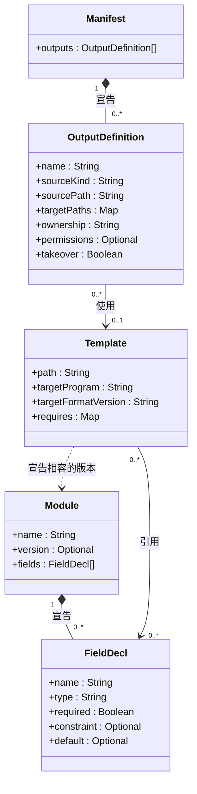
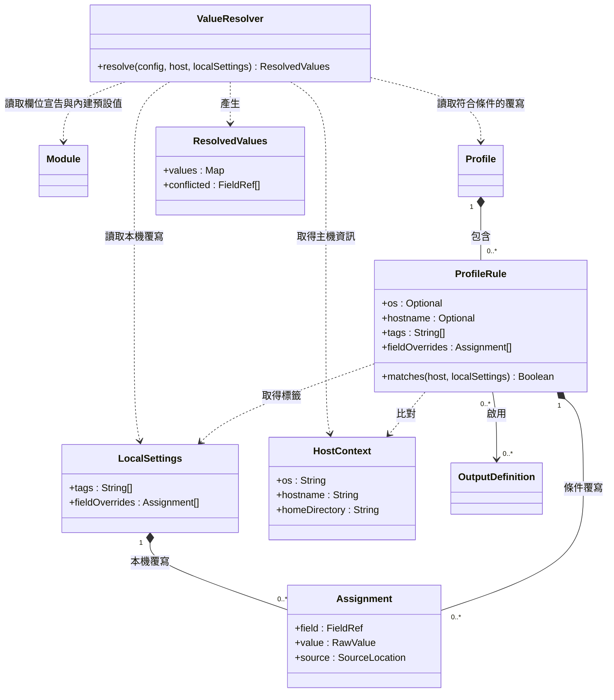
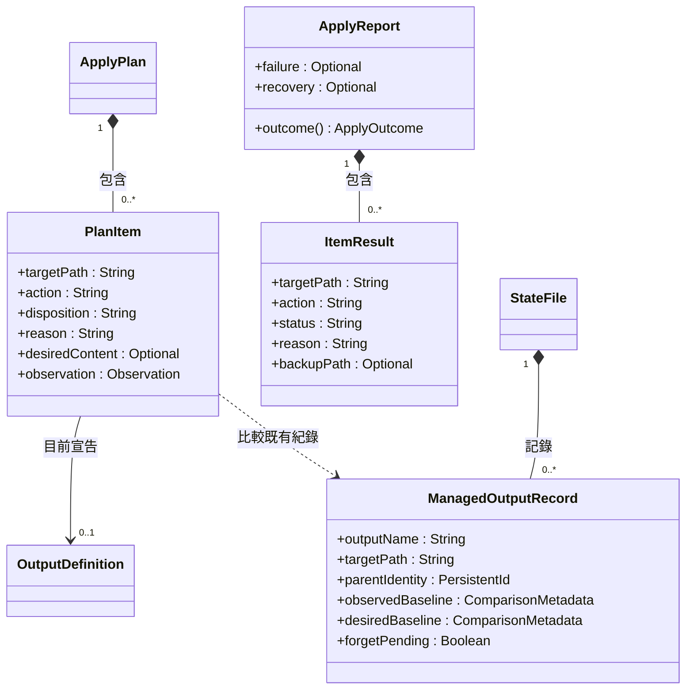
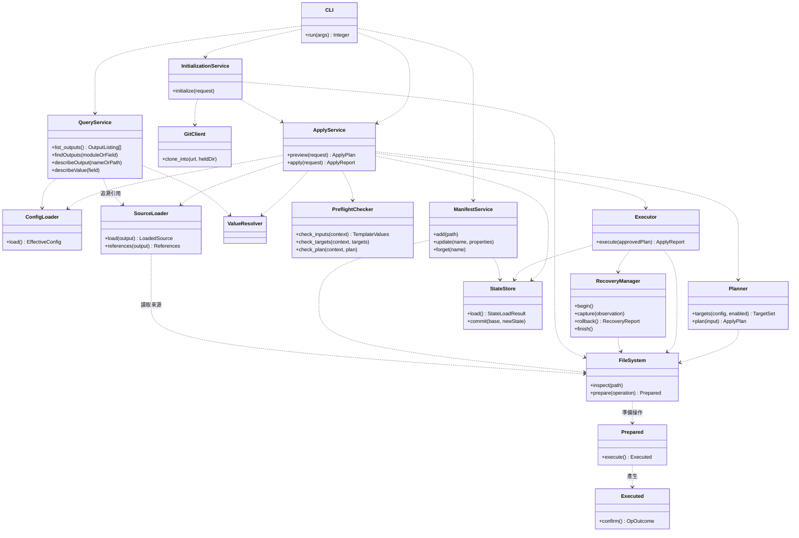
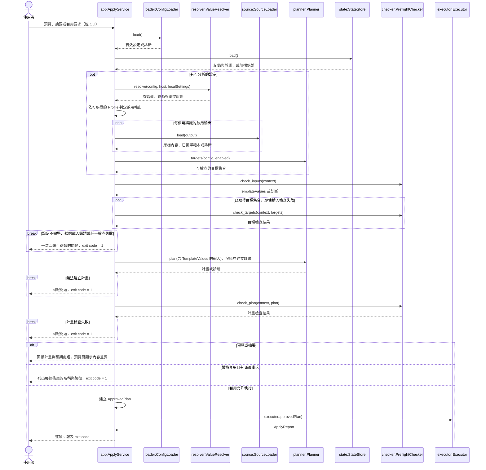
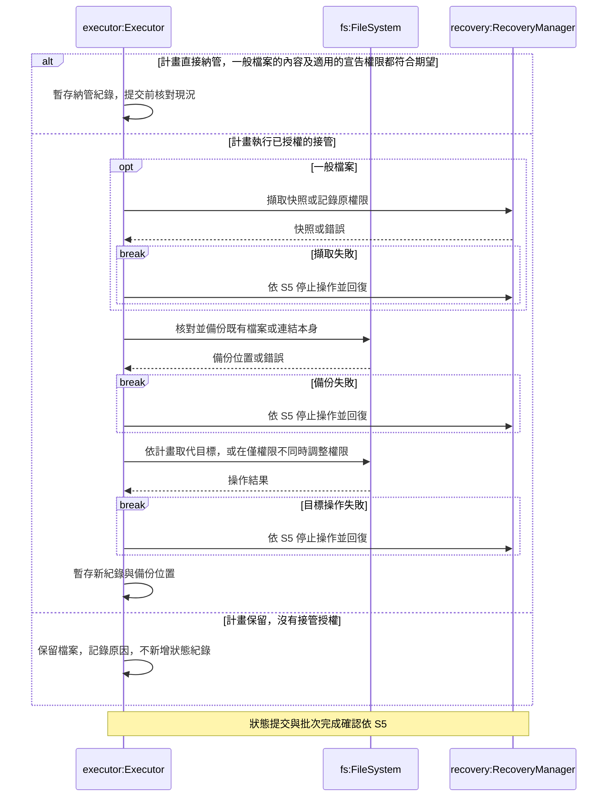
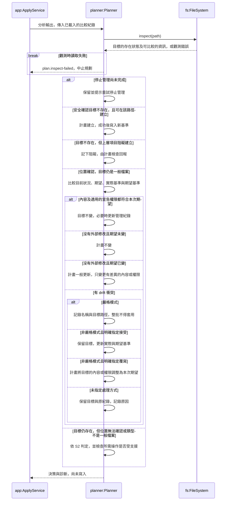
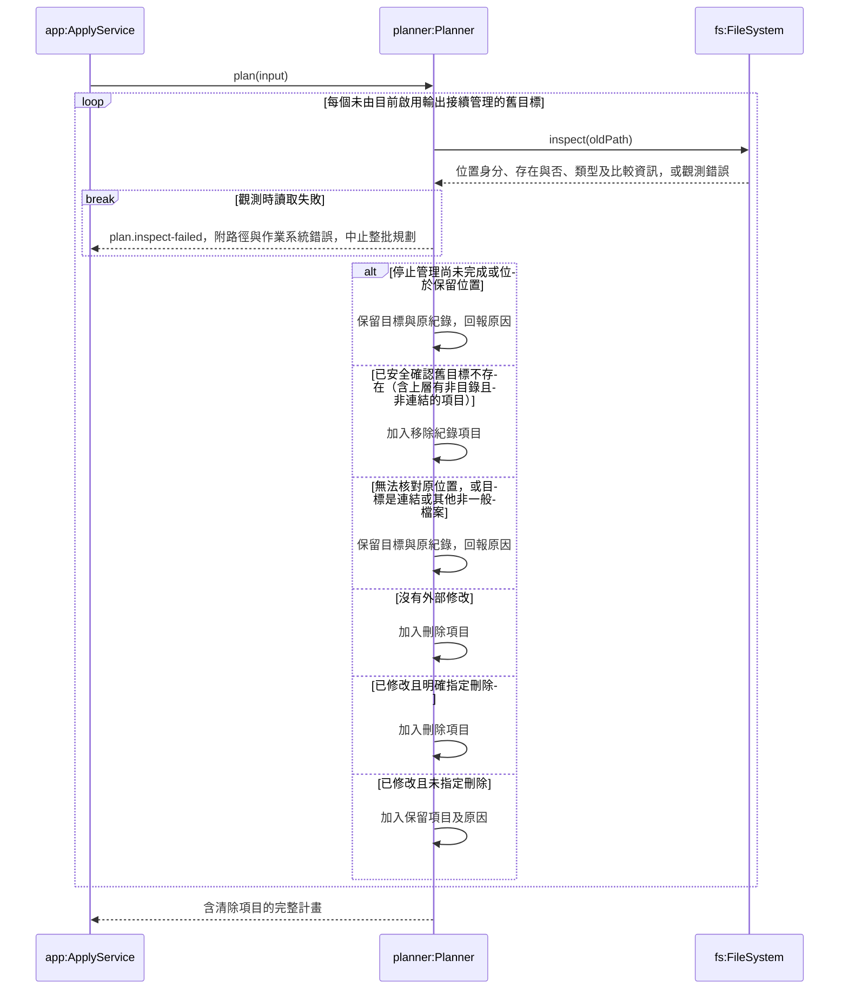
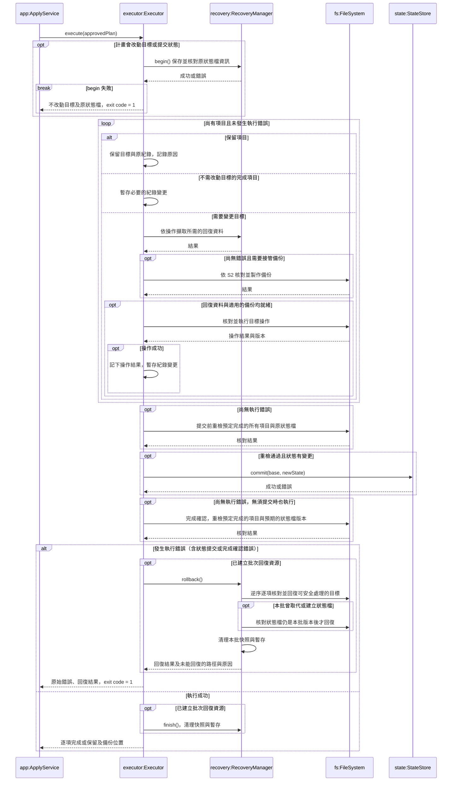
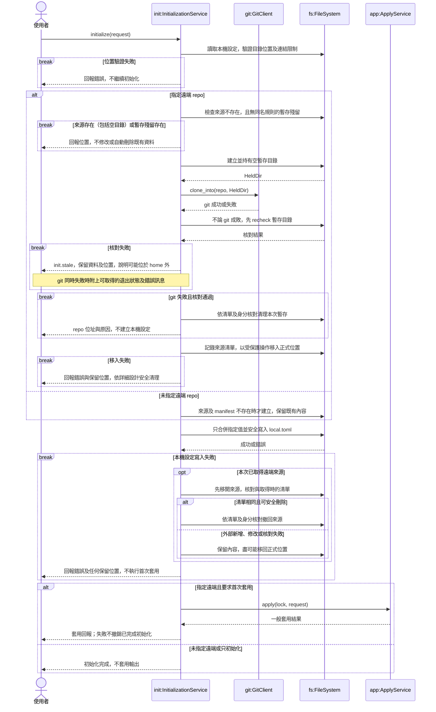

# 初步設計 UML

需求以 [SRS](../02-srs/srs.md) 為準。圖表索引見[初步設計總覽](preliminary-design.md)。

類別圖 C1–C4 描述資料與服務的分工，循序圖 S1–S6 描述主要操作。

第一版依 SRS A.3 延後 12 條需求；互動詢問、依賴檢查、編輯來源內容及指定欄位管理不列入本次流程。其餘 conditional 功能依詳細設計的第一版範圍處理，不再一律視為待定。

## 1. 類別圖 C1：設定資料模型

此圖表示載入並合併後的設定宣告。Manifest 集中宣告輸出，模組宣告欄位。使用者提供的欄位設定值由 C2 的 `Assignment` 表示，後續才解析與驗證。

圖中的 `+` 表示可供其他元件讀取的資訊。詳細設計 §4.2 定義資料型別與封裝方式。

`sourceKind` 區分範本與原樣複製；每個輸出只選其中一種來源。原樣複製必須保留位元組，不經範本處理。權限未宣告時，不變更既有權限；Windows 不套用 POSIX 權限位元。型別、格式與版本相容規則依詳細設計；FR-TPL-004、005 的模組格式相容檢查納入第一版，依賴檢查則依 SRS A.3 延後。

內建範本依 FR-TPL-002 標示目標程式及其設定格式版本。FR-TPL-004、005 另規定模組格式相容性。模組可宣告 `version`，範本可用 `requires` 列出相容的版本。已列在 `requires` 的模組缺少版本或版本不符時，預檢回報錯誤。

範本使用欄位值產生內容。查詢透過範本追溯輸出引用的模組與欄位，包含未啟用的輸出（FR-QRY-004）。Profile 決定各輸出的啟用狀態。

### C1 成員說明

下表的泛型寫法是設計說明，不是選定實作語言。圖內 Map、Optional 等簡寫的具體意義以下表為準。

| 類別／成員 | 型別 | 用途與限制 |
| --- | --- | --- |
| Manifest.outputs | OutputDefinition[] | 合併內建宣告與使用者覆寫後的有效輸出清單；輸出名稱不可重複。 |
| OutputDefinition.name | String | 輸出的唯一名稱，供啟用、查詢及管理操作使用。 |
| OutputDefinition.sourceKind | String | 區分 template（範本）與 verbatim（原樣複製）；這兩個值是設計命名建議。 |
| OutputDefinition.sourcePath | String | 範本或複製來源的位置；來源目錄內的路徑相對於來源目錄解讀，內建資源如何定位留給詳細設計。 |
| OutputDefinition.targetPaths | `Map<Platform, String>` | key 為 Linux、Windows、macOS；value 為該平台尚未展開的目標路徑字串。每個平台最多一個值；不要求每個輸出都有三平台路徑，但啟用時必須有目前平台的路徑。 |
| OutputDefinition.ownership | String | 第一版提供完整管理（預設）及只在不存在時建立（FR-MAN-013）；只管理指定欄位（FR-MAN-014）延後。 |
| OutputDefinition.permissions | `Optional<PermissionBits>` | 可不宣告的 POSIX 權限位元，如 0600；非任意字串。未宣告時不變更既有權限，Windows 不變更 POSIX 權限位元。實際編碼留待詳細設計。 |
| OutputDefinition.takeover | Boolean | 授權先備份再接管不符合期望的未受管理目標。對一般檔案，內容或適用的宣告權限有一項不同，就須取得授權才能改動目標。 |
| Module.name | String | 模組識別名稱，例如 theme、font。 |
| Module.version | `Optional<Integer>` | 模組格式版本，供預檢核對範本的 `requires`。 |
| Module.fields | FieldDecl[] | 模組宣告的欄位集合。 |
| FieldDecl.name | String | 模組內的欄位名稱。完整參照包含模組名稱，例如 `theme.foreground`。 |
| FieldDecl.type | String | 對應 SRS §3.4.1 的欄位型別。 |
| FieldDecl.required | Boolean | 是否必填。缺少必填欄位的最終值時，預檢失敗。 |
| FieldDecl.constraint | `Optional<FieldConstraint>` | 欄位的範圍或格式限制，例如最小值、最大值、色碼格式或列舉選項。 |
| FieldDecl.default | `Optional<FieldValue>` | 內建欄位可宣告符合其型別的預設值，作為 C2 覆寫順序的第一層。 |
| Template.path | String | 範本資源位置；使用者範本可取代特定輸出的內建範本。 |
| Template.targetProgram | String | 範本對應的目標程式名稱；內建範本必填。 |
| Template.targetFormatVersion | String | 目標程式設定格式版本；不同於模組格式相容版本，內建範本必填。 |
| Template.requires | `Map<ModuleName, Integer[]>` | 每個列名模組可接受的格式版本。 |

## 2. 類別圖 C2：Profile 與欄位解析

重複出現的類別僅為跨圖參照。條件內是 AND，同一輸出的多個啟用條件是 OR；未啟用的輸出不產生新的輸出寫入，既有受管理舊檔的清除另依 S4 處理。

解析順序固定為內建預設值 → 使用者模組 → Profile → 本機設定；後者優先，未指定欄位保留低層值。覆寫以整個欄位值為單位，清單與對照表不逐項合併。

只有條件成立的 Profile 規則參與覆寫。同層有多個來源設定同一欄位時，即使值相同，也須回報衝突並列出所有來源，不以檔名或列出順序決定。

`ResolvedValues` 一起保存解析後的原始值及來源，並記錄發生衝突的欄位。`PreflightChecker` 檢查各層設定值的型別、範圍與格式，並檢查必填欄位的最終值。檢查通過才產生供渲染的 `TemplateValues`。

未指定的主機條件不構成限制；作業系統、主機名稱與標籤條件皆未指定時，規則對所有主機成立。

### C2 成員與方法說明

`Platform` 表示 Linux、Windows、macOS；`FieldRef` 表示模組與欄位的識別，例如 `theme.foreground`；`RawValue` 表示尚待預檢驗證的原始值；`Resolved` 同時保存解析後的原始值與來源。

| 類別／成員 | 型別 | 用途 |
| --- | --- | --- |
| Profile | 包含 ProfileRule 的容器 | 保存啟用輸出及覆寫欄位的條件規則。 |
| ProfileRule.os | `Optional<Platform>` | 限制作業系統；未指定則不限制。 |
| ProfileRule.hostname | `Optional<String>` | 限制主機名稱；未指定則不限制，比對時不分 ASCII 大小寫。 |
| ProfileRule.tags | String[] | 主機必須具備的標籤，全部符合才成立。 |
| ProfileRule.fieldOverrides | Assignment[] | 條件成立時提供的 Profile 層設定；保留每筆設定及來源，以偵測同層重複。 |
| HostContext.os | Platform | 目前主機的作業系統。 |
| HostContext.hostname | String | 目前主機名稱。 |
| HostContext.homeDirectory | String | 使用者 home 的絕對路徑，供路徑展開與驗證。 |
| LocalSettings.tags | String[] | 本機指定的標籤，供 Profile 比對。 |
| LocalSettings.fieldOverrides | Assignment[] | 本機設定層的欄位覆寫，優先序最高；保留原始值與來源。 |
| Assignment.field | FieldRef | 被設定的欄位，例如 theme.foreground。 |
| Assignment.value | RawValue | 尚未通過欄位型別檢查的原始值。 |
| Assignment.source | SourceLocation | 設定所在的檔案與位置，供診斷使用。 |
| ResolvedValues.values | `Map<FieldRef, Resolved>` | 每個已解析欄位的原始值及來源；未設定任何值的欄位可不在其中。 |
| ResolvedValues.conflicted | FieldRef[] | 發生同層重複設定的欄位，供預檢辨識衝突。 |

`Resolved` 的來源資訊包含覆寫層級、來源位置，以及適用時的 Profile 規則識別；具體結構以詳細設計為準。

| 方法 | 參數 | 回傳與用途 |
| --- | --- | --- |
| ProfileRule.matches(host, localSettings) | `host: HostContext`；`localSettings: LocalSettings` | 回傳 Boolean，比對作業系統、主機名稱及本機標籤，判斷條件是否成立。 |
| ValueResolver.resolve(config, host, localSettings) | `config: EffectiveConfig`，包含欄位宣告、內建預設值、使用者模組設定及 Profile；`host: HostContext`；`localSettings: LocalSettings` | 回傳 ResolvedValues，依四層優先序解析原始值並保留來源；同層重複設定時記錄衝突並回報診斷，不在此進行型別驗證。 |

圖中的方法為概念摘要，省略診斷參數；實際簽名與資料結構以詳細設計為準。

## 3. 類別圖 C3：套用資料模型

本圖區分規劃、執行結果與持久化狀態：ApplyPlan 描述本次準備執行的工作，ApplyReport 記錄實際結果，StateFile 保存下次比較所需的管理紀錄。類別與成員名稱為概念摘要，實際結構以詳細設計為準。

`action` 為建立、更新、刪除或不變；`disposition` 表示執行、接管、接受、覆寫或保留等處理決策。兩者分開表示，例如接受 drift 時，可以不改動目標內容，但仍更新管理紀錄。

`desiredContent` 保存本次渲染或讀取的期望內容及比較資訊，供 Executor 執行；清除項目可沒有期望內容。`observation` 保存規劃時的目標與父路徑觀測資料，執行時必須重新核對，不能因為預檢通過就假設目標沒有被外部程式修改。執行期的輸出原文不得序列化進狀態檔。

兩份 baseline 的責任已由詳細設計具體化：observedBaseline 用於偵測目標後續的外部修改，desiredBaseline 用於判斷來源產生的期望內容是否改變。它們只存比較用中繼資料，不存輸出原文。這個分工支援「接受 drift 後，來源未改時不立刻覆寫；來源改變且目標未再被外部修改時，依一般更新處理」。

ComparisonMetadata 是值型別，記錄內容指紋及適用的宣告權限，不是檔案原文。未宣告的權限及 Windows 的 POSIX 權限位元不得納入 drift 判斷。接受時 observedBaseline 記錄目前實際內容的比較資訊，desiredBaseline 記錄本次來源產生的期望內容比較資訊，兩者可以不同。

目標內容已符合期望時，不重寫內容；若仍有已宣告且適用於目前平台的權限變更，仍須完成該變更，才能將項目記為完成。必要時更新狀態紀錄。

狀態紀錄除了目標路徑，也保存父目錄身分。相同路徑字串或相同內容，不足以證明仍是原受管理的位置；位置核對及無法確認時的處理依詳細設計。`forgetPending` 表示停止管理尚未完成，套用時保留相關目標並提示使用者重新執行停止管理，避免中途停止後誤將它清除或接管。

正常結束的逐項狀態為完成或保留；發生執行錯誤時，另區分失敗、已回復、未能回復及尚未執行。已回復的項目不得仍列為完成，原始執行錯誤與回復失敗須分別回報。

### C3 成員說明

| 類別／成員 | 型別 | 用途 |
| --- | --- | --- |
| ApplyPlan | 包含 PlanItem 的容器 | 保存本次套用的完整計畫；圖中以組合關係表示。 |
| PlanItem.targetPath | String | 本項目解析後的目標路徑。 |
| PlanItem.action | String | 建立、更新、刪除或不變。 |
| PlanItem.disposition | String | 本次處理決策，例如執行、接管、接受、覆寫或保留；與目標動作分開。 |
| PlanItem.reason | String | 處理決策的原因；保留項目必須說明原因。 |
| PlanItem.desiredContent | `Optional<DesiredContent>` | 本次期望內容及比較資訊；清除項目可沒有期望內容，輸出原文不寫入狀態檔。 |
| PlanItem.observation | Observation | 規劃時取得的目標與父路徑觀測資料，供執行時核對。 |
| ApplyReport.failure | `Optional<ExecutionError>` | 使批次停止的第一個執行錯誤，包含相關路徑及原因。 |
| ApplyReport.recovery | `Optional<RecoveryReport>` | 回復結果，包含所有未能回復的路徑與原因。 |
| ApplyReport.outcome() | ApplyOutcome | 批次結果。CLI 依 S5 的規則轉為 exit code。 |
| ItemResult.targetPath | String | 回報項目的目標路徑。 |
| ItemResult.action | String | 該項目的建立、更新、刪除或不變動作。 |
| ItemResult.status | String | 完成、保留、失敗、已回復、未能回復或尚未執行；不得把已回復項目列為完成。 |
| ItemResult.reason | String | 保留原因；完成項目可使用空字串。執行錯誤與回復失敗的原因另由批次回報提供。 |
| ItemResult.backupPath | `Optional<String>` | 接管時產生的備份位置；沒有備份時為空。 |
| StateFile | 包含 ManagedOutputRecord 的容器 | 保存受管理輸出的紀錄，不保存輸出原文。 |
| ManagedOutputRecord.outputName | String | 受管理輸出的識別名稱。 |
| ManagedOutputRecord.targetPath | String | 已記錄的實際目標路徑，供 drift 判斷與舊輸出清除。 |
| ManagedOutputRecord.parentIdentity | PersistentId | 父目錄的持久身分資訊，協助核對原受管理的位置。 |
| ManagedOutputRecord.observedBaseline | ComparisonMetadata | 上次記錄的實際目標比較資訊，用於偵測後續外部修改。 |
| ManagedOutputRecord.desiredBaseline | ComparisonMetadata | 上次處理時的期望內容比較資訊，用於判斷來源是否改變。 |
| ManagedOutputRecord.forgetPending | Boolean | 停止管理尚未完成的標記；套用時保留相關目標，提示使用者重新執行停止管理。 |

`DesiredContent` 為執行期的期望內容與比較資訊；`Observation` 為檔案系統觀測資料；`PersistentId` 為位置身分資訊。`ExecutionError`、`RecoveryFailure` 是錯誤描述資料，`ComparisonMetadata` 是不含輸出原文的比較資料。具體結構以詳細設計為準。

`ApplyReport` 透過組合關係包含逐項的 `ItemResult`。計畫產生、執行及狀態儲存由 C4 的服務負責。

## 4. 類別圖 C4：服務責任

服務皆為同一 CLI 程式內部的邏輯分工，不表示常駐服務或網路服務。此圖只列主要依賴。

ConfigLoader 必須保留診斷來源位置；無法解析的設定可直接回傳診斷，不能假設一定能先建立完整計畫。寫回 manifest 等使用者文件時，ManifestService 必須保留註解與格式。停止管理除了移除宣告，也要移除狀態紀錄，才能避免下次清除目標檔。

`StateLoadResult` 將狀態檔不存在視為載入空紀錄，並保留檔案不存在的觀測。不可讀、損毀或較新版本的狀態檔均阻擋操作，保留原狀態檔。方法簽名列出主要資料與成功結果，診斷可附來源位置。

### C4 方法與參數說明

本圖只列方法，未列服務內部屬性。方法簽名以正常結果為概念摘要，省略鎖定、診斷等參數；執行失敗時須回報錯誤。實際簽名與錯誤表示方式以詳細設計為準。

| 類別／方法 | 參數 | 回傳與用途 |
| --- | --- | --- |
| CLI.run(args) | `args: String[]`，命令列參數 | 回傳 `Integer` exit code；解析子指令與選項，呼叫對應服務並顯示結果。 |
| ApplyService.preview(request) | `request: ApplyRequest`，包含預覽與衝突處理選項 | 回傳 `ApplyPlan`；協調設定載入、值解析、預檢與規劃，不寫入目標或狀態檔。 |
| ApplyService.apply(request) | `request: ApplyRequest`，包含套用模式及衝突處理選項 | 回傳 `ApplyReport`；在持有寫入鎖後重新分析與產生計畫，不重用先前預覽的計畫；整批預檢與模式檢查通過後才交由 Executor 執行。 |
| ConfigLoader.load() | 無顯式參數；來源位置由初始化紀錄及執行環境取得 | 成功時回傳 `EffectiveConfig`；載入來源設定與內建資源，合併輸出覆寫並保留診斷來源位置。 |
| SourceLoader.load(output) | `output: OutputDefinition` | 讀取原樣來源，或讀取並編譯範本。輸入及目標檢查通過後才渲染。 |
| SourceLoader.references(output) | `output: OutputDefinition` | 取得範本的靜態引用。原樣複製的輸出沒有欄位引用。 |
| Planner.targets(config, enabled) | `config: EffectiveConfig` 與 Profile 判定的啟用輸出 | 取得可檢查的目標集合 `TargetSet`，不必先渲染範本。 |
| Planner.plan(input) | 輸入包含 `TemplateValues`、載入的來源、已檢查的目標、狀態及處理選項 | 回傳 `ApplyPlan`，包含期望內容、動作、衝突與清除項目。此階段唯讀。 |
| PreflightChecker.check_inputs(context) | `context: AnalysisContext`，包含目前可取得的設定、解析值、來源、主機資訊與狀態載入結果 | 檢查欄位、必填、範本引用與格式相容性等輸入。成功時回傳 `TemplateValues`。 |
| PreflightChecker.check_targets(context, targets) | `AnalysisContext` 與 `TargetSet` | 檢查目標碰撞、保留位置及路徑錯誤。即使輸入檢查失敗，仍檢查已取得的目標。 |
| PreflightChecker.check_plan(context, plan) | `AnalysisContext` 與 `ApplyPlan` | 確認計畫要求的操作可執行，例如要接管的檔案類型受支援。 |
| Executor.execute(approvedPlan) | `approvedPlan: ApprovedPlan`，已通過預檢與模式檢查的計畫 | 回傳 `ApplyReport`。執行計畫並提交狀態，發生執行錯誤時協調整批回復。 |
| RecoveryManager.begin() | 無顯式參數；使用本批次上下文 | 建立回復上下文並保存原狀態檔資訊；失敗時不得開始變更目標。 |
| RecoveryManager.capture(observation) | `observation: Observation`，規劃時取得的目標觀測 | 核對並保存本次操作需要的快照或權限資訊。擷取失敗時停止操作。 |
| RecoveryManager.rollback() | 無顯式參數；使用已保存的批次快照 | 回傳 `RecoveryReport`；恢復本批受影響的目標與狀態檔，列出所有未能恢復的路徑與原因。 |
| RecoveryManager.finish() | 無顯式參數；使用目前批次上下文 | 結束成功批次並清理回復暫存資源。暫存清理問題與套用結果分開回報。 |
| StateStore.load() | 無顯式參數；使用已設定的狀態檔位置 | 回傳 `StateLoadResult`，包含狀態內容與觀測，或阻擋錯誤。 |
| StateStore.commit(base, newState) | 載入的基準狀態與待提交的新狀態 | 核對基準後原子提交。程序中止時，狀態檔維持完整舊內容或完整新內容。 |
| FileSystem.inspect(path) | `path: String`，待檢查路徑 | 成功時回傳 `FileInspection`，包含存在與否、內容及屬性資訊；讀取錯誤不可當成檔案不存在。 |
| FileSystem.prepare(operation) | 一項檔案操作及預期的觀測 | 核對位置及檔案後準備操作。建立、取代、備份及擷取快照都使用這項操作契約。 |
| Prepared.execute() | 使用已核對的位置 | 執行已準備的操作，回傳待確認的結果。 |
| Executed.confirm() | 使用操作結果 | 再核對路徑與結果。確認失敗時依詳細設計 §6.3 處理。 |
| InitializationService.initialize(request) | `request: InitializationRequest`，包含遠端來源、具名本機值及適用的初始化選項 | 回傳 `InitializationResult`；準備來源、建立或合併本機設定、記錄來源位置，並依選項執行首次套用。 |
| GitClient.clone_into(url, heldDir) | `url: String`；`heldDir: HeldDir`，由初始化服務經 FileSystem 建立並持有的空暫存目錄 | 僅執行 git，不自行配置或清理暫存目錄；初始化服務負責 clone 後核對、移入及失敗處理（詳細設計 §4.16）。 |
| ManifestService.add(path) | `path: String`，home 內既有檔案路徑 | 回傳 `OperationResult`；複製檔案到來源目錄並新增原樣複製輸出，不刪除原目標檔。 |
| ManifestService.update(name, properties) | `name: String`，輸出名稱；`properties: OutputPropertyPatch`，指定要修改的屬性 | 回傳 `OperationResult`；只更新指定屬性，保留其他內容、註解及格式。 |
| ManifestService.forget(name) | `name: String`，輸出名稱 | 回傳 `OperationResult`；移除輸出宣告及其狀態紀錄，不刪除或修改目標檔。 |
| QueryService.list_outputs() | 無顯式參數；使用有效設定 | 列出所有輸出的屬性、當前平台路徑及啟用狀態，包含內建、未啟用及已移除的內建輸出。 |
| QueryService.findOutputs(moduleOrField) | `moduleOrField: ModuleRef 或 FieldRef` | 列出引用該模組或欄位的輸出，包含未啟用者。無法判定的輸出另列並回報錯誤。 |
| QueryService.describeOutput(nameOrPath) | `nameOrPath: String`，輸出名稱或目標路徑 | 說明符合條件的輸出、範本或複製來源，以及透過範本追溯的模組與欄位。 |
| QueryService.describeValue(field) | `field: FieldRef`，模組與欄位的識別 | 回傳 `ResolvedValueDescription`，包含最終值、來源層級及來源檔案。 |

ValueResolver 的方法與參數已於 C2 說明；此圖只參照該類別，不重複列出。

### C4 資料型別說明

以下為服務間傳遞的概念資料，不代表新增設定檔格式；具體欄位結構於詳細設計時決定。

| 型別 | 說明 |
| --- | --- |
| EffectiveConfig | 合併後的有效設定，包含輸出宣告、模組、使用者模組的設定值與 Profile。輸出宣告指出來源，由 SourceLoader 讀取。 |
| ApplyRequest | 本次預覽或套用的選項；只包含第一版交付範圍，不提供延後的互動詢問。 |
| AnalysisContext | 可取得的設定、解析值、主機資訊、狀態載入結果及累積診斷。 |
| TargetSet | 可取得的啟用輸出目標及保留位置，供渲染前的路徑檢查。 |
| TemplateValues | `check_inputs` 通過後產生，供 Planner 渲染範本。 |
| ApprovedPlan | `ApplyService` 在整批預檢與模式檢查通過後建立，供 Executor 執行。 |
| Diagnostics | 檢查問題集合，提供來源位置、原因與可用的修正提示。 |
| StateLoadResult | 狀態載入結果，區分成功、不存在與阻擋錯誤。 |
| FileInspection | 檔案存在與否、內容比較所需資料及適用屬性。 |
| RecoveryReport | 整批回復結果，以及未能恢復的路徑與原因。 |
| InitializationRequest | 初始化輸入，包括來源及具名本機設定。 |
| InitializationResult | 初始化結果、錯誤，以及有執行首次套用時的套用回報。 |
| OutputPropertyPatch | 只包含本次指定修改的輸出屬性；未指定的屬性保持原值。 |
| OperationResult | 管理操作的成功結果或錯誤資訊。 |
| OutputSummary | 輸出名稱、目前平台目標路徑與啟用狀態等查詢摘要。 |
| OutputDescription | 輸出來源及引用的模組、欄位資訊。 |
| ResolvedValueDescription | 最終欄位值與其來源描述。 |

`Executor` 使用 `PlanItem` 中已確認的期望內容執行，操作時核對觀測，詳見詳細設計 §4.12、§4.14。

## 5. 循序圖 S1：預覽與套用入口

套用在載入設定前取得寫入鎖，預覽及摘要維持唯讀。三者各自重建計畫。在來源、本機設定、目標現況、狀態、主機資訊與會影響計畫的選項相同時，預覽與套用產生相同的項目和動作（FR-PLN-006）。

預檢依序檢查輸入、目標及完整計畫。前兩階段各自使用能取得的資料，同一次可回報欄位錯誤、manifest 屬性錯誤與目標碰撞（USE-004）。兩階段都通過才渲染及建立計畫。輸出與狀態檔的寫入要等到所有檢查通過。

預覽不執行使用者定義的外部命令。狀態檔不存在時以空紀錄規劃，不產生舊檔清除項目。狀態檔不可讀、損毀或由較新版本寫入時，預檢失敗。嚴格模式的 drift 衝突在預覽中標示，實際套用才整批阻擋。寫入鎖協調 rosamta 的寫入指令，外部變更另由 S5 的操作核對處理。

## 6. 循序圖 S2：未受管理檔案的接管

本圖描述完整管理輸出的既有目標，且沒有管理紀錄或無法確認紀錄位置。處理方式由 `Planner` 決定，`Executor` 在整批預檢及模式檢查通過後依計畫操作。符號連結只比對類型，接管時備份並替換連結本身。預檢阻擋必須操作但類型不受支援的目標。未授權接管的非一般檔案只檢查類型，保留現況。

互動接管（FR-MAN-022）延後；第一版依設定清單中的明確接管宣告處理，不詢問使用者。接管備份與回復快照用途不同，不應混為同一個生命週期。

一般檔案內容相同但適用的宣告權限不同時，也要先取得接管授權、保存原權限及完成備份，才只變更權限。未授權時保留檔案。直接納管不改動目標，該檔案停用或移除後仍依 S4 處理（FR-MAN-021）。符號連結接管時以備份的連結供回復。

## 7. 循序圖 S3：受管理輸出的 drift 決策

本圖描述完整管理輸出的規劃。安全確認目標不存在且可在該路徑建立時，規劃建立。若路徑上的非目錄項目阻礙建立，依 S1 的計畫檢查阻擋。目標仍存在時，須先核對原位置與類型。位置無法確認或目標不是一般檔案時，依 S2 判定。若紀錄標示停止管理尚未完成，保留該項並提示重試（S4）。

比較目前狀況與期望時，檢查內容與本次適用的宣告權限。偵測外部修改時，檢查內容與實際基準所記錄的權限。Windows 不比較 POSIX 權限。

嚴格模式優先：即使同時指定接受或覆寫，只要有 drift 衝突，就不寫入任何輸出與狀態檔。這是已確認的規則，不再列為設計提案。

接受只更新狀態紀錄，執行成功時記為完成。實際基準記錄目前狀況，期望基準記錄本次期望，兩者只保存比較資訊。接受後若期望改變而目標未再被外部修改，依一般更新處理（FR-DRF-008）。FR-DRF-010、011 的互動流程延後。

所有分支只產生計畫；實際操作仍須通過整批預檢、重新核對及 S5 的執行流程。

## 8. 循序圖 S4：清除舊輸出

此圖只產生清除計畫。舊目標是已移除、已停用或已改路徑的受管理輸出。先依位置鍵將狀態紀錄與目前啟用的輸出配對。同一位置由新名稱接續管理時，沿用紀錄並依 S3 判定。完成的項目改記新名稱，保留的項目維持舊名稱。這類項目不列入清除計畫（詳細設計 §12.1）。

觀測時讀取失敗，規劃器回報 `plan.inspect-failed`，附上路徑與作業系統錯誤。依 S1 的「無法建立計畫」分支回傳 `1`，整批不寫入輸出或狀態檔（詳細設計 §4.12）。

安全確認舊目標不存在且沒有其他保留條件時，只移除紀錄並記完成（FR-DRF-015）。這包括目標或父目錄確定不存在，以及上層路徑中有一層是非目錄、非連結的項目（`Missing { blocker }`，詳細設計 §4.10、§5.11）。若父路徑含連結、現存父目錄身分與紀錄不符，或舊目標本身是連結或其他非一般檔案，保留原紀錄並回報原因。

檢查通過後依 S5 執行，Executor 不參與本圖的計畫階段。刪除時同步移除紀錄；保留時檔案與原紀錄都不變。第一版納入明確刪除已修改舊檔（FR-DRF-014）；未指定時保留，不提供互動詢問（FR-DRF-017 延後）。手動從 manifest 移除、停用、改目標路徑，都可能產生清除項目；「停止管理」指令則移除狀態紀錄並保留檔案，後續不清除它。

## 9. 循序圖 S5：執行與整批回復

套用持有寫入鎖，並已通過預檢及模式檢查。一般檔案的回復快照使用副本。圖中的目標操作依詳細設計 §4.10、§6.3 的 `prepare`、`execute`、`confirm` 契約核對位置與版本。

提交前重檢包含不變及只更新紀錄的項目。確認完成時也重新核對這些項目，並檢查狀態檔仍是本批寫入的版本，或在沒有提交時仍是首次載入的版本。任一項核對失敗就停止並按已執行的操作回復。若已建立回復資源，即使尚未改動目標也要清理本批暫存。因 drift 或未取得接管授權而保留的項目，按正常逐項結果回報。

輸出與狀態檔先寫好暫存內容，再以平台支援的原子替換提交。程序中止時，單一檔案只會有完整舊內容或完整新內容（REL-001、REL-002）。若外部修改使某個目標或狀態檔無法安全回復，保留該位置的現況，列出路徑及原因，並繼續回復其他可安全處理的項目。

全數完成或空計畫回傳 `0`，完成與保留並存回傳 `2`，只有保留或發生執行錯誤回傳 `1`。不變的項目算完成。嚴格模式若沒有 drift 衝突，也按這組規則計算（FR-APL-006–008）。

## 10. 循序圖 S6：新機器初始化

初始化持有寫入鎖。一般批次暫存依詳細設計 §6.5 處理，來源旁殘留的初始化暫存項目由使用者確認。既有本機設定只合併本次明確指定的值，保留其他值、註解與格式。標籤加到既有清單。

clone 成功或失敗都先核對暫存路徑。核對不符時保留檔案，並回報暫存目錄原先的位置。本機設定寫入失敗時，依來源清單及檔案身分安全撤回。若資料須保留，回報實際保留位置，並停止首次套用。已完成初始化後才發生的套用錯誤，依一般套用回報。

**DC-002 的適用限制**：Linux／macOS 在 clone 前後的目錄搬移或替換可能讓 git 寫入 home 外；路徑在 recheck 時仍改變才會被發現，若先被還原則無法發現。其他受保護操作也存在詳細設計所列的檢查空窗，不宣稱所有平台都絕不短暫寫出 home 或一定能移除外部殘留。Windows 依持有各層目錄的設計限制替換。撤回的時間與內容比較仍有平台差異及逐項刪除空窗，詳見 SRS §3.5、詳細設計 §4.16、§6.3、§12.3。

## 11. 需求追溯與審查重點

| 圖 | 主要需求 | 審查重點 |
| --- | --- | --- |
| C1 | FR-MOD-001–004、FR-TPL-002、FR-TPL-004–006、FR-MAN-001–013、FR-MAN-015–016 | 模組欄位與輸出分開宣告，支援平台目標、格式版本相容性與原樣複製 |
| C2 | FR-PRF-001–013 | AND／OR、四層覆寫、同層衝突、值來源追溯 |
| C3 | FR-APL-001–009、FR-DRF-001–008、SEC-001 | 計畫與結果分開；狀態不存原文；接受不立即被覆寫 |
| C4 | FR-MAN-023–026、FR-MAN-028–030、FR-QRY-001–006 及主要套用需求 | 各服務責任，設定格式保留、輸出清單與引用查詢 |
| S1 | FR-PLN-001–010、FR-DRF-009、USE-004 | 整批預檢；預覽不寫入；嚴格模式不寫入 |
| S2 | FR-MAN-018–021、FR-MAN-015；FR-MAN-022 延後 | 內容與適用的宣告權限都符合才直接納管；接管先備份；未獲授權則保留 |
| S3 | FR-DRF-001–009、B-17；FR-DRF-010、011 延後 | 三種處理、接受只更新狀態、嚴格模式 |
| S4 | FR-DRF-012–016、FR-MAN-025；FR-DRF-017 延後 | 修改過的舊檔保留；停止管理與清除不同 |
| S5 | FR-APL-001–009、REL-001–002 | 寫入、刪除、權限與狀態皆可回復；正確 exit code |
| S6 | FR-INI-001–006、008–011、IF-013、DC-002；FR-INI-007 延後 | 不指定遠端只初始化；clone 後先核對；安全清理與首次套用分開 |

SRS A.4 列出第一版 140 條需求對應的測試案例。12 條延後需求與原因見 SRS A.3。IF-001 的子指令涵蓋第一版交付的操作。

## 12. 與詳細設計的對照及審查案例

### 嚴格模式與 exit code

嚴格模式只要發現 drift 衝突就整批停止。若只有未接管等保留項目，仍按完成與保留的項目數決定 exit code。見詳細設計 §4.15、§9.7。

### 接管備份與回復快照

接管備份供使用者取回原檔，結果列出備份位置。回復快照供本批失敗時使用，批次結束後清理。見詳細設計 §4.14、§5.12、§6.5。

### 兩份比較基準

核對接受後重跑、只有期望改變及目標再次被修改三種情境。見詳細設計 §5.10、§5.11。

### 並行與外部修改

核對寫入鎖、操作前後的路徑與版本檢查、提交前重檢與完成確認。回復前也須確認目標或狀態仍是本批版本。見詳細設計 §4.10、§6.3、§6.6、§6.7。

### 路徑安全

核對三平台的路徑限制及搬移、替換、檢查前已還原的偵測範圍。見 SRS §3.5 的 DC-002 及詳細設計 §12.3。

### 停止管理與同位置新輸出

核對停止管理成功及中途停止時均保留目標，以及已移除的內建輸出不會重新啟用。同一位置改名的行為見詳細設計 §12.1。

### 初始化失敗處理

核對既有來源、暫存殘留、clone 後的路徑檢查、本機設定寫入失敗時的撤回，以及首次套用失敗時保留已完成的初始化。見詳細設計 §4.16。
