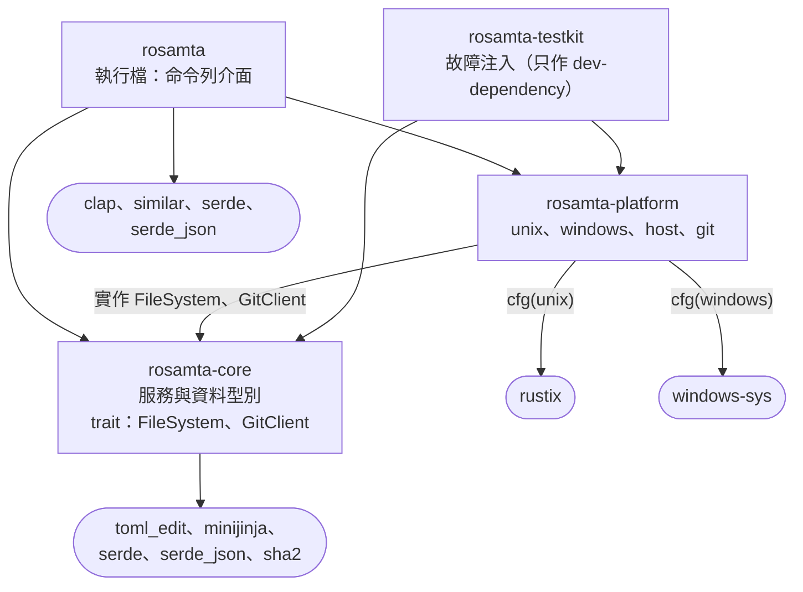
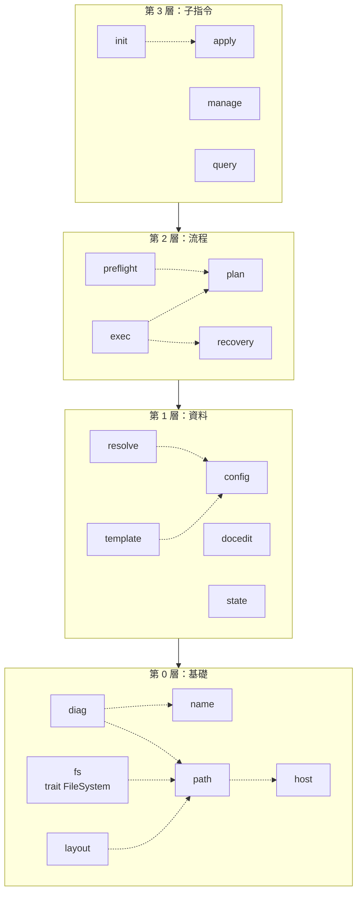
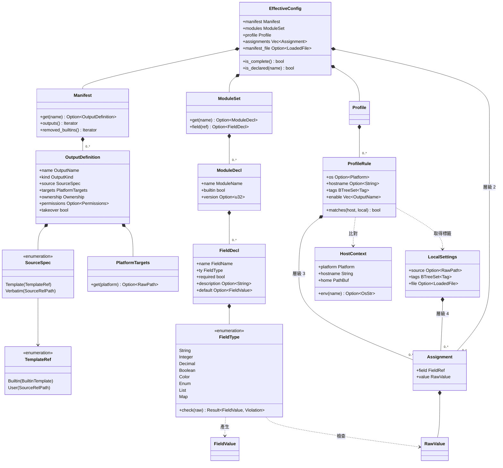
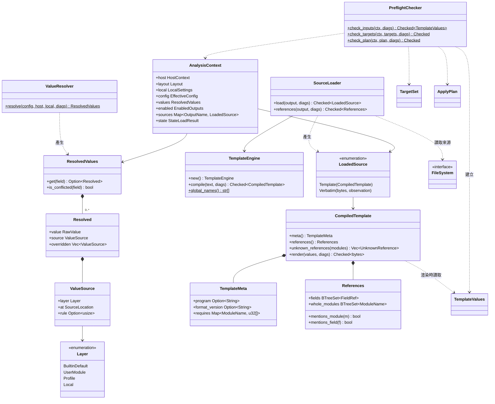
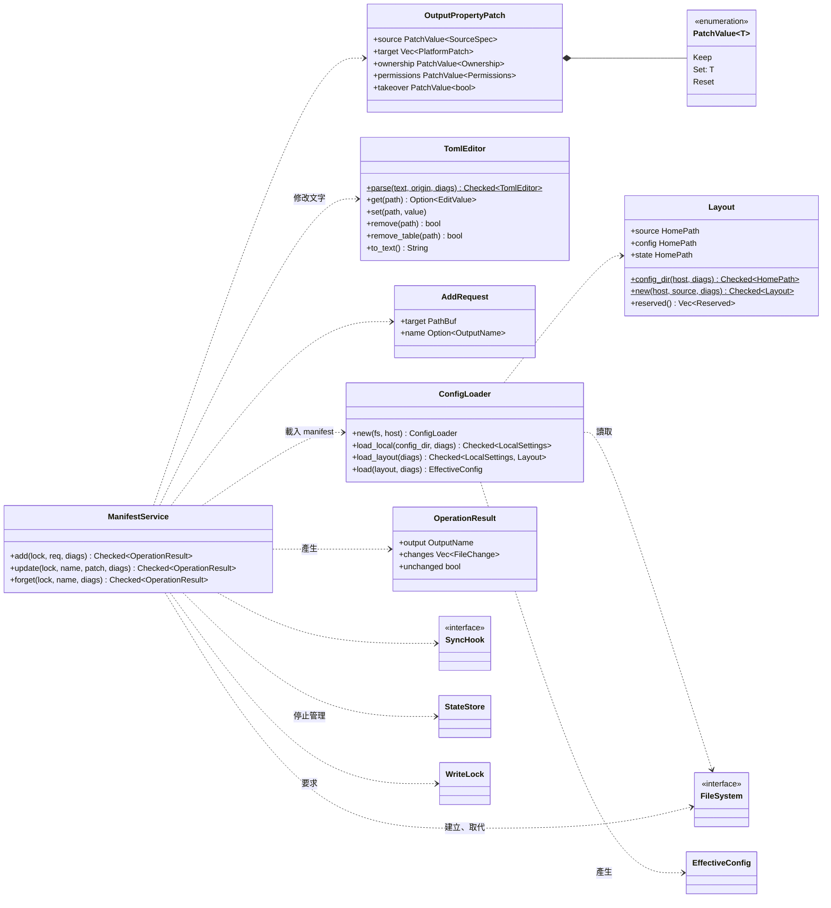
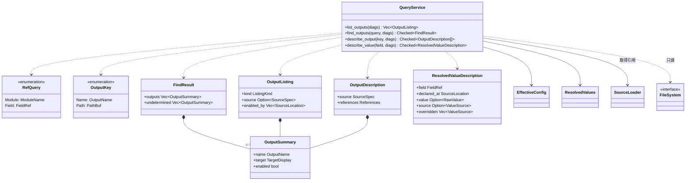
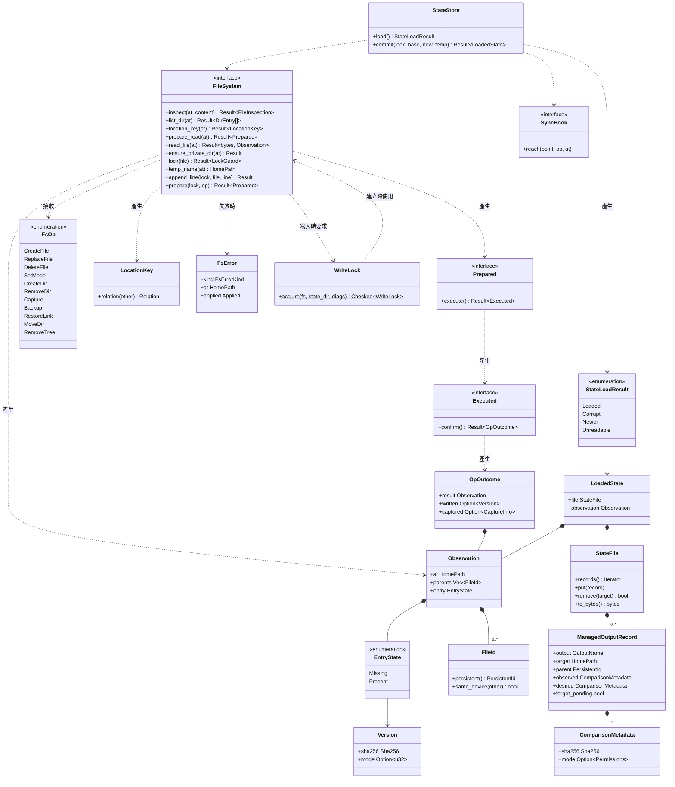
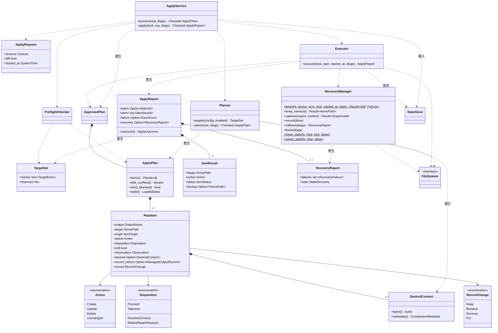
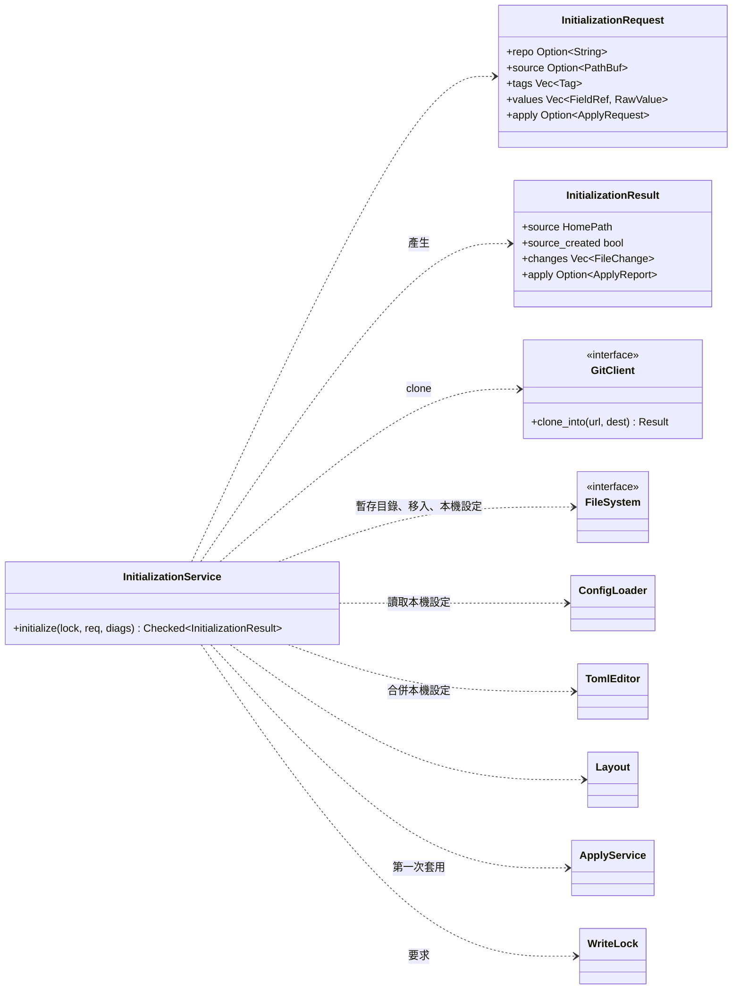
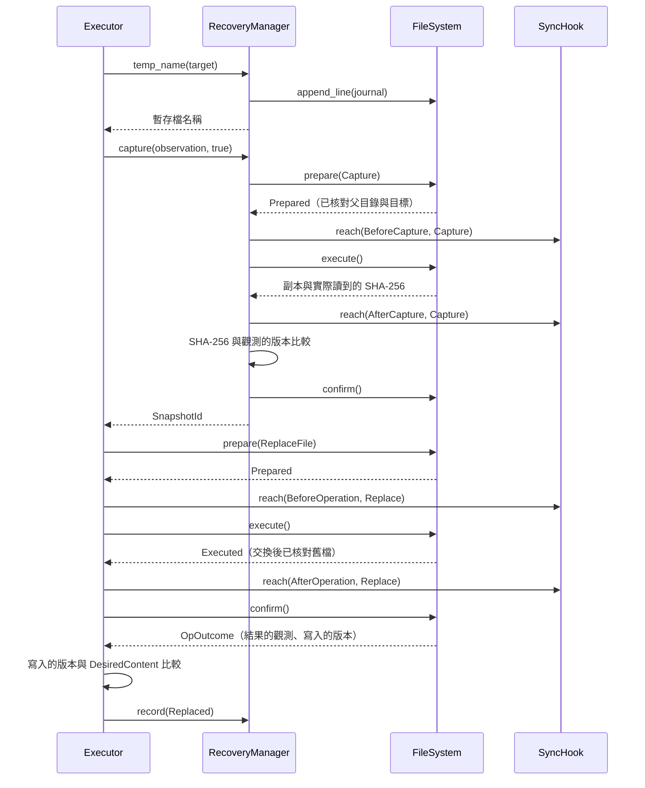

# 詳細設計 UML

本文件放[詳細設計](detailed-design.md)的圖，文字說明以 detailed-design.md 為準。圖以 Mermaid 11 撰寫；Mermaid 沒有套件圖，以 flowchart 表示，箭頭由依賴的一方指向被依賴的一方。

## 1. 套件圖 P1：crate

對應 §3.1。`rosamta-platform` 到 `rosamta-core` 的箭頭同時表示實作 core 定義的 trait。`rosamta-testkit` 只供測試使用，哪些測試使用它見 §8。

## 2. 套件圖 P2：core 的 module 分層

對應 §3.2。每個方框是一層，箭頭表示上層可以依賴下層。同層之間允許的依賴以虛線畫出，其餘同層依賴都不允許；每個 module 可依賴的完整清單見 §3.2 的表格。

層與層的箭頭表示可以依賴任何較低的層，例如第 3 層的 `manage` 直接使用第 1 層的 `docedit`。`name`、`host`、`path` 以外的 module 都使用 `diag`，這類依賴不逐一畫出；這三個 module 不使用 `diag`，因為 `diag` 的來源位置要用到名稱與路徑，反過來會形成循環。

## 3. 詳細類別圖 D1：設定資料型別

對應 §4.2，細化 03 的 C1、C2。圖中省略 `Located` 的包裝與 `SourceLocation` 欄位；enum 以 `<<enumeration>>` 標示，成員是它的變體。`FieldType::check` 是欄位值從 `RawValue` 轉成 `FieldValue` 的唯一途徑。

## 4. 詳細類別圖 D2：值的解析、範本與預檢

對應 §4.4–§4.6。`TemplateValues` 只由 `PreflightChecker.check_inputs` 建立，`CompiledTemplate.render` 只接受它，未通過檢查的值因此無法進入範本。`TargetSet`、`ApplyPlan`、`StateLoadResult` 與 `FileSystem` 在 §4.10–§4.12 定義（D5、D6），這裡只畫出依賴。

## 5. 詳細類別圖 D3：設定載入與管理

對應 §4.3、§4.7、§4.8。`WriteLock` 只能由取得鎖定的函式建立，`ManifestService` 的每個方法都要求它。`StateStore`、`WriteLock`、`SyncHook` 與 `FileSystem` 在 §4.10、§4.11 定義（D5）。

## 6. 詳細類別圖 D4：查詢

對應 §4.9。`QueryService` 只使用 `FileSystem` 的讀取與列出目錄，不需要 `WriteLock`。

## 7. 詳細類別圖 D5：檔案系統與狀態

對應 §4.10、§4.11。會改變檔案的方法都要求 `WriteLock`，`WriteLock` 只能由 `acquire` 建立。綁定的操作分成 `prepare`、`execute`、`confirm` 三次呼叫，同步點落在呼叫之間（E1）。

## 8. 詳細類別圖 D6：規劃、執行與回復

對應 §4.12–§4.15，細化 03 的 C3 與 C4 的套用部分。`DesiredContent` 只由 `Planner` 建立，`ApprovedPlan` 只由 `ApplyService` 在預檢與模式檢查通過後建立；`Executor` 只接收 `ApprovedPlan`，只寫入 `DesiredContent` 的位元組。

## 9. 詳細類別圖 D7：初始化

對應 §4.16。`GitClient` 只把 repo clone 到 `InitializationService` 經由 `FileSystem` 建立的暫存目錄；第一次套用重用 `ApplyService`。

## 10. 循序圖 E1：一個項目的執行

對應 §4.10、§4.13、§4.14 與 §6.6，以「更新」為例。同步點（§8.2）以 `SyncHook` 的呼叫表示；任一步失敗時停止，交給 `RecoveryManager.rollback`。

