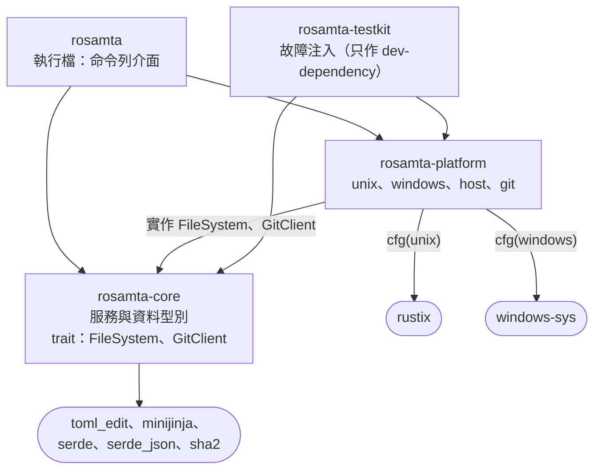
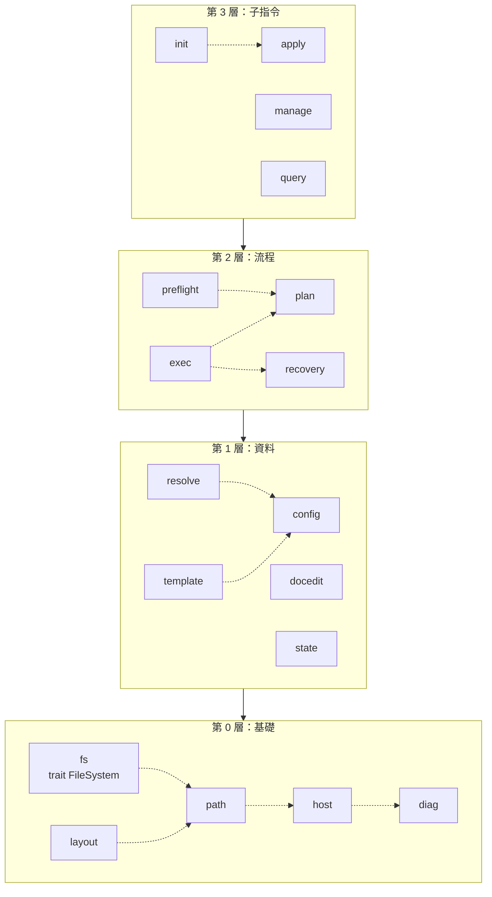

# 詳細設計 UML

本文件放[詳細設計](detailed-design.md)的圖，文字說明以 detailed-design.md 為準。圖以 Mermaid 11 撰寫；Mermaid 沒有套件圖，以 flowchart 表示，箭頭由依賴的一方指向被依賴的一方。

## 1. 套件圖 P1：crate

對應 §3.1。`rosamta-platform` 到 `rosamta-core` 的箭頭同時表示實作 core 定義的 trait。`rosamta-testkit` 只供測試使用，哪些測試使用它見 §8。

## 2. 套件圖 P2：core 的 module 分層

對應 §3.2。每個方框是一層，箭頭表示上層可以依賴下層。同層之間允許的依賴以虛線畫出，其餘同層依賴都不允許；每個 module 可依賴的完整清單見 §3.2 的表格。

層與層的箭頭表示可以依賴任何較低的層，例如第 3 層的 `manage` 直接使用第 1 層的 `docedit`。所有 module 都使用 `diag`，第 0 層以外的這類依賴不逐一畫出。
